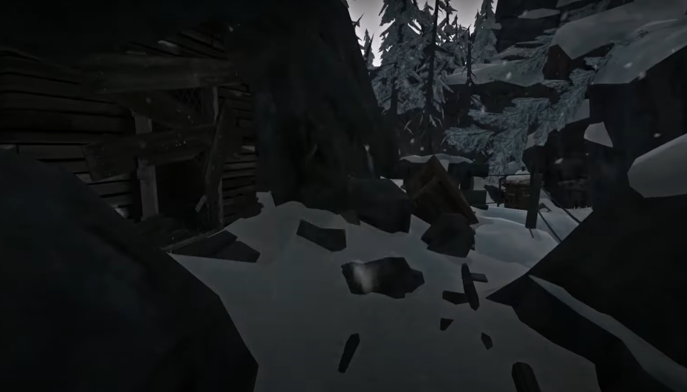
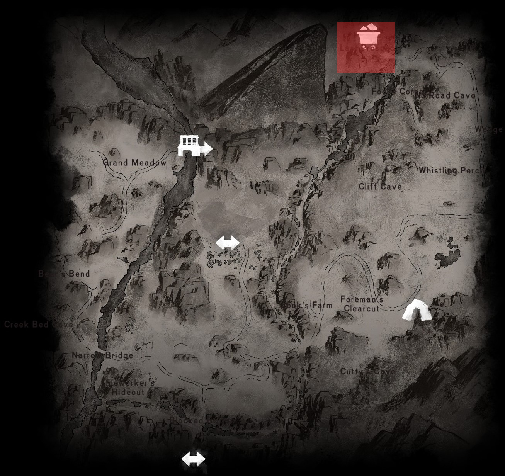
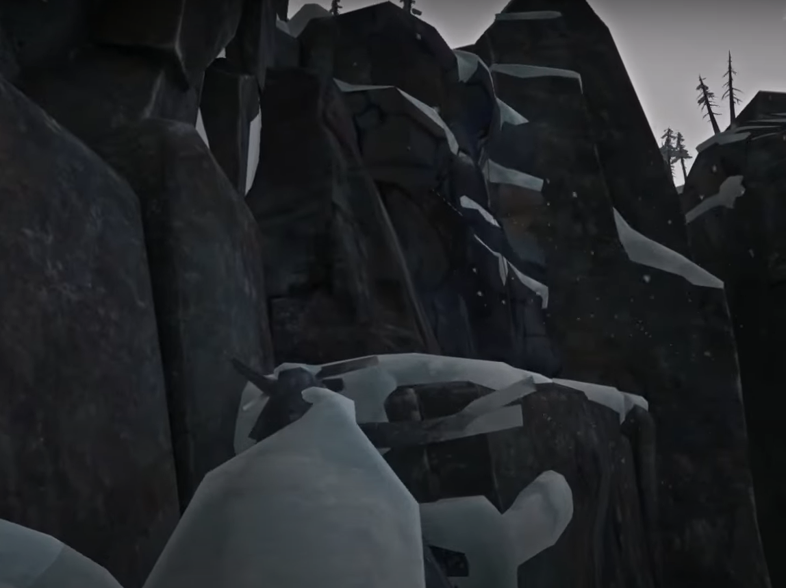
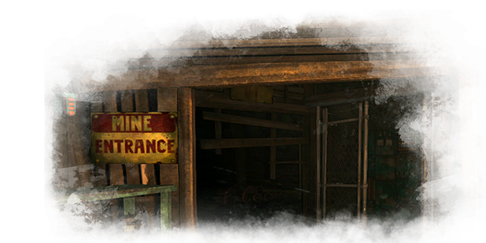

# Last Prospect

**Categories:** Blackrock, Locations, Locations in Blackrock · **Source:** [Fandom](https://thelongdark.fandom.com/wiki/Last_Prospect)

**Contents**

- [Overview](#overview)
- [Navigation](#navigation)
- [Suffocation](#suffocation)
- [Resources](#resources)
- [Tips](#tips)
- [Gallery](#gallery)

**Last Prospect**

| Property | Details |
| --- | --- |
|  |  / _LastProspectEntrance.png_ |
| **Location** |  |
|  |  / _Last\_Prospect\_Location.png_ |
| Region |  |
| Location | Northeast corner of [Blackrock](./Blackrock.md), at the western edge of the [Mule Bridge](./Mule%20Bridge.md) |
| Description | Abandoned gold mine containing suffocating fog |
| **General** |  |
| Type |  |
| Firebox |  |
|  |  |

> “__Blackrock's mine was said to be the brainchild of a Mainland consortium. With newer technology, for its time, they hoped to delve deeper than any other mine on the Island. It remains unknown if the mine's ambitious goal is in some way connected to its shuttering.__”
>
> — [Load Screen](./Load%20Screen.md) Description

**Last Prospect** is a key location in [The Detonators](./The%20Detonators.md), the fourth mission in [Episode 4: Fury, then Silence](./Episode%204%20-%20Fury%2C%20Then%20Silence.md) in [Wintermute](./Wintermute.md). In [Survival Mode](./Survival%20Mode.md), it contains the keypad code for the [Blackrock Prison](./Blackrock%20Prison.md) workshop door, along with [noisemakers](./Noisemaker.md) that, once picked up, grant the player the blueprint to craft them at the [Ammunition Work Bench](./Ammunition%20Work%20Bench.md).

## Overview

The Last Prospect gold mine is an abandoned gold mine located in the mountains in the northeast corner of [Blackrock](./Blackrock.md) region. To get there in the story mode, players can travel north along the eastern side of the map on the road, and then cross a ravine at the [Mule Bridge](./Mule%20Bridge.md) to reach one of two entrances. The second entrance to the area requires the player to make two rope climbs from the bottom of the ravine that runs through the center of the region, and is the only entrance that can be accessed in [Survival Mode](./Survival%20Mode.md). The mine contains noisemakers/the blueprint to craft them as well as the key code to the workshop in the prison, the mine is a must-visit for any players staying in Blackrock long term. The lower level can be explored with the aid of the [Elevator Crank](./Elevator%20Crank.md).

## Navigation

Once at the location, the player can enter the mine, which requires a light source to traverse. Traveling deeper into the mine will bring the player to a hand-powered elevator that requires a crank found on a crate nearby. The crank weighs 1 kg in Survival, but is weightless in [Wintermute](./Wintermute.md). The elevator can be used to reach the lowest level of the mine, where the player will then have to deal with poisonous fog and suffocation.

In Story mode, there are multiple sections with fog and short timers, and the player will need to clear sections of fog by opening air valves in order to progress. In Survival, there is only one long section with fog: the timer is generous for this part to compensate for the permadeath aspect. However, players will need to sprint and be unburdened in order to make it through this section safely. Once the player reaches the center floor of the mine, they can return through a different elevator and avoid making a return trip through the fog.

### [Suffocation](./Suffocation.md)

Suffocation risk is a new status introduced in [The Detonators](./The%20Detonators.md) in Wintermute. It then appears again in [Donner](./Donner.md), and makes an appearance in Survival mode in the deepest area of the Last Prospect mine. When entering an area with poisonous fog or smoke, a timer will above the status bars in the bottom left corner of the screen, and the player's vision will begin to blur. If the timer reaches zero while the player is still in an area with fog or smoke, then the player will die _immediately, regardless of [condition](./Condition.md)_. By reaching clean air, the status will be cleared and the timer will disappear. In the mine, this risk appears when the player enters an area with poisonous fog.

In Survival mode, there is ample time to get through the toxic fog as long as the player is not encumbered and can sprint most of, if not all the way. The use of an [Emergency Stim](./Emergency%20Stim.md) or [Go! Energy Drink](./Go!%20Energy%20Drink.md) can help if speed is a concern.

## Resources

On the top floor, where both entrances into the mine meet, there is a supply closet that contains valuable resources. In Story mode, the closet is locked and requires the player to find clues left by the Forest Talkers throughout the mine. In Survival, this is where the noisemakers can be found. Picking up a noisemaker will unlock the crafting blueprint, allowing the player to make their own.

If the player travels deep into the mine and braves the toxic gases to reach the second floor, they will be rewarded with a note that contains the key code for the workshop door back at the prison. Much like [Bleak Inlet](./Bleak%20Inlet.md), the player needs to retrieve this note and wait for an [Aurora](./Aurora.md) before they can open the door. Once this door has been opened once, it can be opened and closed freely. The workshop, much like the one in Bleak Inlet, contains both an [Ammunition Work Bench](./Ammunition%20Work%20Bench.md) and a [Milling Machine](./Milling%20Machine.md). While the milling machine requires an aurora to use, the ammunition work bench may be used at any time. Unlike Bleak Inlet, a rope climb is not required to reach the workshop, which allows players to lug materials there with greater ease. These advantages mean that, in easier difficulties, when combined with readily available [car batteries](./Car%20Battery.md) to harvest for [Scrap Lead](./Scrap%20Lead.md) and the high spawn rate of [gunpowder](./Can%20of%20Gunpowder.md)/its respective crafting materials throughout the region, it is easy to reach [Gunsmithing](./Gunsmithing.md) 5 and craft a supply of ammunition.

## Tips

- Bring a [prybar](./Prybar.md) in order to access storage lockers within the mine. There is a possible spawn for one outside the second (collapsed) entrance, near the chain with a bucket. It is NOT guaranteed.
- Access to the mine requires two consecutive [rope climbs](./Rope%20Climbing.md) with a narrow ledge between the two. It is very difficult to rest on this ledge as there are no obstacles available to act as windbreaks for a campfire. Start the climb with full fatigue and stamina, and bring coffee or an energy drink if possible. If you are low on fatigue and stamina, you may be forced to take a dangerously exposed nap on the ledge. The crate beneath the fallen [Mule Bridge](./Mule%20Bridge.md) usually contains the nearest energy drink, but the trail to it is only one way(in the direction of water flow).
- Craft [Improvised Crampons](./Improvised%20Crampons.md) before attempting the journey, with 3 ropes (one down, two up) and then 2 ropes (down) + 1 (up) if you want to climb above [Blackrock Prison](./Blackrock%20Prison.md) to avoid [Timberwolves](./Timberwolf.md) on the way back, they are a sound investment. The [Blackrock Prison](./Blackrock%20Prison.md) and tunnels provide ample [Scrap Metal](./Scrap%20Metal.md) and [Leather](./Cured%20Leather.md)/harvestable footwear.
- There are two routes to reach the bottom of the rope climbs: following the frozen creek upstream from the bridge leading to [Cook's Farm](./Cook%27s%20Farm.md) or by climbing down from [Fool's Corner](./Fool%27s%20Corner.md). The former route is shorter and safer, but you will miss some loot on the eastern side of the region, as a one-way descent prevents access to the uppermost part of the river where the [Fool's Corner](./Fool%27s%20Corner.md) rope is located. Potential loot in this area includes a [Military-Grade MRE](./Military-Grade%20MRE.md) and [Go! Energy Drink](./Go!%20Energy%20Drink.md) inside of a crate underneath the fallen bridge. A [Hunting Rifle](./Hunting%20Rifle.md)/[Rifle Ammunition](./Rifle%20Ammunition.md) can spawn in the collapsed railway tunnel near the bridge connection above the river, and there is also a corpse and backpack at the top of this rope.
- Multiple wolves spawn underneath the rope climbs: try to time your descent to avoid being detected and have a window to react. It might even be easier to kill the wolves before climbing up, as there is a cave nearby for regaining Condition than to risk a surprise confrontation when tired from descending as you will have to travel through here when going back.

## Gallery

_The upper entrance to the mine. It is the only one open in Survival Mode._

_Between the two rope climbs up from the bottom of the ravine_

_Entrance to head deeper into the mine_
