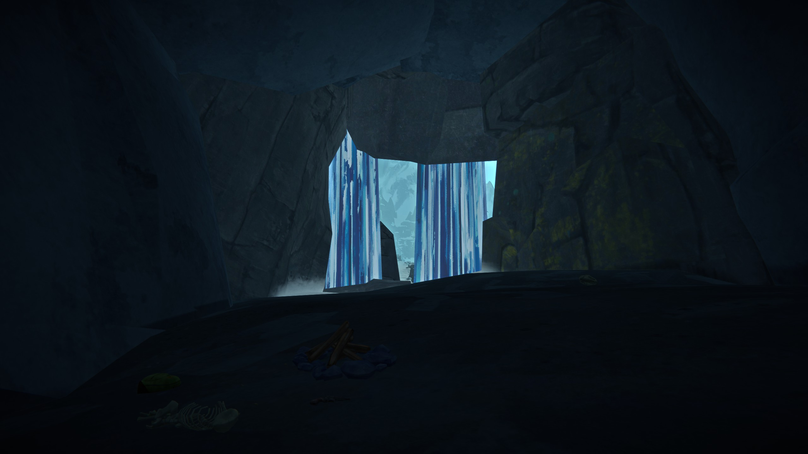

# Last Quarrel

| Column 1 | Column 2 | Column 3 |
| --- | --- | --- |
|  / *Seal\_icon.png* | **DLC-Exclusive content.** / This content requires the [Iron Road](./Iron%20Road.md) addon to be installed before it can be seen or used in regular gameplay. | \|} / **Last Quarrel** / \| Property \| Details \| / \| --- \| --- \| / \|  \|  / *Last\_Quarrel.jpg* \| / \| **Location** \|  \| / \|  \|  / *Last\_Quarrel\_Location.png* \| / \| Region \| [Port Remnant](./Port%20Remnant.md)\\|- \| / \| Description \| A large cave hidden behind 2 waterfalls. \| / \| **General** \|  \| / \|  \| Has no shelter\\|} **Last Quarrel** is a location in [Port Remnant](./Port%20Remnant.md). / ## Overview / This location is found at the mid-eastern section of the map, north of the eastern most [Whale Bone Shrine](./Whale%20Bone%20Shrine.md). / The area is a cave behind 2 waterfalls, and contains the skeletons of a human and bear (likely why the area gets its name). A [Campfire](./Campfire.md), [Backpack](./Backpack.md), and [Revolver](./Revolver.md) are found near the human skeleton, and a single bear skull is located across from the area. There is no fuel items inside the cave. / Heading north will lead to a tree bridge and later a small area hidden in the jagged mountains with a [Deer Carcass](./Deer%20Carcass.md) and some [Cat Tails](./Cat%20Tail.md).**Lua execution error in Module:Navbox function navbox** \| |
|  / *Last\_Quarrel.jpg* |  |  |
| **Location** |  |  |
|  / *Last\_Quarrel\_Location.png* |  |  |
| Region | [Port Remnant](./Port%20Remnant.md)\|- |  |
| Description | A large cave hidden behind 2 waterfalls. |  |
| **General** |  |  |
|  | Has no shelter\|} **Last Quarrel** is a location in [Port Remnant](./Port%20Remnant.md). / ## Overview / This location is found at the mid-eastern section of the map, north of the eastern most [Whale Bone Shrine](./Whale%20Bone%20Shrine.md). / The area is a cave behind 2 waterfalls, and contains the skeletons of a human and bear (likely why the area gets its name). A [Campfire](./Campfire.md), [Backpack](./Backpack.md), and [Revolver](./Revolver.md) are found near the human skeleton, and a single bear skull is located across from the area. There is no fuel items inside the cave. / Heading north will lead to a tree bridge and later a small area hidden in the jagged mountains with a [Deer Carcass](./Deer%20Carcass.md) and some [Cat Tails](./Cat%20Tail.md).**Lua execution error in Module:Navbox function navbox** |  |
