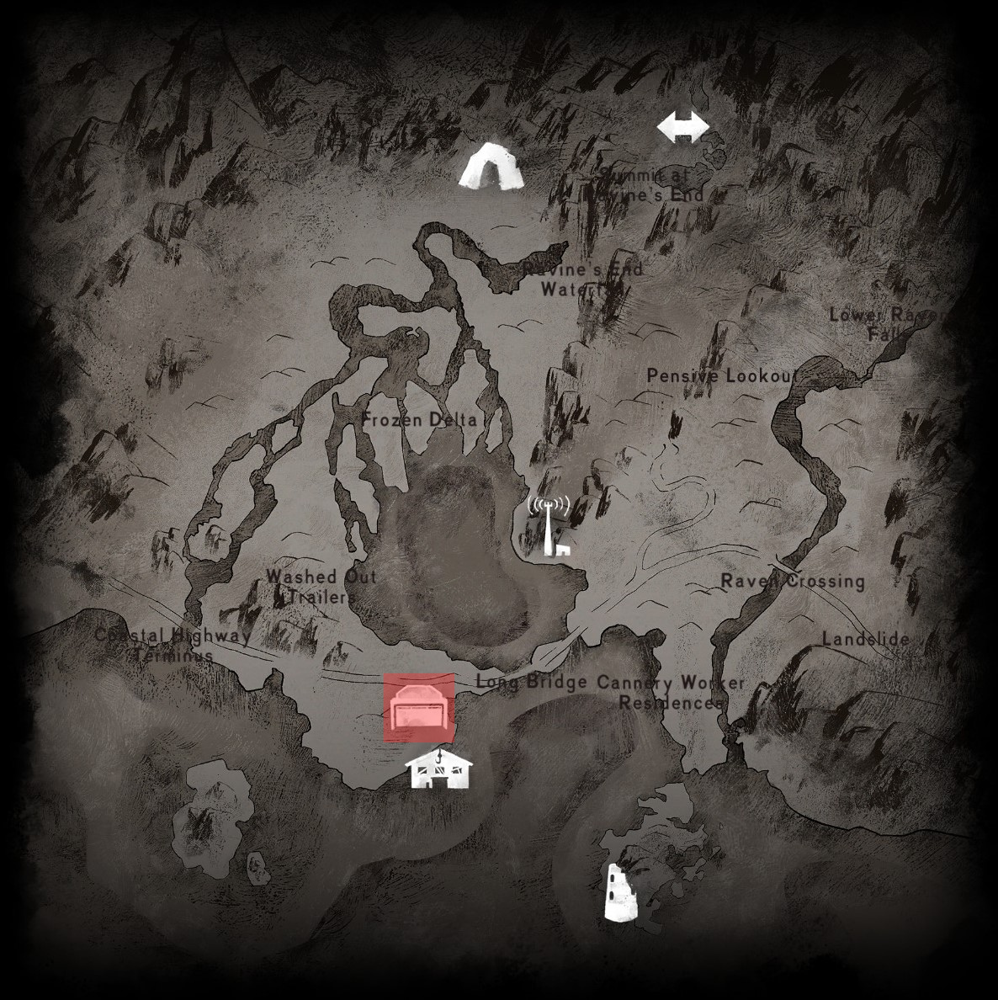

# Last Resort Cannery

**Contents**

- [Overview](#Overview)
- [Gatehouse](#Gatehouse)
- [Trailer](#Trailer)
- [Warehouses](#Warehouses)
- [Workshop](#Workshop)
- [Dangers](#Dangers)
- [Tin of Sardines](#Tin_of_Sardines)
- [Trivia](#Trivia)
- [Gallery](#Gallery)

<table class="infobox">
<caption>Last Resort Cannery</caption>
<colgroup>
<col style="width: 50%" />
<col style="width: 50%" />
</colgroup>
<tbody>
<tr>
<td colspan="2"><figure>
[Missing image: SS-BI-Cannery03.jpg]
<figcaption>SS-BI-Cannery03.jpg</figcaption>
</figure></td>
</tr>
<tr>
<td colspan="2" class="section">
<strong>Location</strong>
</td>
</tr>
<tr>
<td colspan="2"><figure>

<figcaption>Last_Resort_Cannery_Location.png</figcaption>
</figure></td>
</tr>
<tr>
<td>
Region
</td>
<td>
<a href="./Bleak%20Inlet.md" class="wikilink" title="Bleak Inlet">Bleak Inlet</a>|-
</td>
</tr>
<tr>
<td>
Description
</td>
<td>
Fenced Industrial compound
</td>
</tr>
<tr>
<td colspan="2" class="section">
<strong>General</strong>
</td>
</tr>
<tr>
<td>
Type
</td>
<td>
Industrial|-
</td>
</tr>
<tr>
<td></td>
<td>
Has an interior|}

<strong>Last Resort Cannery</strong> is a major location in <a href="./Bleak%20Inlet.md" class="wikilink" title="Bleak Inlet">Bleak Inlet</a>. The cannery complex features a renewable source of a few important materials, a special workshop with some unique tools, and a trailer that can be used for shelter.

<h2 id="Overview">Overview</h2>

The area is composed of several locations:

<ul>
<li>A trailer near the Cannery Gates next to a ruined building</li>
<li><a href="./Cannery%20Pier.md" class="wikilink" title="Cannery Pier">Cannery Pier</a> across the ruined main pier</li>
<li><a href="./Workshop.md" class="wikilink" title="Workshop">Workshop</a> on the Cannery Pier</li>
<li>Several Warehouses (one of which leads to an obstacle course to the Cannery Pier)</li>
<li>An abandoned Fishing Trawler named "The Harbinger"</li>
<li>An outdoor break room near the Trawler</li>
</ul>

In addition to its numerous amenities, the cannery also features the first example of an obstacle course "puzzle" in Survival mode, as well as an ample supply of its signature product, <a href="./Tin%20of%20Sardines.md" class="wikilink" title="Tin of Sardines">Tin of Sardines</a>, and multiple resident <a href="./Timberwolf.md" class="wikilink" title="timberwolf">timberwolf</a> packs. Extreme caution is advised when entering the Cannery grounds, as the Timberwolves are numerous and kill quickly.

<h2 id="Gatehouse">Gatehouse</h2>

[Missing image: SS-BI-Cannery-Gatehouse.jpg] GatehouseThere is a gatehouse with a door along the road in front of the cannery. It may be a good place for players to fight timberwolves with firearms.

<h2 id="Trailer">Trailer</h2>

The trailer serves as a useful place to evade <a href="./Timberwolf.md" class="wikilink" title="timberwolves">timberwolves</a>. It contains much of the loot typically found in trailers--a few packaged food items, some clothing, crafting materials, tools, etc. The trailer is also the only easily accessed indoor building in the cannery complex, and thus serves as shelter to rest and recover when necessary.

<h2 id="Warehouses">Warehouses</h2>

[Missing image: SS-BI-Warehouse02.jpg]The cannery has 3 dilapidated warehouses surrounding an open work yard and dock area. The yard contains a few vehicles, some semitrailers, industrial equipment, and several green wooden crates.

Of the warehouses surrounding the area, two are broken down and mostly open to the outdoors; they provide little shelter from the elements but might contain a few supplies. Another warehouse is situated just off the pier and contains the workshop, but it is difficult to access. The other four warehouses are also more difficult to gain entry to and offer some limited protection from the weather.

One of the warehouses has a room around back (off the wrap-around dock) with a door that can be opened and closed. This room is secure enough to protect the player from <a href="./Timberwolf.md" class="wikilink" title="timberwolves">timberwolves</a>, though it may be too cold without warm clothing. Inside the room there may be a few supplies, as well as a fire barrel and a bed.

<h2 id="Workshop">Workshop</h2>

[Missing image: SS-BI-Workshop-Keypad.jpg] Locked doorThe Cannery workshop is one of the two locations on <a href="./Great%20Bear%20Island.md" class="wikilink" title="Great Bear Island">Great Bear Island</a> that contains an <a href="./Ammunition%20Work%20Bench.md" class="wikilink" title="Ammunition Work Bench">Ammunition Work Bench</a> and a <a href="./Milling%20Machine.md" class="wikilink" title="Milling Machine">Milling Machine</a> (the other one being Blackrock).

The workshop is challenging to reach; it is accessed via an obstacle course that starts with climbing the rope located in one of the warehouses on the opposite side of the entrance.

If you follow the linear course all the way through, you will reach the workshop. There is only one path to take, with no major side or alternate paths, and there is only one method to enter the course path. Essentially the only "obstacle" in the course is climbing the rope to start it. Balancing on the beams and rafters throughout the course is fairly easy. Note - the course winds through the complex and does not allow the player to backtrack after passing certain points.

After completing the course, the player can enter the pier warehouse's outer entryway. The way into the workshop is initially blocked by a locked door. The door can only be unlocked using the electronic keypad beside it, which requires a 3-digit code and electricity.

The workshop cannot be accessed through any alternate path, and the key-code cannot be guessed through trial and error. The player must read the Communication Report letter that is inside the <a href="./Echo%20One%20Radio%20Tower.md" class="wikilink" title="Echo One Radio Tower">Echo One Radio Tower</a> in <a href="./Bleak%20Inlet.md" class="wikilink" title="Bleak Inlet">Bleak Inlet</a>. You do not need to take the report, but the player character must have seen the code document at least once.

The first time, the player will only be able to enter the workshop during an <a href="./Aurora.md" class="wikilink" title="aurora">aurora</a> when the electronic keypad is active and the code can be entered to unlock the door. [Missing image: SS-BI-Workshop02.jpg]Once door is unlocked, entrance to the workshop remains unlocked.

Whenever the player passes through the workshop's door, there is a random chance of encountering a wolf. Once the wolf is dealt with, the player will be able to access the milling machine and the ammunition workbench. As the aurora appears frequently in this region, use caution around the live wires scattered about.

<h2 id="Dangers">Dangers</h2>

[Missing image: SS-BI-TimberWolf.jpg]The Cannery is usually guarded by one or two packs of <a href="./Timberwolf.md" class="wikilink" title="timberwolves">timberwolves</a>. Extreme caution should be used when nearing the facility complex as the number of timberwolves present could easily overwhelm the player.

Before venturing into the open outdoors in the area, it is advisable to drop any gear that isn't essential, especially before attempting to reach the workshop. The player will have to climb a rope to get away from the timberwolves and get started on the obstacle course. Because you can't climb while encumbered, you will need to be unencumbered to reach the catwalks that make up the first part of the course.

Attempting to start the course unprepared will required the player to drop items at the base of the rope while being circled by timberwolves or abort the attempt to reach the workshop. Failing to drop items to become unencumbered could result in death if the player has no means to escape or drive off the timberwolves.

<h2 id="Tin_of_Sardines">Tin of Sardines</h2>

The Cannery is responsible for producing the packaged food <a href="./Tin%20of%20Sardines.md" class="wikilink" title="Tin of Sardines">Tin of Sardines</a>. Despite the plant having shut down long ago, several Tins of the product are found all over the Cannery, making it a great place to stock up on easy food stuffs (though some tins can be quite low Condition considering the age of the abandoned facility). The number of Tin of Sardines changes depending on the Experience played on, with more appearing on lower difficulties.

They are routinely found on <a href="./Pallet.md" class="wikilink" title="Pallets">Pallets</a>, on <strong>AND</strong> inside of <a href="./Crate.md" class="wikilink" title="Crates">Crates</a>, or just generally out in the open:

Open field

<ul>
<li>2 Green Crates in the open field</li>
<li>Near a group of barrels buried in the snow, right up against a pile of turned over industrial bins (green crates are nearby for reference)</li>
</ul>

Warehouse 1 (Rope Climb building)

<ul>
<li>Buried in the back of the Truck near the pier warehouse (broom and motor are in the back, truck has train wheels on it)</li>
<li>Near the docks on a Pallet, near a broken pier bridge</li>
</ul>

Warehouse 2 (Trawler Pier)

<ul>
<li>On a pallet on the other end of the building doors</li>
</ul>

Warehouse 3 (Loading Dock)

<ul>
<li>3 Green Crates near the loading dock building, west of the Trailer.</li>
<li>On a Frozen Corpse near the broken pier, close to the Safe.</li>
<li>2 Green Crates near the broken pier, close to a tipped over storage tower tank (close to previous location)</li>
</ul>

<a href="./Workshop.md" class="wikilink" title="Workshop">Workshop</a>

<ul>
<li>On a table to the west near the loading doors</li>
</ul>
<h2 id="Trivia">Trivia</h2>
<ul>
<li>The obstacle course that leads to the Cannery Pier was created by the technician that wrote the <a href="./Communication%20Report.md" class="wikilink" title="Communication Report">Communication Report</a> and <a href="./The%20Technician%27s%20Notebook.md" class="wikilink" title="The Technician&#39;s Notebook">The Technician's Notebook</a>.</li>
<li>The obstacle course can be skipped entirely by placing a deployed <a href="./Travois.md" class="wikilink" title="Travois">Travois</a> with an item inside on the lowest pier at the Cannery Pier, then placing the handles near the edge. Walking on the ocean below will then give the player the option to pick up the Travois, wherein the player will teleport up to the pier.</li>
</ul>
<h2 id="Gallery">Gallery</h2>
<table class="gallery">
<colgroup>
<col style="width: 25%" />
<col style="width: 25%" />
<col style="width: 25%" />
<col style="width: 25%" />
</colgroup>
<tbody>
<tr>
<td><figure>
[Missing image: SS-BI-Cannery01.jpg]
<figcaption>Cannery</figcaption>
</figure></td>
<td><figure>
[Missing image: SS-BI-Cannery02.jpg]
<figcaption>Cannery</figcaption>
</figure></td>
<td><figure>
[Missing image: SS-BI-Cannery03.jpg]
<figcaption>Cannery (full view)</figcaption>
</figure></td>
<td><figure>
[Missing image: SS-BI-Cannery04.jpg]
<figcaption>Cannery (view from the sea)</figcaption>
</figure></td>
</tr>
<tr>
<td><figure>
[Missing image: SS-BI-CanneryPier02.jpg]
<figcaption>Cannery Pier</figcaption>
</figure></td>
<td><figure>
[Missing image: SS-BI-TheHarbinger.jpg]
<figcaption>The Harbinger</figcaption>
</figure></td>
<td><figure>
[Missing image: SS-BI-Warehouse01.jpg]
<figcaption>Warehouse (rope)</figcaption>
</figure></td>
<td><figure>
[Missing image: SS-BI-Warehouse02.jpg]
<figcaption>Warehouse (barrel and bed)</figcaption>
</figure></td>
</tr>
<tr>
<td><figure>
[Missing image: SS-BI-Workshop-Keypad.jpg]
<figcaption>Workshop (keypad)</figcaption>
</figure></td>
<td><figure>
[Missing image: SS-BI-Workshop01.jpg]
<figcaption>Workshop (inside)</figcaption>
</figure></td>
<td><figure>
[Missing image: SS-BI-Workshop02.jpg]
<figcaption>Workshop (the ammunition workbench and milling machine )</figcaption>
</figure></td>
<td><figure>
[Missing image: SS-BI-TimberWolf.jpg]
<figcaption>Timber wolf</figcaption>
</figure></td>
</tr>
<tr>
<td><figure>
[Missing image: SS-BI-Cannery-Gatehouse.jpg]
<figcaption>Gatehouse</figcaption>
</figure></td>
<td><figure>
[Missing image: SS-BI-Cannery-ObstacleCourse.jpg]
<figcaption>Obstacle Course</figcaption>
</figure></td>
<td><figure>
[Missing image: 20210118151624_1.jpg]
<figcaption>Common Wolf encounters</figcaption>
</figure></td>
<td><figure>
[Missing image: 20210111153142_1.jpg]
<figcaption>Dawn at Cannery</figcaption>
</figure></td>
</tr>
<tr>
<td><figure>
[Missing image: 20210111153220_1.jpg]
<figcaption>Bunker down</figcaption>
</figure></td>
<td><figure>

<figcaption>LRCannery.png</figcaption>
</figure></td>
<td></td>
<td></td>
</tr>
</tbody>
</table>

<strong>Lua execution error in Module:Navbox function navbox</strong>

<a href="es:Conservera_el_%C3%BAltimo_recurso" class="wikilink" title="es:Conservera el último recurso">es:Conservera el último recurso</a>
</td>
</tr>
</tbody>
</table>

