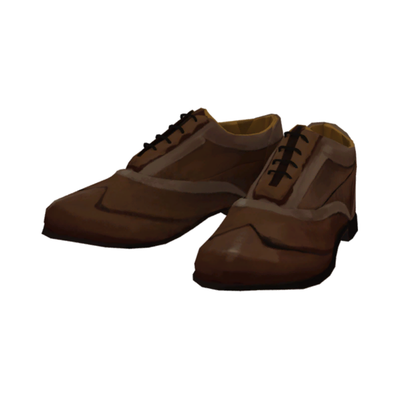

# Leather Shoes

<table class="infobox">
<caption>Leather Shoes</caption>
<colgroup>
<col style="width: 50%" />
<col style="width: 50%" />
</colgroup>
<tbody>
<tr>
<td colspan="2"><figure>

<figcaption>Leather_Shoes_icon.png</figcaption>
</figure></td>
</tr>
<tr>
<td colspan="2" class="section">
<strong>General</strong>
</td>
</tr>
<tr>
<td>
Item Type
</td>
<td>
Clothing|-
</td>
</tr>
<tr>
<td>
Renewable
</td>
<td>
Yes (<a href="./Beachcombing.md" class="wikilink" title="Beachcombing">Beachcombing</a>)
</td>
</tr>
<tr>
<td>
Clothing Slot
</td>
<td>
Outer feet
</td>
</tr>
<tr>
<td colspan="2" class="section">
<strong>Statistics</strong>
</td>
</tr>
<tr>
<td>
Weight
</td>
<td>
0.50 kg(1.1 lbs)
</td>
</tr>
<tr>
<td>
Warmth bonus
</td>
<td>
1.0 °C(1.8 °F)
</td>
</tr>
<tr>
<td>
Windproof bonus
</td>
<td>
0.5 °C(0.9 °F)
</td>
</tr>
<tr>
<td>
Waterproof bonus
</td>
<td>
10%
</td>
</tr>
<tr>
<td>
Protection
</td>
<td>
2%
</td>
</tr>
<tr>
<td>
Mobility
</td>
<td>
-3%
</td>
</tr>
<tr>
<td>
Harvest
</td>
<td>
2 × <a href="./Cured%20Leather.md" class="wikilink" title="Cured leather">Cured leather</a> 
75 minutes
</td>
</tr>
<tr>
<td>
Repair
</td>
<td>
1 × <a href="./Cured%20Leather.md" class="wikilink" title="Cured leather">Cured leather</a>, 1 × <a href="./Cloth.md" class="wikilink" title="Cloth">Cloth</a> 
90 minutes 
20% condition
</td>
</tr>
</tbody>
</table>

<table>
<colgroup>
<col style="width: 33%" />
<col style="width: 33%" />
<col style="width: 33%" />
</colgroup>
<tbody>
<tr>
<td style="vertical-align: top; font-size: 3em; color: #5d5980; padding-right: 10px">
“
</td>
<td>
Simple leather shoes that look good on Bay Street but will probably get you killed out here. Hope you have some warm socks!

&#10;

In-game description

</td>
<td style="vertical-align: bottom; font-size: 3em; color: #5d5980; padding-left: 10px">
”
</td>
</tr>
</tbody>
</table>

**Leather Shoes** are a type of <a href="./Clothing.md" class="wikilink" title="footwear">footwear</a> in *The Long Dark*.

## Overview

Low tier shoes and a common starting item. They offer more protection and waterproofing than <a href="./Running%20Shoes.md" class="wikilink" title="Running Shoes">Running Shoes</a>, but also have a 3% movement penalty. typically not worth repairing, but harvesting them yields 2 <a href="./Cured%20Leather.md" class="wikilink" title="Leather">Leather</a>.

<table class="gallery">
<colgroup>
<col style="width: 50%" />
<col style="width: 50%" />
</colgroup>
<tbody>
<tr>
<td><figure>

<figcaption>Clothing model icon</figcaption>
</figure></td>
<td><figure>

<figcaption>Clothing model icon</figcaption>
</figure></td>
</tr>
</tbody>
</table>

## Update history

- UPDATE **19 December 2016 (<a href="./The%20Long%20Dark%20%E2%80%94%20Early%20Access%20Changelog.md#0.386" class="wikilink" title="Update">Update</a>):**
  - Added to game

**Lua execution error in Module:Navbox function navbox** <a href="ru:%D0%9A%D0%BE%D0%B6%D0%B0%D0%BD%D1%8B%D0%B5_%D1%82%D1%83%D1%84%D0%BB%D0%B8" class="wikilink" title="ru:Кожаные_туфли">ru:Кожаные_туфли</a>

