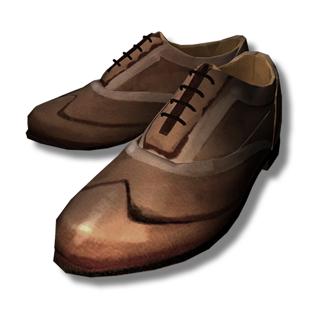
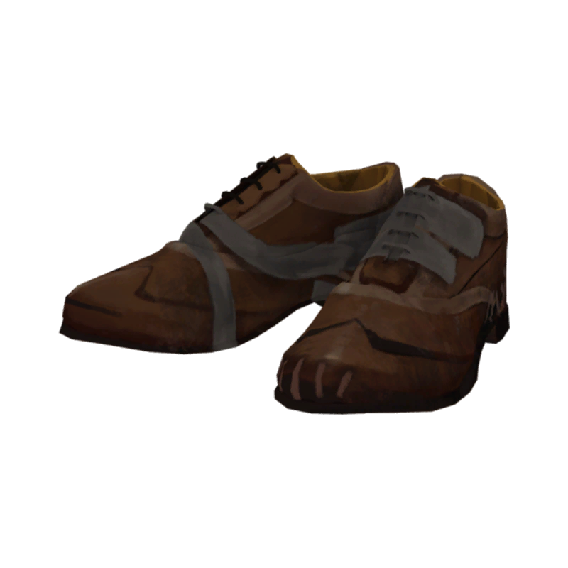

# Leather Shoes

**Leather Shoes**

| Property | Details |
| --- | --- |
|  |  / *Leather\_Shoes\_icon.png* |
| **General** |  |
| Item Type | Clothing\|- |
| Renewable | Yes ([Beachcombing](./Beachcombing.md)) |
| Clothing Slot | Outer feet |
| **Statistics** |  |
| Weight | 0.50 kg(1.1 lbs) |
| Warmth bonus | 1.0 °C(1.8 °F) |
| Windproof bonus | 0.5 °C(0.9 °F) |
| Waterproof bonus | 10% |
| Protection | 2% |
| Mobility | -3% |
| Harvest | 2 × [Cured leather](./Cured%20Leather.md) / 75 minutes |
| Repair | 1 × [Cured leather](./Cured%20Leather.md), 1 × [Cloth](./Cloth.md) / 90 minutes / 20% condition |

> “**Simple leather shoes that look good on Bay Street but will probably get you killed out here. Hope you have some warm socks!**”
>
> — In-game description

**Leather Shoes** are a type of [footwear](./Clothing.md) in *The Long Dark*.

## Overview

Low tier shoes and a common starting item. They offer more protection and waterproofing than [Running Shoes](./Running%20Shoes.md), but also have a 3% movement penalty. typically not worth repairing, but harvesting them yields 2 [Leather](./Cured%20Leather.md).

| Column 1 | Column 2 |
| --- | --- |
|  / *Clothing model icon* |  / *Clothing model icon* |

## Update history

- UPDATE **19 December 2016 ([Update](./The%20Long%20Dark%20%E2%80%94%20Early%20Access%20Changelog.md#0.386)):**
  - Added to game

**Lua execution error in Module:Navbox function navbox** [ru:Кожаные\_туфли](ru:%D0%9A%D0%BE%D0%B6%D0%B0%D0%BD%D1%8B%D0%B5_%D1%82%D1%83%D1%84%D0%BB%D0%B8)
