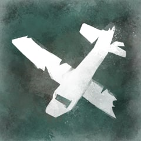

# Leaving the Old World Behind

<table class="infobox">
<caption>Leaving the Old World Behind</caption>
<colgroup>
<col style="width: 50%" />
<col style="width: 50%" />
</colgroup>
<tbody>
<tr>
<td colspan="2"><figure>

<figcaption>Leaving_the_Old_World_Behind_icon.png</figcaption>
</figure></td>
</tr>
<tr>
<td>
Description
</td>
<td>
Leave Milton. Complete Episode One.
</td>
</tr>
</tbody>
</table>

**Leaving the Old World Behind** is a <a href="./Wintermute.md" class="wikilink" title="Wintermute">Wintermute</a> <a href="./The%20Long%20Dark%20%E2%80%94%20Achievements.md" class="wikilink" title="achievement">achievement</a> in <a href="./Episode%201%20-%20Do%20Not%20Go%20Gentle.md" class="wikilink" title="Episode 1: Do Not Go Gentle">Episode 1: Do Not Go Gentle</a> of *<a href="./The%20Long%20Dark.md" class="wikilink" title="The Long Dark">The Long Dark</a>*.

## Guide

This is an unmissable story achievement achieved after completing the mission <a href="./Paradise%20Lost.md" class="wikilink" title="Paradise Lost">Paradise Lost</a>. Make your way out of <a href="./Milton.md" class="wikilink" title="Milton">Milton</a> via the <a href="./Rope%20Climbing.md" class="wikilink" title="Rope Climbing">Rope Climbing</a> section near <a href="./Milton%20Park.md" class="wikilink" title="Milton Park">Milton Park</a> and then continue climbing your way to the cave to <a href="./Mystery%20Lake%20%28region%29.md" class="wikilink" title="Mystery Lake (region)">Mystery Lake (region)</a>. After exiting the cave, a cutscene showing <a href="./Jeremiah.md" class="wikilink" title="a man">a man</a> being attacked by a <a href="./Old%20Bear.md" class="wikilink" title="large bear">large bear</a> as <a href="./Will%20Mackenzie.md" class="wikilink" title="Will Mackenzie">Will Mackenzie</a> picks up a <a href="./Hunting%20Rifle.md" class="wikilink" title="Hunting Rifle">Hunting Rifle</a> and shoots it. The achievement is unlocked shortly afterwards from completing Episode 1.

## Game History

\* UPDATE **1 August 2017 (<a href="./The%20Long%20Dark%20%E2%80%94%20Changelog.md#1.00" class="wikilink" title="Update">Update</a>):**

- - Added to game.

**Lua execution error in Module:Navbox function navbox**

