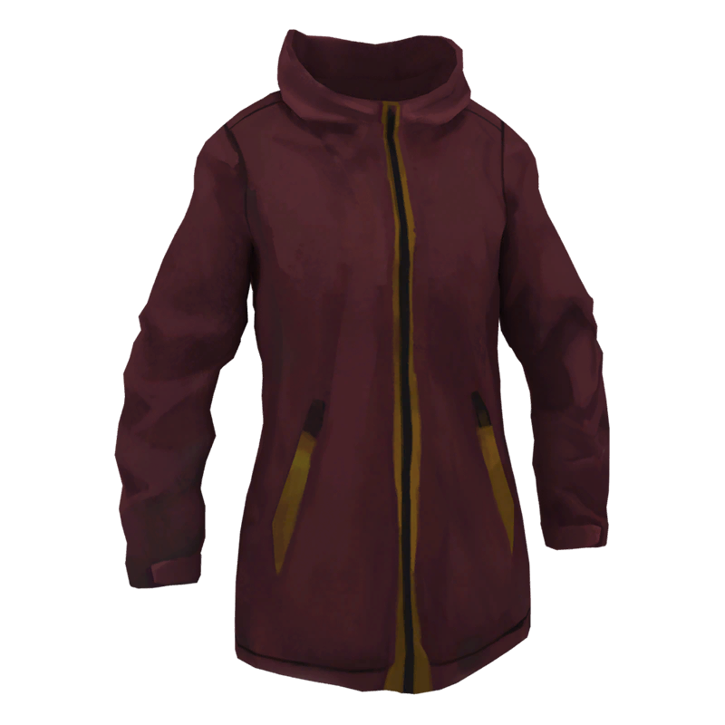
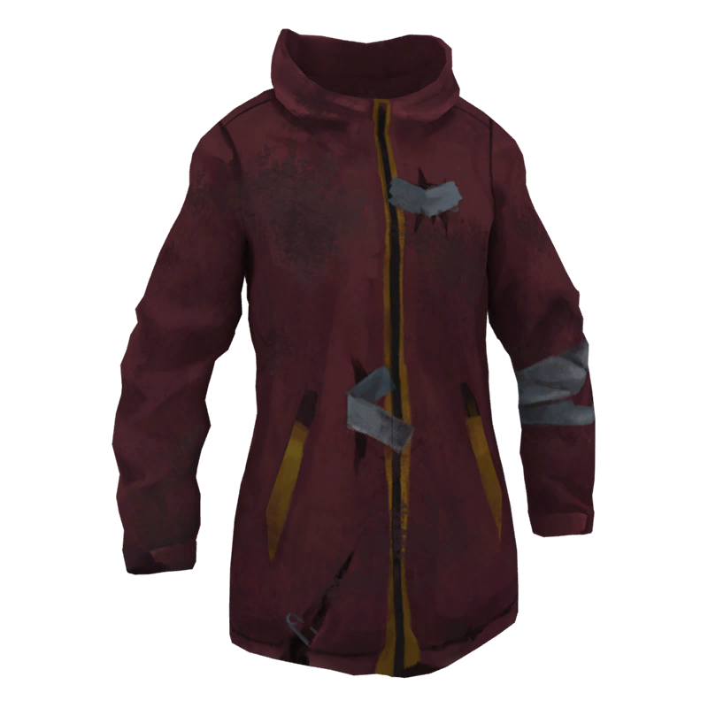

# Light Shell

**Categories:** Clothing, Pages with update history · **Source:** [Fandom](https://thelongdark.fandom.com/wiki/Light_Shell)

**Light Shell**

| Property | Details |
| --- | --- |
|  |  / _Light\_Shell\_icon.png_ |
| **General** |  |
| Item Type | Clothing\|- |
| Clothing Slot | Outer torso |
| **Statistics** |  |
| Weight | 1.00 kg(2.2 lbs) |
| Warmth bonus | 1.0 °C(1.8 °F) |
| Windproof bonus | 3.0 °C(5.4 °F) |
| Waterproof bonus | 30% |
| Protection | 3% |
| Mobility | -2% |
| Harvest | 2 × [Cloth](./Cloth.md) / 40 minutes |
| Repair | 1 × [Cloth](./Cloth.md) / 45 minutes / 30% condition |

> “__A light outer layer meant to protect from wind and water. Has no real warmth value of its own, but useful when paired with a decent under layer.__”
>
> — In-game description

The **Light Shell** is a type of [clothing](./Clothing.md) in _The Long Dark_.

## Overview

Mid-tier outer torso with similar stats to the [Windbreaker](./Windbreaker.md), but with double the warmth and weight. Good as an outer layer, although not as waterproof as a Windbreaker.

_Clothing model_

_Clothing model damaged_

## Update history

- UPDATE **19 December 2016 ([Update](./The%20Long%20Dark%20%E2%80%94%20Early%20Access%20Changelog.md#0.386)):**
  - Added to game
