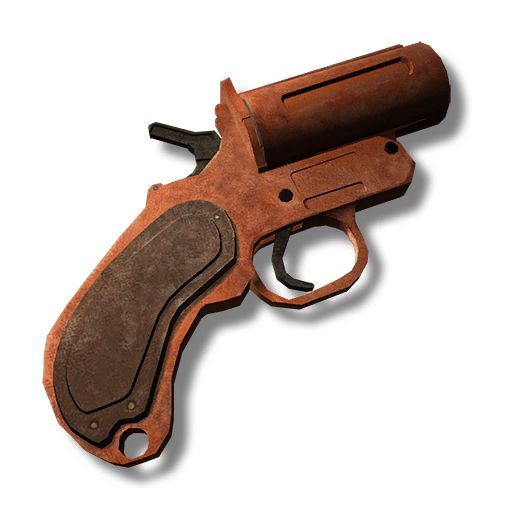

# Light Up The Night

**Contents**

- [Official description](#Official_description)
- [Objectives](#Objectives)
- [Overview](#Overview)
- [Rewards](#Rewards)
- [Transcript](#Transcript)
- [Trivia](#Trivia)
- [Update history](#Update_history)

<table class="infobox">
<caption>Light Up The Night</caption>
<colgroup>
<col style="width: 50%" />
<col style="width: 50%" />
</colgroup>
<tbody>
<tr>
<td colspan="2"><figure>

<figcaption>Distress_Pistol_icon.png</figcaption>
</figure></td>
</tr>
<tr>
<td>
Episode
</td>
<td>
<a href="./Episode%201%20-%20Do%20Not%20Go%20Gentle.md" class="wikilink" title="Episode 1">Episode 1</a>|-
</td>
</tr>
<tr>
<td>
Current
</td>
<td>
Light Up The Night
</td>
</tr>
<tr>
<td>
Region
</td>
<td>
<a href="./Mountain%20Town.md" class="wikilink" title="Mountain Town">Mountain Town</a>
</td>
</tr>
</tbody>
</table>

**Spoiler Warning:***This page may contain spoilers from the <a href="./Wintermute.md" class="wikilink" title="story">story</a> of The Long Dark.*

**Light Up The Night** was a side mission of the Predux <a href="./Episode%201%20-%20Do%20Not%20Go%20Gentle.md" class="wikilink" title="Episode 1: Do Not Go Gentle">Episode 1: Do Not Go Gentle</a> of the <a href="./Wintermute.md" class="wikilink" title="Wintermute">Wintermute</a> story. It has since been replaced after the V1.47 Wintermute Redux version of the game, but is still playable to those that download versions V1.15, V1.30, or V1.37 of Steam version of *<a href="./The%20Long%20Dark.md" class="wikilink" title="The Long Dark">The Long Dark</a>* by using the <a href="./Time%20Capsule.md" class="wikilink" title="Time Capsule">Time Capsule</a>.

This side mission has since been replaced by the <a href="./Highway%20Robbery%20%28mission%29.md" class="wikilink" title="Highway Robbery (mission)">Highway Robbery (mission)</a>.

## Official description

|  |  |  |
|----|----|----|
| “ | Grey Mother Trusts you enough to tell you about a Distress Pistol stashed away by one of her neighbours. If you can find it, it would make a useful Wolf deterrent. | ” |

## Objectives

- Search the house and locate the hidden Distress Pistol.

## Overview

To start the mission, Mackenzie has to raise the Trust of <a href="./Grey%20Mother.md" class="wikilink" title="Grey Mother">Grey Mother</a> to at least 175 points and speak to her about arming yourself. She will direct you to a nearby house in Milton, where her neighbor, whom used to work in the Coast Guard, has stashed a <a href="./Distress%20Pistol.md" class="wikilink" title="Distress Pistol">Distress Pistol</a> somewhere in his home where the neighbor children could not find it.

Make your way down the road to the <a href="./Paradise%20Meadows%20Farm.md" class="wikilink" title="Paradise Meadows Farm">Paradise Meadows Farm</a> and the house on the left is your objective (can easily be seen on the map). Go inside and go to the dressers next to the bathroom. The rug on the floor holds a hidden cache.

## Rewards

- <a href="./Distress%20Pistol.md" class="wikilink" title="Distress Pistol">Distress Pistol</a>
- 4 x <a href="./Flare%20Shell.md" class="wikilink" title="Flare Shell">Flare Shell</a>

## Transcript

*The following conversation occurs when selected in the Trust menu with Grey Mother.*

- PROTECTION

Mackenzie: "There are...a lot of wolves around."

Grey Mother: "Watch out. People say they can smell your fear."

Mackenzie: "You think I could...borrow that Rifle of yours?"

Grey Mother: "You'd leave an old lady defenseless so you could protect yourself? Shame on you, Mackenzie."

Mackenzie: "Of course not! But it would be nice to have a little more protection out there. Surely someone else in this town must have owned a gun of some kind."

Grey Mother: "Old Henry McDermott used to be with the Coast Guard. He kept a Distress Pistol around just in case."

Mackenzie: "To call for help?"

Grey Mother: "Right. Henry was always worried about kids getting their hands on it, so it won't be easy to find."

Mackenzie: "Thanks."

*Walking to the house on the road to <a href="./Paradise%20Meadows%20Farm.md" class="wikilink" title="Paradise Meadows Farm">Paradise Meadows Farm</a>, Mackenzie steps inside*

Mackenzie: "Old McDermott must have hidden that weapon in here somewhere."

*Mackenzie searches the house, eventually finding a carpet near the clothing dressers and searches a Hidden Cache, finding the flaregun*

## Trivia

While this side mission was ultimately cut from the game following the Redux update, Henry McDermott's name can be seen in a <a href="./Buffer%20Memories.md" class="wikilink" title="Buffer Memory">Buffer Memory</a> email at the <a href="./Orca%20Gas%20Station.md" class="wikilink" title="Orca Gas Station">Orca Gas Station</a>, suggesting that he was still canonically a resident of Milton before the First Flare (though renamed Hank McDermott).

## Update history

- UPDATE **1 August 2017 (<a href="./The%20Long%20Dark%20%E2%80%94%20Changelog.md#1.00" class="wikilink" title="Update">Update</a>):**
  - Added to game.
- UPDATE **17 December 2018 (<a href="./The%20Long%20Dark%20%E2%80%94%20Changelog.md#1.41" class="wikilink" title="Update">Update</a>):**
  - Removed from the game as part of the Redux edition.

**Lua execution error in Module:Navbox function navbox**

