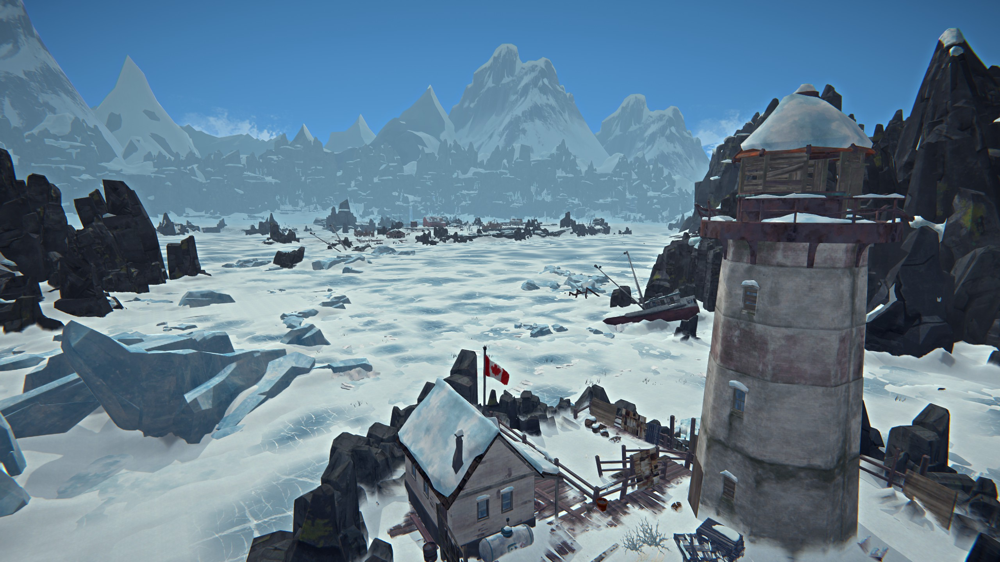
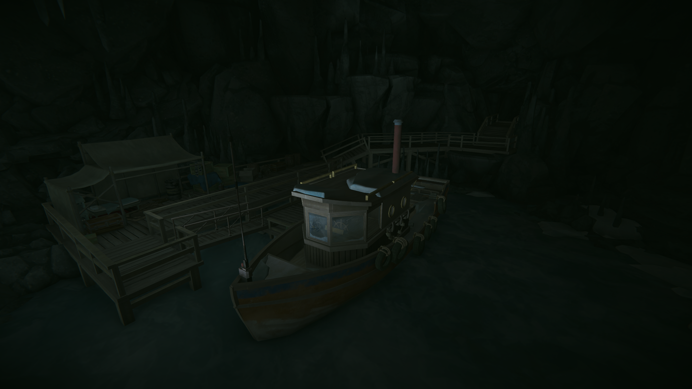

# Lighthouse \(Port Remnant\)

**Categories:** DLC Content, Indoor locations, Locations, Locations in Port Remnant · **Source:** [Fandom](https://thelongdark.fandom.com/wiki/Lighthouse_%28Port_Remnant%29)

**DLC-Exclusive content.**

This content requires the [Iron Road](./Iron%20Road.md) addon to be installed before it can be seen or used in regular gameplay.

**Lighthouse (Port Remnant)**

**Location**

**Region:** [Port Remnant](./Port%20Remnant.md)

**Description:** A ruined lighthouse with an interior cave system below it.

**General**

**Firebox:** [Fire Barrel](./Fire%20Barrel.md)

Has a bed

Has an interior **Lighthouse** is a location in [Port Remnant](./Port%20Remnant.md). It is located next to the [Lighthouse Keeper's Cabin](./Lighthouse%20Keeper%27s%20Cabin.md), and is the first location visited when entering [Cauldron Island](./Cauldron%20Island.md).

## Overview

A cave system is located below it, and is the location where the [Fulmar Autopilot Boat](./Fulmar%20Autopilot%20Boat.md) parks itself after leaving [Great Bear Island](./Great%20Bear%20Island.md). A makeshift shelter is located near the docks, with a [Bed](./Bed.md), [Trunk](./Trunk.md), and some tools are found inside (including 2 [Whale Oil Cans](./Whale%20Oil%20Can.md)), but the area is quite cold. A small cave past the docks gives way to a set of naturally cut stairs, leadi, revealing the inside of a ruined Lighthouse above.

[Wax Cylinder 2](./Wax%20Cylinder%202.md) and [Map (Church)](./Map%20%28Church%29.md) are located in a window sill when reaching the base floor of the Lighthouse. Wax Cylinder 2 is required to be picked up, as a key is tied with it to unlock the door to the outside region (the key cannot be picked up by itself).

The Lighthouse is quite old when viewed from the outside, and is falling apart. Unlike the [Fallen Lighthouse](./Fallen%20Lighthouse.md) in [Bleak Inlet](./Bleak%20Inlet.md), this one still stands (however the light itself has fallen, destroying the stairs inside in the process). The outside is weathered and boarded up, yet a small [Lighthouse Keeper's Cabin](./Lighthouse%20Keeper%27s%20Cabin.md) still stands in pristine condition next to it (and is much warmer than the docks).

The underground cave docks cannot be seen when outside, making its location a mystery.

