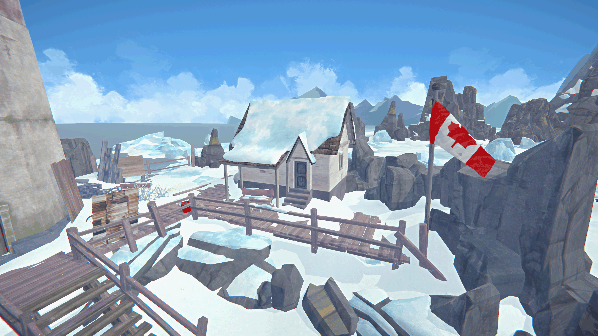

# Lighthouse Keeper's Cabin

**Categories:** DLC Content, Indoor locations, Locations, Locations in Port Remnant · **Source:** [Fandom](https://thelongdark.fandom.com/wiki/Lighthouse_Keeper's_Cabin)

_Seal\_icon.png_

**DLC-Exclusive content.** / This content requires the [Iron Road](./Iron%20Road.md) addon to be installed before it can be seen or used in regular gameplay.

_Lighthouse\_Keepers\_Cabin.png_

**Location**

_Lighthouse\_(Port\_Remnant)\_Location.png_

**Region:** [Port Remnant](./Port%20Remnant.md)\|-

**Description:** A lighthouse keeper's cabin

**General**

**Firebox:** [Wood Stove](./Wood%20Stove.md)

_bed\_icon.png_

Has a bed

_forge\_icon\_green.png_

_workbench\_icon\_green.png_
