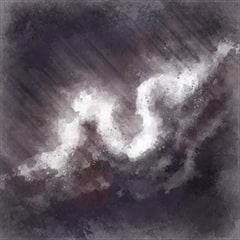

# Lights in the Sky

<table class="infobox">
<caption>Lights in the Sky</caption>
<colgroup>
<col style="width: 50%" />
<col style="width: 50%" />
</colgroup>
<tbody>
<tr>
<td colspan="2"><figure>

<figcaption>Lights_in_the_Sky_icon.png</figcaption>
</figure></td>
</tr>
<tr>
<td>
Description
</td>
<td>
Survive the first Aurora event.
</td>
</tr>
</tbody>
</table>

**Lights in the Sky** is a <a href="./Wintermute.md" class="wikilink" title="Wintermute">Wintermute</a> <a href="./The%20Long%20Dark%20%E2%80%94%20Achievements.md" class="wikilink" title="achievement">achievement</a> in <a href="./Episode%202%20-%20Luminance%20Fugue.md" class="wikilink" title="Episode 2: Luminance Fugue">Episode 2: Luminance Fugue</a> of *<a href="./The%20Long%20Dark.md" class="wikilink" title="The Long Dark">The Long Dark</a>*.

## Guide

This is an unmissable story achievement achieved during the mission <a href="./The%20Best%20Defense.md" class="wikilink" title="The Best Defense">The Best Defense</a> after the encounter with the <a href="./Old%20Bear.md" class="wikilink" title="Old Bear">Old Bear</a>. Simply make your way to the <a href="./Maintenance%20Yard.md" class="wikilink" title="Maintenance Yard">Maintenance Yard</a> and fall asleep inside the Maintenance Shed for the night or continue onwards to the <a href="./Hunting%20Lodge.md" class="wikilink" title="Hunting Lodge">Hunting Lodge</a> and after the night ends, the achievement will unlock.

## Trivia

The achievement's name is a reference to a quote from <a href="./Methuselah.md" class="wikilink" title="Methuselah">Methuselah</a>: "The lights in the sky are a reckoning. The wonder of humanity and all its creations, laid bare."

## Game History

- UPDATE **1 August 2017 (<a href="./The%20Long%20Dark%20%E2%80%94%20Changelog.md#1.00" class="wikilink" title="Update">Update</a>):**
  - Added to game.

**Lua execution error in Module:Navbox function navbox**

