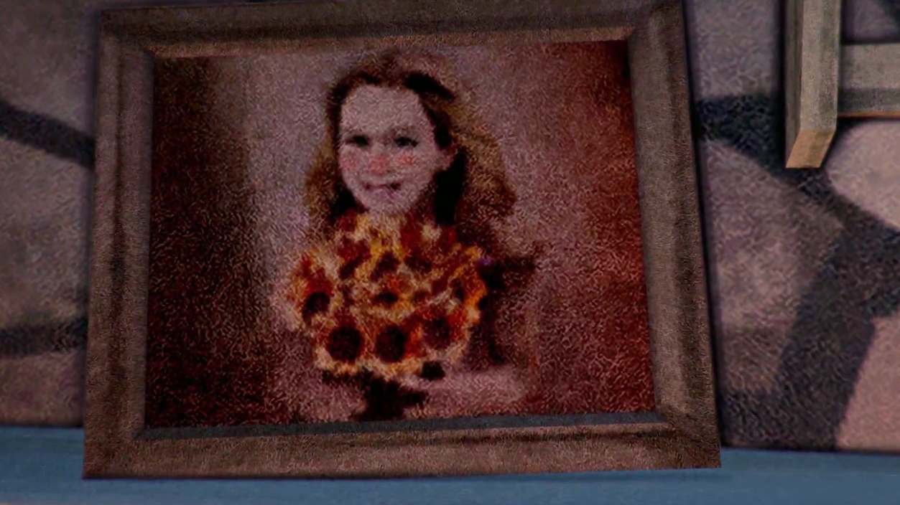
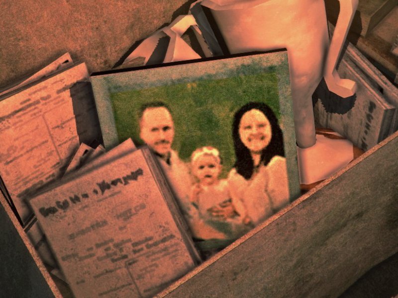
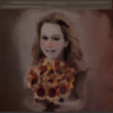
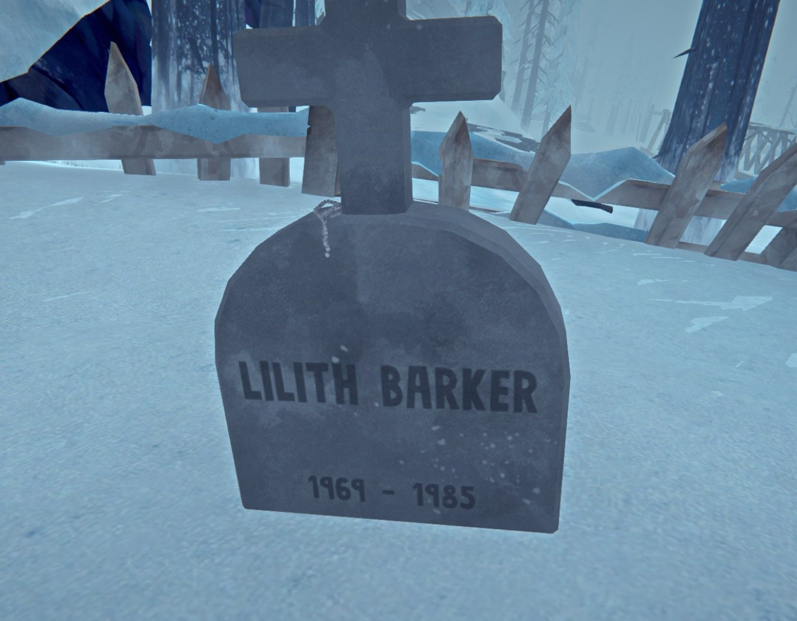

# Lilith Barker

**Spoiler Warning:****This page may contain spoilers from the [story](./Wintermute.md) of The Long Dark.**

**Lilith Barker**

| Property | Details |
| --- | --- |
|  |  / *Lilith\_Barker.png* |
| Release | [Wintermute Launch (v1.0)](./The%20Long%20Dark%20%E2%80%94%20Changelog.md#1.00) |
| Date | 1 August 2017 |
| Wintermute | [Episode 1](./Episode%201%20-%20Do%20Not%20Go%20Gentle.md) |
| Mission | [The Grey Mother](./The%20Grey%20Mother.md) |
| Location(s) | [St. Christopher's Church](./St.%20Christopher%27s%20Church.md) |
| **Biographical Information** |  |
| Age | 16 |
| Status | Dead |
| Place of death | [Great Bear Island](./Great%20Bear%20Island.md) |
| Relatives | **•** [Martin Barker](./Martin%20Barker.md) (Father) / **•** [Grey Mother](./Grey%20Mother.md) (Mother) |
| Occupation | Climber |
| **Game Information** |  |
| Equipment | [Lily's map](./Lily%27s%20Map.md) |

**Lilith "Lily" Barker** (1969 – 1985) was the daughter of [Grey Mother](./Grey%20Mother.md) and [Martin Barker](./Martin%20Barker.md). She lived in the town of [Milton](./Milton.md) in the [Mountain Town](./Mountain%20Town.md) region and was determined to climb all the peaks of [Great Bear](./Great%20Bear%20Island.md) From a young age. One particular day at age 16 she wanted to climb the rock climbing portion of [Milton Park](./Milton%20Park.md); Grey Mother told her not to do so, but her father let her go. Lily fell during the climb and died, with the rock climbing portion of the park being shut down and a [Park Warning Notice](./Park%20Warning%20Notice.md) placed to warn others. The incident caused the permanent separation of Grey Mother and Martin Barker, with Martin keeping Lily's pearl necklace to remember his daughter and keeping it locked in the local bank.

Lily is buried in the graveyard across the street from [St. Christopher's Church](./St.%20Christopher%27s%20Church.md). In [Episode 1](./Episode%201%20-%20Do%20Not%20Go%20Gentle.md) of the story mode, When [Will Mackenzie](./Will%20Mackenzie.md) initally meets Grey Mother, her conversations constantly fluctuate between talking about [Astrid Greenwood](./Astrid%20Greenwood.md) and mentioning her own daughter. A confused Mackenzie is eventually tasked with finding a lockbox containing her daughter's pearls (unbeknownst to him) as this will help him find Astrid.

After retrieving the pearls, Mackenzie is asked to go "meet" Lily, finally learning the truth of the woman Grey Mother was occasionally refering to. He places them on Lily's grave and returns to Grey Mother, finally giving her closure after many years of suffering. Grey Mother then offers Lily's climbing equipment as a reward to Mackenzie, hoping that he can find Astrid before she suffers the same fate as her Lily, allowing Mackenzie a way to leave the town of Milton.

## Trivia

Her grave is located across from [St. Christopher's Church](./St.%20Christopher%27s%20Church.md) in the [Graveyard](./Graveyard.md), with the headstone reading 1969-1985 "Our Fallen Angel"

Lily's belongings consisted of:

- [Mackinaw Jacket](./Mackinaw%20Jacket.md) ([Extra Supplies](./Extra%20Supplies.md))
- [Mountaineering Rope](./Mountaineering%20Rope.md)
- [Lily's Map](./Lily%27s%20Map.md)
- [Lily's Trunk Key](./Lily%27s%20Trunk%20Key.md) and her blue [Trunk](./Trunk.md)
- [Climbing Socks](./Climbing%20Socks.md)
- [Mountaineering Boots](./Mountaineering%20Boots.md) ([One Last Thing](./One%20Last%20Thing.md))
- [Grey Mother's Pearls](./Grey%20Mother%27s%20Pearls.md)

A [Recipe Card](./Recipe%20Cards.md) named after Lily can be found in the [Milton House (Grey Mother's)](./Milton%20House%20%28Grey%20Mother%27s%29.md) in [Survival Mode](./Survival%20Mode.md) called [Lily's Pancakes](./Lily%27s%20Pancakes.md). The recipe mentions her love of climbing, and implies that Pancakes with Peaches were her favorite food. Sometimes the Recipe Card is found behind the photo of her above the fireplace.

## Gallery

| Column 1 | Column 2 | Column 3 |
| --- | --- | --- |
|  / *A portrait found in [Milton House (Grey Mother's)](./Milton%20House%20%28Grey%20Mother%27s%29.md), likely of [Martin Barker](./Martin%20Barker.md), **Lilith Barker** and [Grey Mother](./Grey%20Mother.md).* |  / *Lily\_picture.png* |  / *Lilly's tombstone, with the pearls* |

[ru:Лилит Баркер](ru:%D0%9B%D0%B8%D0%BB%D0%B8%D1%82_%D0%91%D0%B0%D1%80%D0%BA%D0%B5%D1%80)
