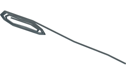

# Line

**Categories:** Craftable tools, Tools · **Source:** [Fandom](https://thelongdark.fandom.com/wiki/Line)

**Contents**

- [Crafting](#crafting)
- [Products](#products)
- [Gallery](#gallery)
- [Update history](#update-history)

**Line**

_Line\_icon.png_

**Release:** [27 November 2014](./The%20Long%20Dark%20%E2%80%94%20Changelog.md#0.163)

**Wintermute:** No

**Renewable:** Yes

**Properties**

**Item type:** [Tools](./Tools.md)\|-

**Stackable:** No

**Examine:** A line suitable for fishing.

**Values**

**Weight:** 0.01 kg (0.02 lbs)

**Actions**

**On ground:** Take It, Leave It

A **Line** is a tool that is required for building a [Fishing Tackle](./Fishing%20Tackle.md). Line can either constructed at a [Work Bench](./Work%20Bench.md) from [Cured Gut](./Cured%20Gut.md), or can occasionally be found when searching containers.

## Crafting

**Line**

| Property | Details |
| --- | --- |
|  | - |
|  | - |
|  | 15 minutes |
| **Requirements** |  |
| Facility | **Template:iconlink** |
| **Materials** |  |
| **Template:iconlink plain** |  |
| Item | [Cured Gut](./Cured%20Gut.md) |
| Quantity | 1 |

## Products

## Gallery

_Old model._

## Update history

**Template:update history**
