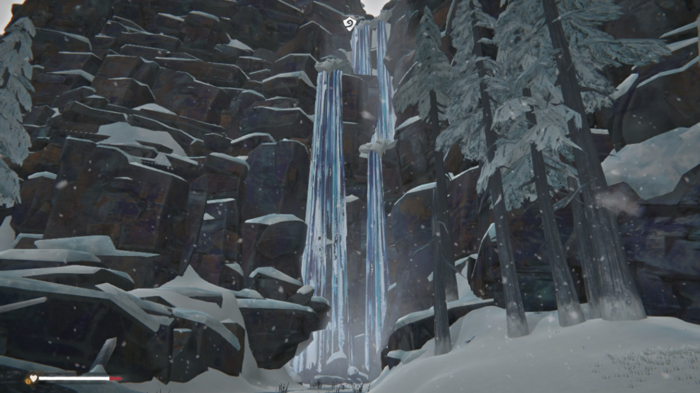
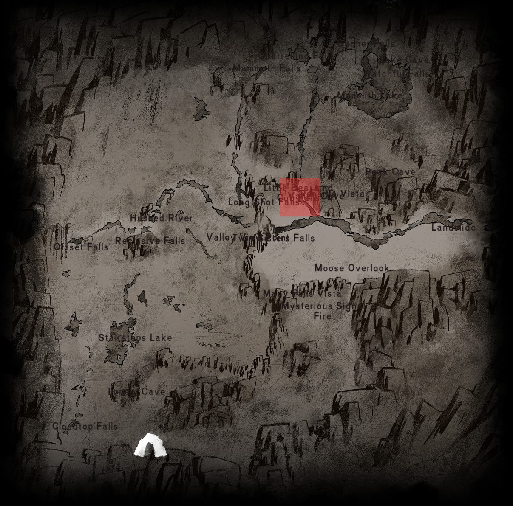

# Little Bear and Cub Falls

**Little Bear and Cub Falls**

| Property | Details |
| --- | --- |
|  |  / *Little\_Bear\_and\_Cub\_Falls.jpg* |
| **Location** |  |
|  |  / *Little\_Bear\_and\_Cub\_Falls\_Location.png* |
| Region | [Hushed River Valley](./Hushed%20River%20Valley.md)\|- |
| Type | Outdoors\|- |
