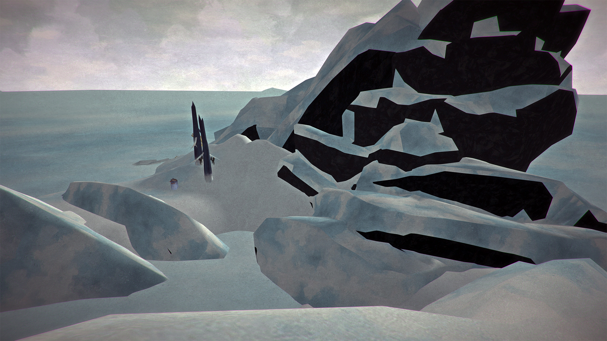
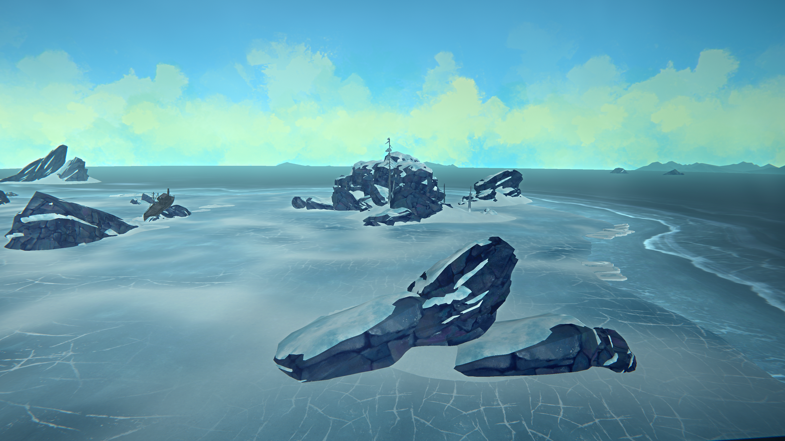

# Little Island

**Categories:** Islands, Locations, Locations in Desolation Point, Outdoor locations · **Source:** [Fandom](https://thelongdark.fandom.com/wiki/Little_Island)

**Little Island**

_Little\_Island\_01.jpg_

**Location**

_Little\_Island\_Location.png_

**Region:** [Desolation Point](./Desolation%20Point.md)

**Type:** Outdoors

## Overview

Little Island is located to the east of [Lonely Lighthouse](./Lonely%20Lighthouse.md), and south of [Hibernia Processing](./Hibernia%20Processing.md) and [The Riken](./The%20Riken.md).

[Old Man's Beard Lichen](./Old%20Man%27s%20Beard%20Lichen.md) and [Reishi Mushroom](./Reishi%20Mushroom.md) may be found on the island, along with [Rabbits](./Rabbit.md).

Also, every few days a couple of [Deer](./Deer.md) will be seen on the island and a [Deer Carcass](./Deer%20Carcass.md) can spawn. A frozen corpse can spawn on the side nearest the water.

## Gallery

_Another view of Little Island._

_Little Island, as seen from [Lonely Lighthouse](./Lonely%20Lighthouse.md)._
