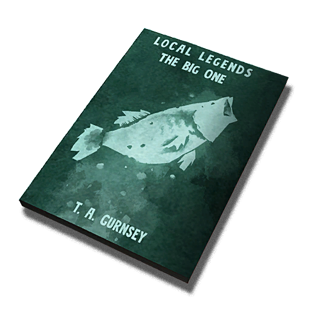

# Local Legends \- The Big One

<table class="infobox">
<caption>Local Legends - The Big One</caption>
<colgroup>
<col style="width: 50%" />
<col style="width: 50%" />
</colgroup>
<tbody>
<tr>
<td colspan="2"><figure>

<figcaption>Local_Legends_-_The_Big_One_icon.png</figcaption>
</figure></td>
</tr>
<tr>
<td>
Release
</td>
<td>
<a href="./The%20Long%20Dark%20%E2%80%94%20Changelog.md#1.60" class="wikilink" title="22 October 2019">22 October 2019</a>
</td>
</tr>
<tr>
<td>
Wintermute
</td>
<td>
<a href="./Episode%203%20-%20Crossroads%20Elegy.md" class="wikilink" title="Episode 3">Episode 3</a> - <a href="./Tall%20Tales.md" class="wikilink" title="Tall Tales">Tall Tales</a>
</td>
</tr>
<tr>
<td colspan="2" class="section">
<strong>Properties</strong>
</td>
</tr>
<tr>
<td>
Item type
</td>
<td>
<a href="./Collectibles.md" class="wikilink" title="Collectibles">Collectibles</a>|-
</td>
</tr>
<tr>
<td>
Stackable
</td>
<td>
No
</td>
</tr>
<tr>
<td>
Examine
</td>
<td>
A book with details about a local pond and its strange aquatic residents.
</td>
</tr>
<tr>
<td colspan="2" class="section">
<strong>Values</strong>
</td>
</tr>
<tr>
<td>
Weight
</td>
<td>
0.00 kg (0 lbs)
</td>
</tr>
<tr>
<td colspan="2" class="section">
<strong>Actions</strong>
</td>
</tr>
<tr>
<td>
Backpack
</td>
<td>
Examine
</td>
</tr>
<tr>
<td>
On ground
</td>
<td>
Take It, Read Text, Leave It
</td>
</tr>
<tr>
<td colspan="2" class="section">
<strong>Advanced data</strong>
</td>
</tr>
<tr>
<td>
Item key
</td>
<td>
STORY_Collectible_TallTalesFishing
</td>
</tr>
</tbody>
</table>

**Local Legends - The Big One** is a <a href="./Collectibles.md" class="wikilink" title="Collectible">Collectible</a> item found in <a href="./Episode%203%20-%20Crossroads%20Elegy.md" class="wikilink" title="Episode 3">Episode 3</a> of the <a href="./Wintermute.md" class="wikilink" title="Wintermute">Wintermute</a> story mode to as a part of the <a href="./Tall%20Tales.md" class="wikilink" title="Tall Tales">Tall Tales</a> side mission.

During the course of the mission, <a href="./Astrid%20Greenwood.md" class="wikilink" title="Astrid Greenwood">Astrid Greenwood</a> finds the book *Local Legends - The Big One* from the second <a href="./Joplin%27s%20Bunker%20Raid.md" class="wikilink" title="bunker">bunker</a> south of <a href="./Heartbreak%20Bridge.md" class="wikilink" title="Heartbreak Bridge">Heartbreak Bridge</a>, and are tasked to catch a <a href="./Big%20Bass%20%28Raw%29.md" class="wikilink" title="giant fish">giant fish</a> at <a href="./Pensive%20Pond.md" class="wikilink" title="Pensive Pond">Pensive Pond</a>.

## Transcript

The following text is transcribed from **Local Legends - The Big One**

Children playing along Pensive Pond know him as Big Eddie. He'd eat every bit of bread, meat or other foodstuffs they would toss into the water, hoping to lure the massive fish to the surface. Of course, being children, their fascination with the creature meant they could spend hours along the banks of the pond, waiting for him to appear.

Others in the Valley, being of more restrained disposition, felt obliged to leave the fish in peace. Who can say what the truth of the story might be?

## Update history

- UPDATE **22 October 2019 (<a href="./The%20Long%20Dark%20%E2%80%94%20Changelog.md#1.60" class="wikilink" title="Update">Update</a>):**
  - Added to game.

**Lua execution error in Module:Navbox function navbox**

