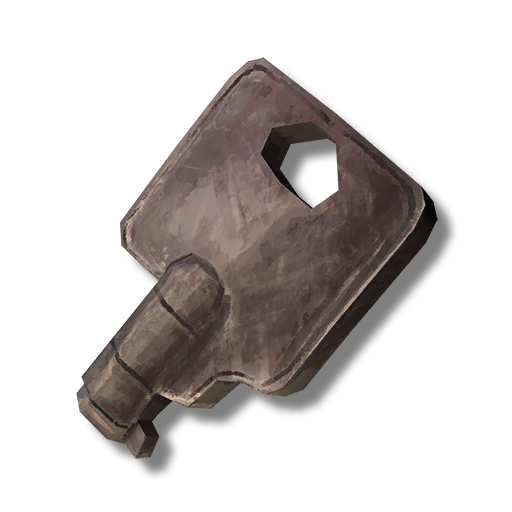

# Lock Box Key \(Predux\)

<table class="infobox">
<caption>Lock Box Key (Predux)</caption>
<colgroup>
<col style="width: 50%" />
<col style="width: 50%" />
</colgroup>
<tbody>
<tr>
<td colspan="2"><figure>

<figcaption>Lock_Box_Key_icon.png</figcaption>
</figure></td>
</tr>
<tr>
<td>
Release
</td>
<td>
<a href="./The%20Long%20Dark%20%E2%80%94%20Early%20Access%20Changelog.md#1.00" class="wikilink" title="1 August 2017">1 August 2017</a>
</td>
</tr>
<tr>
<td>
Wintermute
</td>
<td>
<a href="./Episode%201%20-%20Do%20Not%20Go%20Gentle.md" class="wikilink" title="Episode 1">Episode 1</a>
</td>
</tr>
<tr>
<td colspan="2" class="section">
<strong>Properties</strong>
</td>
</tr>
<tr>
<td>
Item type
</td>
<td>
<a href="./Collectibles.md" class="wikilink" title="Collectibles">Collectibles</a>|-
</td>
</tr>
<tr>
<td>
Stackable
</td>
<td>
No
</td>
</tr>
<tr>
<td>
Examine
</td>
<td>
Lock Box Key found at the Milton Farm
</td>
</tr>
<tr>
<td colspan="2" class="section">
<strong>Values</strong>
</td>
</tr>
<tr>
<td>
Weight
</td>
<td>
0.00 kg (0 lbs)
</td>
</tr>
<tr>
<td colspan="2" class="section">
<strong>Actions</strong>
</td>
</tr>
<tr>
<td>
Backpack
</td>
<td>
Examine
</td>
</tr>
<tr>
<td>
On ground
</td>
<td>
Take It, Leave It
</td>
</tr>
</tbody>
</table>

**Lock Box Key (Predux)** was a <a href="./Collectibles.md" class="wikilink" title="Collectible">Collectible</a> item found in <a href="./Episode%201%20-%20Do%20Not%20Go%20Gentle.md" class="wikilink" title="Episode 1: Do Not Go Gentle">Episode 1: Do Not Go Gentle</a> of the <a href="./Wintermute.md" class="wikilink" title="Wintermute">Wintermute</a> story mode in <a href="./Paradise%20Meadows%20Farm.md" class="wikilink" title="Paradise Meadows Farm">Paradise Meadows Farm</a>. It is considered <a href="./Cut%20%E2%80%94%20Discontinued%20Content.md" class="wikilink" title="Cut/Discontinued Content">Cut/Discontinued Content</a>, as it did not survive the transition from Predux Episode 1 to Redux Episode 1. The Lockbox and this key needed to open it was removed from the game and replaced with a different Lockbox that <a href="./Hobbs.md" class="wikilink" title="Hobbs">Hobbs</a> finds that is filled with <a href="./Cash.md" class="wikilink" title="Cash">Cash</a> and the <a href="./Bank%20Deposit%20Box%20Key%2015.md" class="wikilink" title="Bank Deposit Box Key 15">Bank Deposit Box Key 15</a>.

The key is found on the body of <a href="./Martin%20Barker.md" class="wikilink" title="Martin Barker">Martin Barker</a> in the Predux. The icon for this key would later be reused for <a href="./Lock%20Box%20Key.md" class="wikilink" title="Lock Box Key">Lock Box Key</a>.

The Lock Box that is opened by this key yields:

- <a href="./Emergency%20Kit%20Note.md" class="wikilink" title="Emergency Kit Note">Emergency Kit Note</a>
- <a href="./Bandage.md" class="wikilink" title="Bandage">Bandage</a>
- <a href="./Cardboard%20Matches.md" class="wikilink" title="Cardboard Matches">Cardboard Matches</a>
- <a href="./Military-Grade%20MRE.md" class="wikilink" title="Military-Grade MRE">Military-Grade MRE</a>
- 3 <a href="./Flare.md" class="wikilink" title="Flare">Flare</a>

## Update history

\* UPDATE **1 August 2017 (<a href="./The%20Long%20Dark%20%E2%80%94%20Changelog.md#1.00" class="wikilink" title="Update">Update</a>):**

- - Added to game.
- UPDATE **17 December 2018 (<a href="./The%20Long%20Dark%20%E2%80%94%20Changelog.md#1.41" class="wikilink" title="Update">Update</a>):**
  - Removed from the game as part of the Redux edition.

**Lua execution error in Module:Navbox function navbox**

