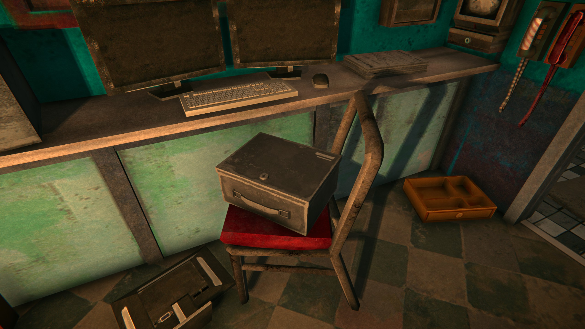

# Lock Box

**Lock Box**

| Property | Details |
| --- | --- |
|  |  / *Lock\_Box.jpg* |
| Release | TBD |
| Story item | Yes |
| **Container** |  |
| Capacity | 10.00 kg(22 lbs) |

A **Lock Box** is a storage container found rarely when exploring the Island. The are small grey boxes with a handle and a single keyhole, often locked and requiring a key.

Many [Mementos](./Mementos.md) Caches have a chance to spawn as a Lock Box and require a key to open.

Occasionally they are found in Wintermute. **Lua execution error in Module:Navbox function navbox**
