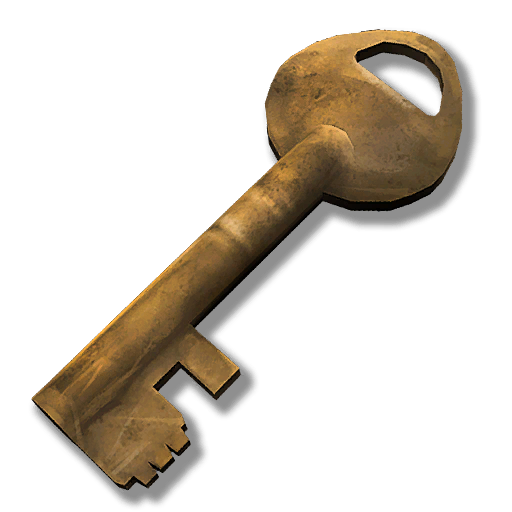
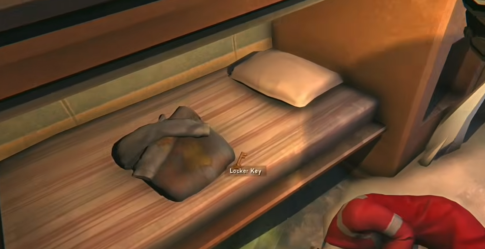

# Locker Key

**Categories:** Collectibles, Pages with update history · **Source:** [Fandom](https://thelongdark.fandom.com/wiki/Locker_Key)

**Locker Key**

| Property | Details |
| --- | --- |
|  |  / _Locker\_Key\_icon.png_ |
| Release | [31 March 2026](./The%20Long%20Dark%20%E2%80%94%20Changelog.md#2.52) |
| Wintermute | [Episode 5: The Light At The End Of All Things](./Episode%205%20-%20The%20Light%20At%20The%20End%20Of%20All%20Things.md) |
| **Properties** |  |
| Item type | [Collectibles](./Collectibles.md)\|- |
| Stackable | No |
| Examine | (#)8 Locker Key |
| **Values** |  |
| Weight | 0.00 kg (0 lbs) |
| **Actions** |  |
| Backpack | Examine |
| On ground | Take It, Read Text, Leave It |

**Locker Key** is a [Collectibles](./Collectibles.md) found in [Episode 5](./Episode%205%20-%20The%20Light%20At%20The%20End%20Of%20All%20Things.md) of the [Wintermute](./Wintermute.md) story. It is found inside the [Fukkatsu Maru](./Fukkatsu%20Maru.md) during the main mission [A Cry For Help](./A%20Cry%20For%20Help.md). It is found in a crew quarters room past the mess hall, and is used to unlock a locker in the baths room across the hall.

_Locker Key Location_

## Update history

\* UPDATE **31 March 2026 ([Update](./The%20Long%20Dark%20%E2%80%94%20Changelog.md#2.52)):**

- 
  - Added to game.
