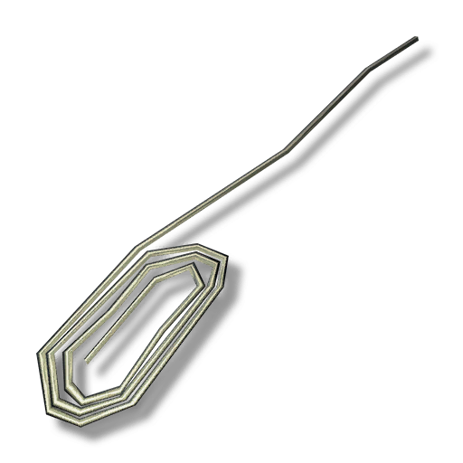

# Locker

<table class="infobox">
<caption>Locker</caption>
<colgroup>
<col style="width: 33%" />
<col style="width: 33%" />
<col style="width: 33%" />
</colgroup>
<tbody>
<tr>
<td colspan="2">
[[File:

<table class="gallery">
<colgroup>
<col style="width: 25%" />
<col style="width: 25%" />
<col style="width: 25%" />
<col style="width: 25%" />
</colgroup>
<tbody>
<tr>
<td><figure>
[Missing image: LockerSingle.jpg]
<figcaption>Single</figcaption>
</figure></td>
<td><figure>
[Missing image: LockerDouble.jpg]
<figcaption>Double</figcaption>
</figure></td>
<td><figure>
[Missing image: LockerTriple.jpg]
<figcaption>Triple</figcaption>
</figure></td>
<td><figure>
[Missing image: Five_Locker.jpg]
<figcaption>Green</figcaption>
</figure></td>
</tr>
</tbody>
</table></td>
<td>
250px]]
</td>
</tr>
<tr>
<td>
Update
</td>
<td>
<a href="./The%20Long%20Dark%20%E2%80%94%20Changelog.md#0.00" class="wikilink" title="0.00">0.00</a>
</td>
<td></td>
</tr>
<tr>
<td>
Story item
</td>
<td>
Yes
</td>
<td></td>
</tr>
<tr>
<td colspan="2">
<strong>Container</strong>
</td>
<td></td>
</tr>
<tr>
<td>
Capacity
</td>
<td>
30.00 kg(66 lbs)
</td>
<td></td>
</tr>
<tr>
<td colspan="2">
<strong>Advanced data</strong>
</td>
<td></td>
</tr>
<tr>
<td>
Object key
</td>
<td>
GAMEPLAY_Locker
</td>
<td></td>
</tr>
</tbody>
</table>

A **Locker** can be found in many places in the game, generally industrial-like places, and serves as a container for storing items. Some Lockers are locked and require a <a href="./Prybar.md" class="wikilink" title="Prybar">Prybar</a> to open. Lockers are one of the most common containers found in the game, along with the metal and plastic containers.

## Variants

There are 4 variants of lockers; Single, Double, and Triple Lockers, and a single Green Locker.

- An opened locker can be searched, for low to mid-tier loot.
- The locked locker requires a Prybar to open, and generally contains mid to high-tier loot.
- The <a href="./Metal%20Shelf.md" class="wikilink" title="broken locker">broken locker</a> can be broken down by a <a href="./Hacksaw.md" class="wikilink" title="Hacksaw">Hacksaw</a> for <a href="./Scrap%20Metal.md" class="wikilink" title="Scrap Metal">Scrap Metal</a>, and cannot be searched.
- A green locker with a "5" painted onto the front can be found in forestry locations such as the <a href="./Trapper%27s%20Homestead.md" class="wikilink" title="Trapper&#39;s Homestead">Trapper's Homestead</a> and the <a href="./Old%20Spence%20Family%20Homestead.md" class="wikilink" title="Old Spence Family Homestead">Old Spence Family Homestead</a>. These are often locked but have a chance to spawn opened.

Occasionally 5th type of locker, a <a href="./Medical%20Locker.md" class="wikilink" title="Medical Locker">Medical Locker</a>, can be found, and only contains <a href="./First%20Aid.md" class="wikilink" title="First Aid">First Aid</a> supplies.

<table class="gallery">
<colgroup>
<col style="width: 100%" />
</colgroup>
<tbody>
<tr>
<td><figure>
[Missing image: Pre_Alpha_Lockers.jpg]
<figcaption>Pre Alpha Lockers</figcaption>
</figure></td>
</tr>
</tbody>
</table>

## Loot

<table>
<colgroup>
<col style="width: 33%" />
<col style="width: 33%" />
<col style="width: 33%" />
</colgroup>
<thead>
<tr>
<th></th>
<th>
Item
</th>
<th>
Rarity
</th>
</tr>
</thead>
<tbody>
<tr>
<td><figure>

<figcaption>Arrowhead_icon.png</figcaption>
</figure></td>
<td>
<a href="./Arrowhead.md" class="wikilink" title="Arrowhead">Arrowhead</a>
</td>
<td>
0.413%
</td>
</tr>
<tr>
<td><figure>

<figcaption>Rifle_Shell_Casing_icon.png</figcaption>
</figure></td>
<td>
<a href="./Rifle%20Shell%20Casing.md" class="wikilink" title="Rifle Shell Casing">Rifle Shell Casing</a>
</td>
<td>
0.413%
</td>
</tr>
<tr>
<td><figure>

<figcaption>Cargo_Pants_icon.png</figcaption>
</figure></td>
<td>
<a href="./Cargo%20Pants.md" class="wikilink" title="Cargo Pants">Cargo Pants</a>
</td>
<td>
0.689%
</td>
</tr>
<tr>
<td><figure>

<figcaption>Combat_Boots_icon.png</figcaption>
</figure></td>
<td>
<a href="./Combat%20Boots.md" class="wikilink" title="Combat Boots">Combat Boots</a>
</td>
<td>
0.689%
</td>
</tr>
<tr>
<td><figure>

<figcaption>Flare_Shell_icon.png</figcaption>
</figure></td>
<td>
<a href="./Flare%20Shell.md" class="wikilink" title="Flare Shell">Flare Shell</a>
</td>
<td>
0.689%
</td>
</tr>
<tr>
<td><figure>

<figcaption>Replacement_Fuse_icon.png</figcaption>
</figure></td>
<td>
<a href="./Replacement%20Fuse.md" class="wikilink" title="Replacement Fuse">Replacement Fuse</a>
</td>
<td>
0.689%
</td>
</tr>
<tr>
<td><figure>

<figcaption>Cured_Leather_icon.png</figcaption>
</figure></td>
<td>
<a href="./Cured%20Leather.md" class="wikilink" title="Cured Leather">Cured Leather</a>
</td>
<td>
0.689%
</td>
</tr>
<tr>
<td><figure>

<figcaption>Line_icon.png</figcaption>
</figure></td>
<td>
<a href="./Line.md" class="wikilink" title="Line">Line</a>
</td>
<td>
0.689%
</td>
</tr>
<tr>
<td><figure>

<figcaption>Thermal_Underwear_icon.png</figcaption>
</figure></td>
<td>
<a href="./Thermal%20Underwear.md" class="wikilink" title="Thermal Underwear">Thermal Underwear</a>
</td>
<td>
0.689%
</td>
</tr>
<tr>
<td><figure>

<figcaption>Wool_Mittens_icon.png</figcaption>
</figure></td>
<td>
<a href="./Wool%20Mittens.md" class="wikilink" title="Wool Mittens">Wool Mittens</a>
</td>
<td>
0.689%
</td>
</tr>
<tr>
<td><figure>

<figcaption>Stack_of_Papers_icon.png</figcaption>
</figure></td>
<td>
<a href="./Stack%20of%20Papers.md" class="wikilink" title="Stack of Papers">Stack of Papers</a>
</td>
<td>
0.689%
</td>
</tr>
<tr>
<td><figure>

<figcaption>Simple_Tools_icon.png</figcaption>
</figure></td>
<td>
<a href="./Simple%20Tools.md" class="wikilink" title="Simple Tools">Simple Tools</a>
</td>
<td>
0.689%
</td>
</tr>
<tr>
<td><figure>

<figcaption>Tinder_Plug_icon.png</figcaption>
</figure></td>
<td>
<a href="./Tinder%20Plug.md" class="wikilink" title="Tinder Plug">Tinder Plug</a>
</td>
<td>
0.689%
</td>
</tr>
<tr>
<td><figure>

<figcaption>Tomato_Soup_icon.png</figcaption>
</figure></td>
<td>
<a href="./Tomato%20Soup.md" class="wikilink" title="Tomato Soup">Tomato Soup</a>
</td>
<td>
0.689%
</td>
</tr>
<tr>
<td><figure>

<figcaption>Water_(Potable)_icon.png</figcaption>
</figure></td>
<td>
<a href="./Water%20%28Potable%29.md" class="wikilink" title="Water Bottle">Water Bottle</a>
</td>
<td>
0.689%
</td>
</tr>
<tr>
<td><figure>

<figcaption>Wires_icon.png</figcaption>
</figure></td>
<td>
<a href="./Wires.md" class="wikilink" title="Wires">Wires</a>
</td>
<td>
0.689%
</td>
</tr>
<tr>
<td><figure>

<figcaption>Work_Pants_icon.png</figcaption>
</figure></td>
<td>
<a href="./Work%20Pants.md" class="wikilink" title="Work Pants">Work Pants</a>
</td>
<td>
0.689%
</td>
</tr>
<tr>
<td><figure>

<figcaption>Accelerant_icon.png</figcaption>
</figure></td>
<td>
<a href="./Accelerant.md" class="wikilink" title="Accelerant">Accelerant</a>
</td>
<td>
1.377%
</td>
</tr>
<tr>
<td><figure>

<figcaption>Wool_Scarf_icon.png</figcaption>
</figure></td>
<td>
<a href="./Wool%20Scarf.md" class="wikilink" title="Wool Scarf">Wool Scarf</a>
</td>
<td>
1.377%
</td>
</tr>
<tr>
<td><figure>

<figcaption>Marine_Flare_icon.png</figcaption>
</figure></td>
<td>
<a href="./Marine%20Flare.md" class="wikilink" title="Marine Flare">Marine Flare</a>
</td>
<td>
1.377%
</td>
</tr>
<tr>
<td><figure>

<figcaption>Antiseptic_icon.png</figcaption>
</figure></td>
<td>
<a href="./Antiseptic.md" class="wikilink" title="Antiseptic">Antiseptic</a>
</td>
<td>
1.377%
</td>
</tr>
<tr>
<td><figure>

<figcaption>Painkillers_icon.png</figcaption>
</figure></td>
<td>
<a href="./Painkillers.md" class="wikilink" title="Painkillers">Painkillers</a>
</td>
<td>
1.377%
</td>
</tr>
<tr>
<td><figure>

<figcaption>Chocolate_Bar_icon.png</figcaption>
</figure></td>
<td>
<a href="./Chocolate%20Bar.md" class="wikilink" title="Candy Bar">Candy Bar</a>
</td>
<td>
1.377%
</td>
</tr>
<tr>
<td><figure>

<figcaption>Pork_and_Beans_icon.png</figcaption>
</figure></td>
<td>
<a href="./Pork%20and%20Beans.md" class="wikilink" title="Pork and Beans">Pork and Beans</a>
</td>
<td>
1.377%
</td>
</tr>
<tr>
<td><figure>

<figcaption>Down_Vest_icon.png</figcaption>
</figure></td>
<td>
<a href="./Down%20Vest.md" class="wikilink" title="Down Vest">Down Vest</a>
</td>
<td>
1.377%
</td>
</tr>
<tr>
<td><figure>

<figcaption>Flare_icon.png</figcaption>
</figure></td>
<td>
<a href="./Flare.md" class="wikilink" title="Flare">Flare</a>
</td>
<td>
1.377%
</td>
</tr>
<tr>
<td><figure>

<figcaption>Fleece_Mittens_icon.png</figcaption>
</figure></td>
<td>
<a href="./Fleece%20Mittens.md" class="wikilink" title="Fleece Mittens">Fleece Mittens</a>
</td>
<td>
1.377%
</td>
</tr>
<tr>
<td><figure>

<figcaption>Revolver_Cartridge_icon.png</figcaption>
</figure></td>
<td>
<a href="./Revolver%20Ammunition.md" class="wikilink" title="Revolver Cartridge">Revolver Cartridge</a>
</td>
<td>
1.377%
</td>
</tr>
<tr>
<td><figure>

<figcaption>Summit_Soda_icon.png</figcaption>
</figure></td>
<td>
<a href="./Summit%20Soda.md" class="wikilink" title="Summit Soda">Summit Soda</a>
</td>
<td>
1.377%
</td>
</tr>
<tr>
<td><figure>

<figcaption>Go!_Energy_Drink_icon.png</figcaption>
</figure></td>
<td>
<a href="./Go!%20Energy%20Drink.md" class="wikilink" title="Go! Energy Drink">Go! Energy Drink</a>
</td>
<td>
1.377%
</td>
</tr>
<tr>
<td><figure>

<figcaption>Stacy's_Grape_Soda_icon.png</figcaption>
</figure></td>
<td>
<a href="./Stacy%27s%20Grape%20Soda.md" class="wikilink" title="Stacy&#39;s Grape Soda">Stacy's Grape Soda</a>
</td>
<td>
1.377%
</td>
</tr>
<tr>
<td><figure>

<figcaption>Spray_Paint_icon.png</figcaption>
</figure></td>
<td>
<a href="./Spray%20Paint.md" class="wikilink" title="Spray Paint">Spray Paint</a>
</td>
<td>
1.377%
</td>
</tr>
<tr>
<td><figure>

<figcaption>Wool_Toque_icon.png</figcaption>
</figure></td>
<td>
<a href="./Wool%20Toque.md" class="wikilink" title="Wool Toque">Wool Toque</a>
</td>
<td>
1.377%
</td>
</tr>
<tr>
<td><figure>

<figcaption>Water_Purification_Tablets_icon.png</figcaption>
</figure></td>
<td>
<a href="./Water%20Purification%20Tablets.md" class="wikilink" title="Water Purification Tablets">Water Purification Tablets</a>
</td>
<td>
1.377%
</td>
</tr>
<tr>
<td><figure>

<figcaption>Thin_Wool_Sweater_icon.png</figcaption>
</figure></td>
<td>
<a href="./Thin%20Wool%20Sweater.md" class="wikilink" title="Thin Wool Sweater">Thin Wool Sweater</a>
</td>
<td>
1.377%
</td>
</tr>
<tr>
<td><figure>

<figcaption>Work_Boots_icon.png</figcaption>
</figure></td>
<td>
<a href="./Work%20Boots.md" class="wikilink" title="Work Boots">Work Boots</a>
</td>
<td>
1.377%
</td>
</tr>
<tr>
<td><figure>

<figcaption>Work_Gloves_icon.png</figcaption>
</figure></td>
<td>
<a href="./Work%20Gloves.md" class="wikilink" title="Work Gloves">Work Gloves</a>
</td>
<td>
1.377%
</td>
</tr>
<tr>
<td><figure>

<figcaption>Book_icon.png</figcaption>
</figure></td>
<td>
<a href="./Book.md" class="wikilink" title="Book">Book</a>
</td>
<td>
2.066%
</td>
</tr>
<tr>
<td><figure>

<figcaption>Book_icon.png</figcaption>
</figure></td>
<td>
<a href="./Book.md" class="wikilink" title="Book">Book</a>
</td>
<td>
2.066%
</td>
</tr>
<tr>
<td><figure>

<figcaption>Cloth_icon.png</figcaption>
</figure></td>
<td>
<a href="./Cloth.md" class="wikilink" title="Cloth">Cloth</a>
</td>
<td>
2.066%
</td>
</tr>
<tr>
<td><figure>

<figcaption>Cotton_Scarf_icon.png</figcaption>
</figure></td>
<td>
<a href="./Cotton%20Scarf.md" class="wikilink" title="Cotton Scarf">Cotton Scarf</a>
</td>
<td>
2.066%
</td>
</tr>
<tr>
<td><figure>

<figcaption>Ketchup_Chips_icon.png</figcaption>
</figure></td>
<td>
<a href="./Ketchup%20Chips.md" class="wikilink" title="Ketchup Chips">Ketchup Chips</a>
</td>
<td>
2.066%
</td>
</tr>
<tr>
<td><figure>

<figcaption>Lantern_Fuel_icon.png</figcaption>
</figure></td>
<td>
<a href="./Lantern%20Fuel.md" class="wikilink" title="Lantern Fuel">Lantern Fuel</a>
</td>
<td>
2.066%
</td>
</tr>
<tr>
<td><figure>

<figcaption>Simple_Parka_icon.png</figcaption>
</figure></td>
<td>
<a href="./Simple%20Parka.md" class="wikilink" title="Simple Parka">Simple Parka</a>
</td>
<td>
2.066%
</td>
</tr>
<tr>
<td><figure>

<figcaption>Newsprint_Roll_icon.png</figcaption>
</figure></td>
<td>
<a href="./Newsprint%20Roll.md" class="wikilink" title="Newsprint Roll">Newsprint Roll</a>
</td>
<td>
2.066%
</td>
</tr>
<tr>
<td><figure>

<figcaption>Scrap_Metal_icon.png</figcaption>
</figure></td>
<td>
<a href="./Scrap%20Metal.md" class="wikilink" title="Scrap Metal">Scrap Metal</a>
</td>
<td>
2.066%
</td>
</tr>
<tr>
<td><figure>

<figcaption>Light_Shell_icon.png</figcaption>
</figure></td>
<td>
<a href="./Light%20Shell.md" class="wikilink" title="Light Shell">Light Shell</a>
</td>
<td>
2.066%
</td>
</tr>
<tr>
<td><figure>

<figcaption>Driving_Gloves_icon.png</figcaption>
</figure></td>
<td>
<a href="./Driving%20Gloves.md" class="wikilink" title="Driving Gloves">Driving Gloves</a>
</td>
<td>
2.755%
</td>
</tr>
<tr>
<td><figure>

<figcaption>Windbreaker_icon.png</figcaption>
</figure></td>
<td>
<a href="./Windbreaker.md" class="wikilink" title="Windbreaker">Windbreaker</a>
</td>
<td>
2.755%
</td>
</tr>
<tr>
<td><figure>

<figcaption>Cotton_Toque_icon.png</figcaption>
</figure></td>
<td>
<a href="./Cotton%20Toque.md" class="wikilink" title="Cotton Toque">Cotton Toque</a>
</td>
<td>
2.755%
</td>
</tr>
<tr>
<td><figure>

<figcaption>Hoodie_icon.png</figcaption>
</figure></td>
<td>
<a href="./Hoodie.md" class="wikilink" title="Hoodie">Hoodie</a>
</td>
<td>
2.755%
</td>
</tr>
<tr>
<td><figure>

<figcaption>Sweatshirt_icon.png</figcaption>
</figure></td>
<td>
<a href="./Sweatshirt.md" class="wikilink" title="Sweatshirt">Sweatshirt</a>
</td>
<td>
2.755%
</td>
</tr>
<tr>
<td><figure>

<figcaption>Sport_Vest_icon.png</figcaption>
</figure></td>
<td>
<a href="./Sport%20Vest.md" class="wikilink" title="Sport Vest">Sport Vest</a>
</td>
<td>
2.755%
</td>
</tr>
<tr>
<td><figure>

<figcaption>Jeans_icon.png</figcaption>
</figure></td>
<td>
<a href="./Jeans.md" class="wikilink" title="Jeans">Jeans</a>
</td>
<td>
2.755%
</td>
</tr>
<tr>
<td><figure>

<figcaption>Newsprint_icon.png</figcaption>
</figure></td>
<td>
<a href="./Newsprint.md" class="wikilink" title="Newsprint">Newsprint</a>
</td>
<td>
2.755%
</td>
</tr>
<tr>
<td><figure>

<figcaption>Plaid_Shirt_icon.png</figcaption>
</figure></td>
<td>
<a href="./Plaid%20Shirt.md" class="wikilink" title="Plaid Shirt">Plaid Shirt</a>
</td>
<td>
2.755%
</td>
</tr>
<tr>
<td><figure>

<figcaption>T-Shirt_icon.png</figcaption>
</figure></td>
<td>
<a href="./T-Shirt.md" class="wikilink" title="T-Shirt">T-Shirt</a>
</td>
<td>
2.755%
</td>
</tr>
<tr>
<td><figure>

<figcaption>Wood_Matches_icon.png</figcaption>
</figure></td>
<td>
<a href="./Wood%20Matches.md" class="wikilink" title="Wood Matches">Wood Matches</a>
</td>
<td>
2.755%
</td>
</tr>
<tr>
<td><figure>

<figcaption>Trail_Boots_icon.png</figcaption>
</figure></td>
<td>
<a href="./Trail%20Boots.md" class="wikilink" title="Trail Boots">Trail Boots</a>
</td>
<td>
3.444%
</td>
</tr>
<tr>
<td><figure>

<figcaption>Running_Shoes_icon.png</figcaption>
</figure></td>
<td>
<a href="./Running%20Shoes.md" class="wikilink" title="Running Shoes">Running Shoes</a>
</td>
<td>
3.444%
</td>
</tr>
<tr>
<td><figure>

<figcaption>Leather_Shoes_icon.png</figcaption>
</figure></td>
<td>
<a href="./Leather%20Shoes.md" class="wikilink" title="Leather Shoes">Leather Shoes</a>
</td>
<td>
3.444%
</td>
</tr>
</tbody>
</table>

**Lua execution error in Module:Navbox function navbox** <a href="es:Armario" class="wikilink" title="es:Armario">es:Armario</a>

