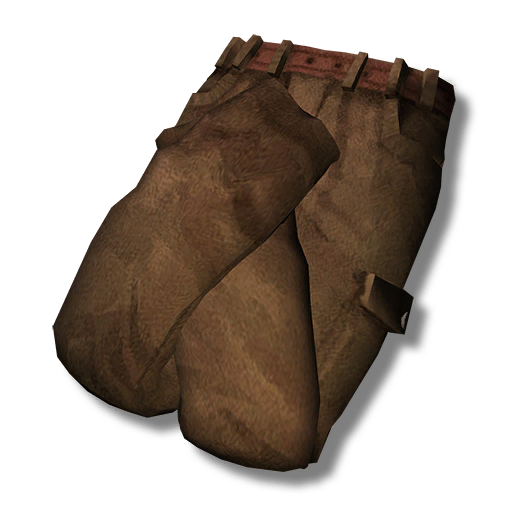
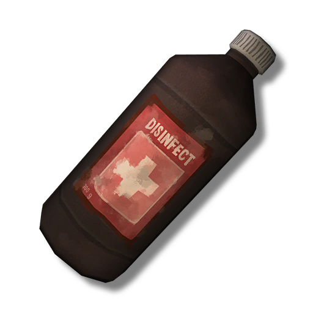
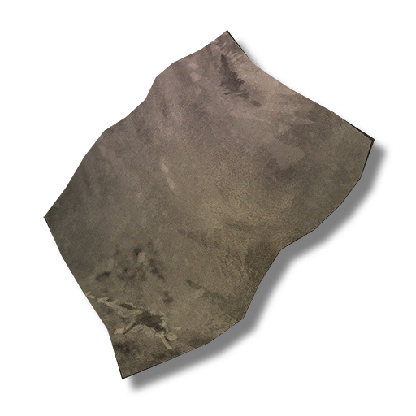
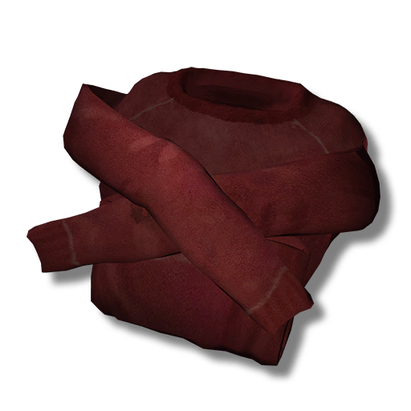

# Locker

**Categories:** Interactable Objects · **Source:** [Fandom](https://thelongdark.fandom.com/wiki/Locker)

**Locker**

\[\[File:

250px\]\]

Update

[0.00](./The%20Long%20Dark%20%E2%80%94%20Changelog.md#0.00)

Story item

Yes

**Container**

Capacity

30.00 kg(66 lbs)

**Advanced data**

Object key

GAMEPLAY\_Locker

A **Locker** can be found in many places in the game, generally industrial-like places, and serves as a container for storing items. Some Lockers are locked and require a [Prybar](./Prybar.md) to open. Lockers are one of the most common containers found in the game, along with the metal and plastic containers.

## Variants

There are 4 variants of lockers; Single, Double, and Triple Lockers, and a single Green Locker.

- An opened locker can be searched, for low to mid-tier loot.
- The locked locker requires a Prybar to open, and generally contains mid to high-tier loot.
- The [broken locker](./Metal%20Shelf.md) can be broken down by a [Hacksaw](./Hacksaw.md) for [Scrap Metal](./Scrap%20Metal.md), and cannot be searched.
- A green locker with a "5" painted onto the front can be found in forestry locations such as the [Trapper's Homestead](./Trapper%27s%20Homestead.md) and the [Old Spence Family Homestead](./Old%20Spence%20Family%20Homestead.md). These are often locked but have a chance to spawn opened.

Occasionally 5th type of locker, a [Medical Locker](./Medical%20Locker.md), can be found, and only contains [First Aid](./First%20Aid.md) supplies.

## Loot

|  | Item | Rarity |
| --- | --- | --- |
|  | [Arrowhead](./Arrowhead.md) | 0.413% |
|  | [Rifle Shell Casing](./Rifle%20Shell%20Casing.md) | 0.413% |
|  | [Cargo Pants](./Cargo%20Pants.md) | 0.689% |
|  | [Combat Boots](./Combat%20Boots.md) | 0.689% |
|  | [Flare Shell](./Flare%20Shell.md) | 0.689% |
|  | [Replacement Fuse](./Replacement%20Fuse.md) | 0.689% |
|  | [Cured Leather](./Cured%20Leather.md) | 0.689% |
|  | [Line](./Line.md) | 0.689% |
|  | [Thermal Underwear](./Thermal%20Underwear.md) | 0.689% |
|  | [Wool Mittens](./Wool%20Mittens.md) | 0.689% |
|  | [Stack of Papers](./Stack%20of%20Papers.md) | 0.689% |
|  | [Simple Tools](./Simple%20Tools.md) | 0.689% |
|  | [Tinder Plug](./Tinder%20Plug.md) | 0.689% |
|  | [Tomato Soup](./Tomato%20Soup.md) | 0.689% |
|  | [Water Bottle](./Water%20%28Potable%29.md) | 0.689% |
|  | [Wires](./Wires.md) | 0.689% |
|  | [Work Pants](./Work%20Pants.md) | 0.689% |
|  | [Accelerant](./Accelerant.md) | 1.377% |
|  | [Wool Scarf](./Wool%20Scarf.md) | 1.377% |
|  | [Marine Flare](./Marine%20Flare.md) | 1.377% |
|  | [Antiseptic](./Antiseptic.md) | 1.377% |
|  | [Painkillers](./Painkillers.md) | 1.377% |
|  | [Candy Bar](./Chocolate%20Bar.md) | 1.377% |
|  | [Pork and Beans](./Pork%20and%20Beans.md) | 1.377% |
|  | [Down Vest](./Down%20Vest.md) | 1.377% |
|  | [Flare](./Flare.md) | 1.377% |
|  | [Fleece Mittens](./Fleece%20Mittens.md) | 1.377% |
|  | [Revolver Cartridge](./Revolver%20Ammunition.md) | 1.377% |
|  | [Summit Soda](./Summit%20Soda.md) | 1.377% |
|  | [Go! Energy Drink](./Go!%20Energy%20Drink.md) | 1.377% |
|  | [Stacy's Grape Soda](./Stacy%27s%20Grape%20Soda.md) | 1.377% |
|  | [Spray Paint](./Spray%20Paint.md) | 1.377% |
|  | [Wool Toque](./Wool%20Toque.md) | 1.377% |
|  | [Water Purification Tablets](./Water%20Purification%20Tablets.md) | 1.377% |
|  | [Thin Wool Sweater](./Thin%20Wool%20Sweater.md) | 1.377% |
|  | [Work Boots](./Work%20Boots.md) | 1.377% |
|  | [Work Gloves](./Work%20Gloves.md) | 1.377% |
|  | [Book](./Book.md) | 2.066% |
|  | [Book](./Book.md) | 2.066% |
|  | [Cloth](./Cloth.md) | 2.066% |
|  | [Cotton Scarf](./Cotton%20Scarf.md) | 2.066% |
|  | [Ketchup Chips](./Ketchup%20Chips.md) | 2.066% |
|  | [Lantern Fuel](./Lantern%20Fuel.md) | 2.066% |
|  | [Simple Parka](./Simple%20Parka.md) | 2.066% |
|  | [Newsprint Roll](./Newsprint%20Roll.md) | 2.066% |
|  | [Scrap Metal](./Scrap%20Metal.md) | 2.066% |
|  | [Light Shell](./Light%20Shell.md) | 2.066% |
|  | [Driving Gloves](./Driving%20Gloves.md) | 2.755% |
|  | [Windbreaker](./Windbreaker.md) | 2.755% |
|  | [Cotton Toque](./Cotton%20Toque.md) | 2.755% |
|  | [Hoodie](./Hoodie.md) | 2.755% |
|  | [Sweatshirt](./Sweatshirt.md) | 2.755% |
|  | [Sport Vest](./Sport%20Vest.md) | 2.755% |
|  | [Jeans](./Jeans.md) | 2.755% |
|  | [Newsprint](./Newsprint.md) | 2.755% |
|  | [Plaid Shirt](./Plaid%20Shirt.md) | 2.755% |
|  | [T-Shirt](./T-Shirt.md) | 2.755% |
|  | [Wood Matches](./Wood%20Matches.md) | 2.755% |
|  | [Trail Boots](./Trail%20Boots.md) | 3.444% |
|  | [Running Shoes](./Running%20Shoes.md) | 3.444% |
|  | [Leather Shoes](./Leather%20Shoes.md) | 3.444% |
