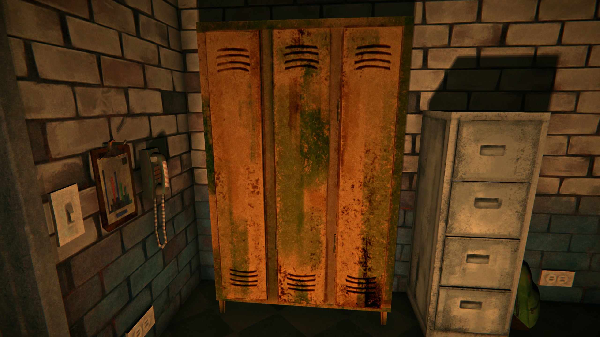
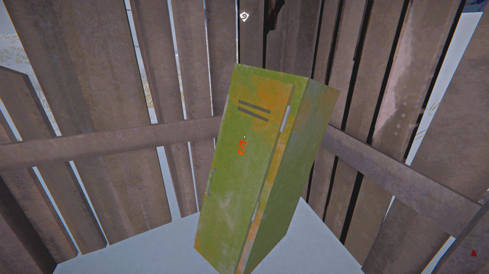
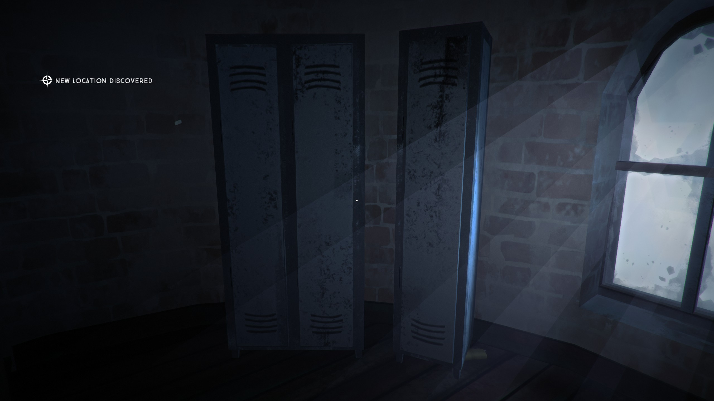

# Locker

**Categories:** Interactable Objects · **Source:** [Fandom](https://thelongdark.fandom.com/wiki/Locker)

**Locker**

| Property | Details |
| --- | --- |
| \[\[File: /  / _Single_ /  / _Double_ /  / _Triple_ /  / _Green_ | 250px\]\] |
|  / _Single_ |  / _Double_ /  / _Triple_ /  / _Green_ |
| Update | [0.00](./The%20Long%20Dark%20%E2%80%94%20Changelog.md#0.00) |
| Story item | Yes |
| **Container** |  |
| Capacity | 30.00 kg(66 lbs) |
| **Advanced data** |  |
| Object key | GAMEPLAY\_Locker |

A **Locker** can be found in many places in the game, generally industrial-like places, and serves as a container for storing items. Some Lockers are locked and require a [Prybar](./Prybar.md) to open. Lockers are one of the most common containers found in the game, along with the metal and plastic containers.

## Variants

There are 4 variants of lockers; Single, Double, and Triple Lockers, and a single Green Locker.

- An opened locker can be searched, for low to mid-tier loot.
- The locked locker requires a Prybar to open, and generally contains mid to high-tier loot.
- The [broken locker](./Metal%20Shelf.md) can be broken down by a [Hacksaw](./Hacksaw.md) for [Scrap Metal](./Scrap%20Metal.md), and cannot be searched.
- A green locker with a "5" painted onto the front can be found in forestry locations such as the [Trapper's Homestead](./Trapper%27s%20Homestead.md) and the [Old Spence Family Homestead](./Old%20Spence%20Family%20Homestead.md). These are often locked but have a chance to spawn opened.

Occasionally 5th type of locker, a [Medical Locker](./Medical%20Locker.md), can be found, and only contains [First Aid](./First%20Aid.md) supplies.

_Pre Alpha Lockers_

## Loot

|  | Item | Rarity |
| --- | --- | --- |
|  / _Arrowhead\_icon.png_ | [Arrowhead](./Arrowhead.md) | 0.413% |
|  / _Rifle\_Shell\_Casing\_icon.png_ | [Rifle Shell Casing](./Rifle%20Shell%20Casing.md) | 0.413% |
|  / _Cargo\_Pants\_icon.png_ | [Cargo Pants](./Cargo%20Pants.md) | 0.689% |
|  / _Combat\_Boots\_icon.png_ | [Combat Boots](./Combat%20Boots.md) | 0.689% |
|  / _Flare\_Shell\_icon.png_ | [Flare Shell](./Flare%20Shell.md) | 0.689% |
|  / _Replacement\_Fuse\_icon.png_ | [Replacement Fuse](./Replacement%20Fuse.md) | 0.689% |
|  / _Cured\_Leather\_icon.png_ | [Cured Leather](./Cured%20Leather.md) | 0.689% |
|  / _Line\_icon.png_ | [Line](./Line.md) | 0.689% |
|  / _Thermal\_Underwear\_icon.png_ | [Thermal Underwear](./Thermal%20Underwear.md) | 0.689% |
|  / _Wool\_Mittens\_icon.png_ | [Wool Mittens](./Wool%20Mittens.md) | 0.689% |
|  / _Stack\_of\_Papers\_icon.png_ | [Stack of Papers](./Stack%20of%20Papers.md) | 0.689% |
|  / _Simple\_Tools\_icon.png_ | [Simple Tools](./Simple%20Tools.md) | 0.689% |
|  / _Tinder\_Plug\_icon.png_ | [Tinder Plug](./Tinder%20Plug.md) | 0.689% |
|  / _Tomato\_Soup\_icon.png_ | [Tomato Soup](./Tomato%20Soup.md) | 0.689% |
|  / _Water\_(Potable)\_icon.png_ | [Water Bottle](./Water%20%28Potable%29.md) | 0.689% |
|  / _Wires\_icon.png_ | [Wires](./Wires.md) | 0.689% |
|  / _Work\_Pants\_icon.png_ | [Work Pants](./Work%20Pants.md) | 0.689% |
|  / _Accelerant\_icon.png_ | [Accelerant](./Accelerant.md) | 1.377% |
|  / _Wool\_Scarf\_icon.png_ | [Wool Scarf](./Wool%20Scarf.md) | 1.377% |
|  / _Marine\_Flare\_icon.png_ | [Marine Flare](./Marine%20Flare.md) | 1.377% |
|  / _Antiseptic\_icon.png_ | [Antiseptic](./Antiseptic.md) | 1.377% |
|  / _Painkillers\_icon.png_ | [Painkillers](./Painkillers.md) | 1.377% |
|  / _Chocolate\_Bar\_icon.png_ | [Candy Bar](./Chocolate%20Bar.md) | 1.377% |
|  / _Pork\_and\_Beans\_icon.png_ | [Pork and Beans](./Pork%20and%20Beans.md) | 1.377% |
|  / _Down\_Vest\_icon.png_ | [Down Vest](./Down%20Vest.md) | 1.377% |
|  / _Flare\_icon.png_ | [Flare](./Flare.md) | 1.377% |
|  / _Fleece\_Mittens\_icon.png_ | [Fleece Mittens](./Fleece%20Mittens.md) | 1.377% |
|  / _Revolver\_Cartridge\_icon.png_ | [Revolver Cartridge](./Revolver%20Ammunition.md) | 1.377% |
|  / _Summit\_Soda\_icon.png_ | [Summit Soda](./Summit%20Soda.md) | 1.377% |
|  / _Go!\_Energy\_Drink\_icon.png_ | [Go! Energy Drink](./Go!%20Energy%20Drink.md) | 1.377% |
|  / _Stacy's\_Grape\_Soda\_icon.png_ | [Stacy's Grape Soda](./Stacy%27s%20Grape%20Soda.md) | 1.377% |
|  / _Spray\_Paint\_icon.png_ | [Spray Paint](./Spray%20Paint.md) | 1.377% |
|  / _Wool\_Toque\_icon.png_ | [Wool Toque](./Wool%20Toque.md) | 1.377% |
|  / _Water\_Purification\_Tablets\_icon.png_ | [Water Purification Tablets](./Water%20Purification%20Tablets.md) | 1.377% |
|  / _Thin\_Wool\_Sweater\_icon.png_ | [Thin Wool Sweater](./Thin%20Wool%20Sweater.md) | 1.377% |
|  / _Work\_Boots\_icon.png_ | [Work Boots](./Work%20Boots.md) | 1.377% |
|  / _Work\_Gloves\_icon.png_ | [Work Gloves](./Work%20Gloves.md) | 1.377% |
|  / _Book\_icon.png_ | [Book](./Book.md) | 2.066% |
|  / _Book\_icon.png_ | [Book](./Book.md) | 2.066% |
|  / _Cloth\_icon.png_ | [Cloth](./Cloth.md) | 2.066% |
|  / _Cotton\_Scarf\_icon.png_ | [Cotton Scarf](./Cotton%20Scarf.md) | 2.066% |
|  / _Ketchup\_Chips\_icon.png_ | [Ketchup Chips](./Ketchup%20Chips.md) | 2.066% |
|  / _Lantern\_Fuel\_icon.png_ | [Lantern Fuel](./Lantern%20Fuel.md) | 2.066% |
|  / _Simple\_Parka\_icon.png_ | [Simple Parka](./Simple%20Parka.md) | 2.066% |
|  / _Newsprint\_Roll\_icon.png_ | [Newsprint Roll](./Newsprint%20Roll.md) | 2.066% |
|  / _Scrap\_Metal\_icon.png_ | [Scrap Metal](./Scrap%20Metal.md) | 2.066% |
|  / _Light\_Shell\_icon.png_ | [Light Shell](./Light%20Shell.md) | 2.066% |
|  / _Driving\_Gloves\_icon.png_ | [Driving Gloves](./Driving%20Gloves.md) | 2.755% |
|  / _Windbreaker\_icon.png_ | [Windbreaker](./Windbreaker.md) | 2.755% |
|  / _Cotton\_Toque\_icon.png_ | [Cotton Toque](./Cotton%20Toque.md) | 2.755% |
|  / _Hoodie\_icon.png_ | [Hoodie](./Hoodie.md) | 2.755% |
|  / _Sweatshirt\_icon.png_ | [Sweatshirt](./Sweatshirt.md) | 2.755% |
|  / _Sport\_Vest\_icon.png_ | [Sport Vest](./Sport%20Vest.md) | 2.755% |
|  / _Jeans\_icon.png_ | [Jeans](./Jeans.md) | 2.755% |
|  / _Newsprint\_icon.png_ | [Newsprint](./Newsprint.md) | 2.755% |
|  / _Plaid\_Shirt\_icon.png_ | [Plaid Shirt](./Plaid%20Shirt.md) | 2.755% |
|  / _T-Shirt\_icon.png_ | [T-Shirt](./T-Shirt.md) | 2.755% |
|  / _Wood\_Matches\_icon.png_ | [Wood Matches](./Wood%20Matches.md) | 2.755% |
|  / _Trail\_Boots\_icon.png_ | [Trail Boots](./Trail%20Boots.md) | 3.444% |
|  / _Running\_Shoes\_icon.png_ | [Running Shoes](./Running%20Shoes.md) | 3.444% |
|  / _Leather\_Shoes\_icon.png_ | [Leather Shoes](./Leather%20Shoes.md) | 3.444% |
