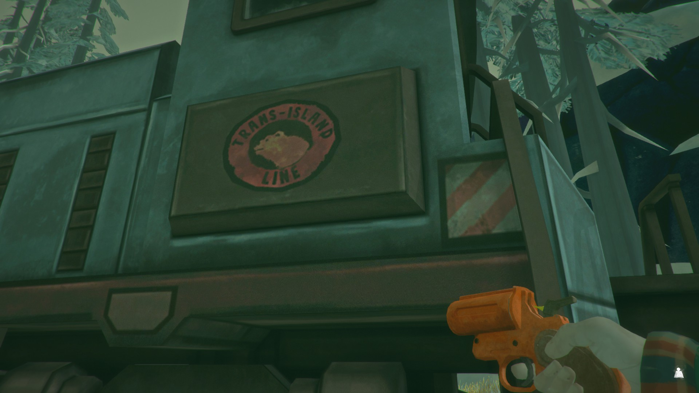
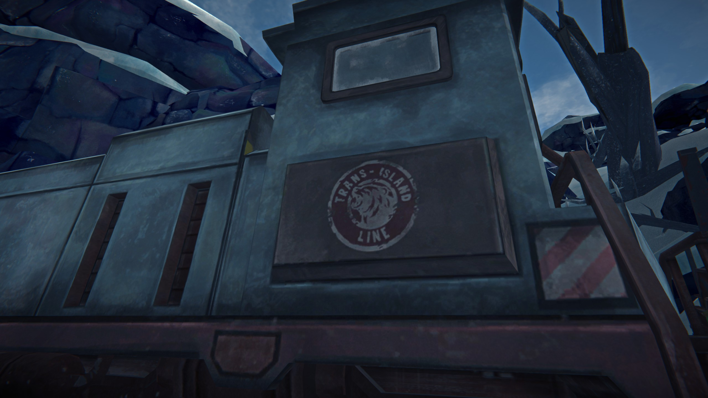

# Locomotive Engine

**Categories:** Landmarks, Locations, Locations in Broken Railroad, Outdoor locations · **Source:** [Fandom](https://thelongdark.fandom.com/wiki/Locomotive_Engine)

**Locomotive Engine**

[Locomotive engine](../assets/Locomotive_engine.jpg)

**Location**

[Locomotive Engine Location](../assets/Locomotive_Engine_Location.png)

**Region:** [Broken Railroad](./Broken%20Railroad.md)

**Description:** A derailed train

**General**

**Type:** Landmark

## Trivia

- The locomotive engine is modeled after a combination of the EMD SW1200 and ALCo S-2.
  - The general shape more closely resembles the EMD, but the hood shape is reminiscent of an ALCo.
- It is unusual to use switcher type engines in road freight service (such as on the mainline of Great Bear). More usually, road switcher locos, such as a GP9 or GP38, would be used on a shortline such as the [Trans-Island Railway Line](./Trans-Island%20Railway%20Line.md).

## Gallery

