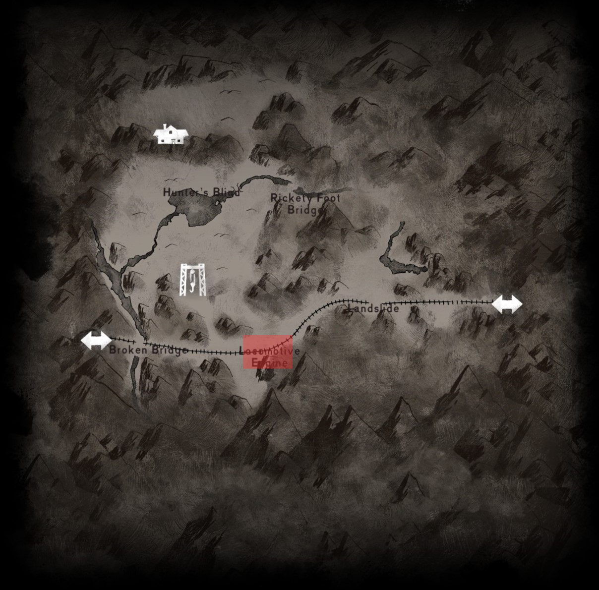

# Locomotive Engine

**Categories:** Landmarks, Locations, Locations in Broken Railroad, Outdoor locations · **Source:** [Fandom](https://thelongdark.fandom.com/wiki/Locomotive_Engine)

**Locomotive Engine**

| Property | Details |
| --- | --- |
|  |  / _locomotive\_engine.jpg_ |
| **Location** |  |
|  |  / _Locomotive\_Engine\_Location.png_ |
| Region | [Broken Railroad](./Broken%20Railroad.md)\|- |
| Description | A derailed train |
| **General** |  |
| Type | Landmark\|- |
