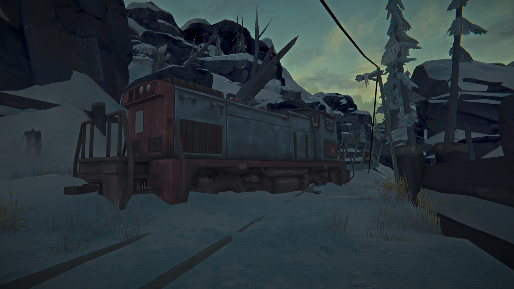

# Locomotive Engine

**Locomotive Engine**

| Property | Details |
| --- | --- |
|  |  / *locomotive\_engine.jpg* |
| **Location** |  |
|  |  / *Locomotive\_Engine\_Location.png* |
| Region | [Broken Railroad](./Broken%20Railroad.md)\|- |
| Description | A derailed train |
| **General** |  |
| Type | Landmark\|- |
