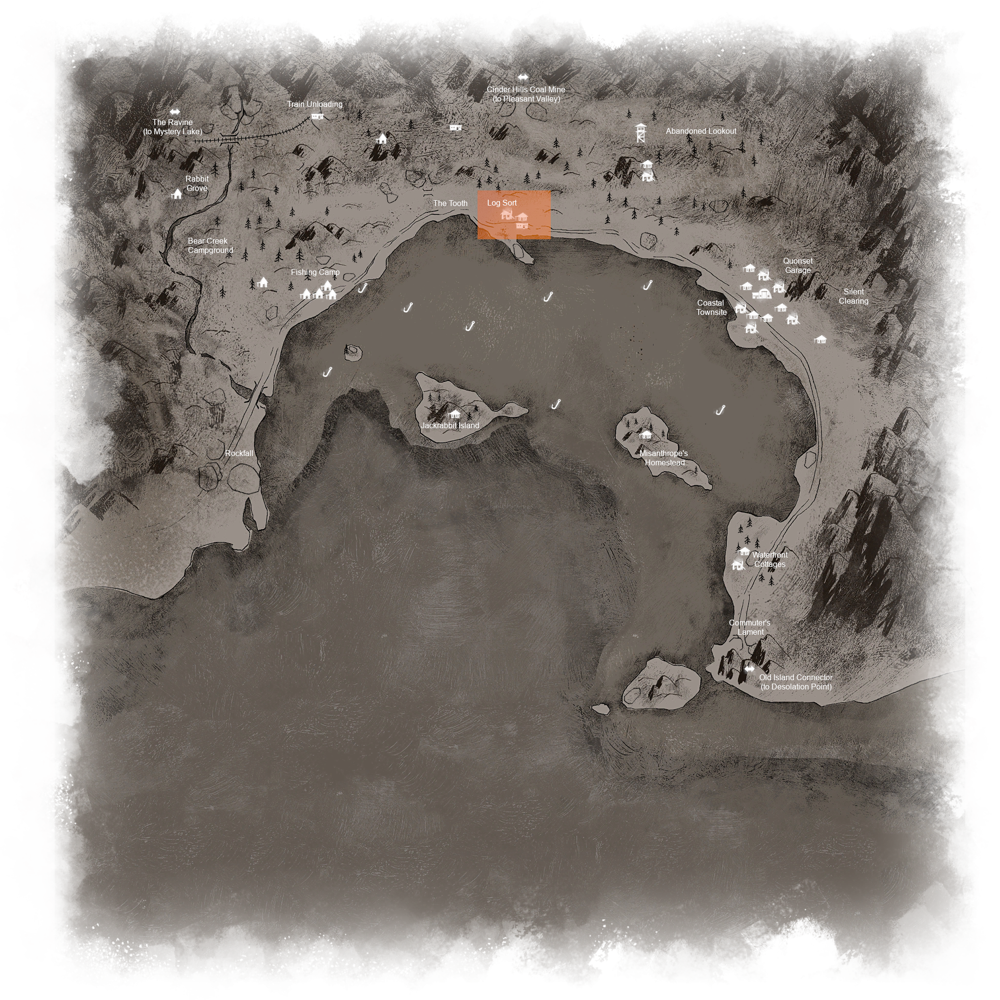

# Log Sort

<table class="infobox">
<caption>Log Sort</caption>
<colgroup>
<col style="width: 33%" />
<col style="width: 33%" />
<col style="width: 33%" />
</colgroup>
<tbody>
<tr>
<td colspan="2">
[[File:

<table class="gallery">
<colgroup>
<col style="width: 100%" />
</colgroup>
<tbody>
<tr>
<td><figure>
[Missing image: Log_Sort_-_double-story_house.jpg]
<figcaption>Log_Sort_-_double-story_house.jpg</figcaption>
</figure></td>
</tr>
</tbody>
</table></td>
<td>
250px]]
</td>
</tr>
<tr>
<td colspan="2">
<strong>Location</strong>
</td>
<td></td>
</tr>
<tr>
<td colspan="2"><figure>

<figcaption>Log_Sort_map.png</figcaption>
</figure></td>
<td></td>
</tr>
<tr>
<td>
Region
</td>
<td>
<a href="./Coastal%20Highway.md" class="wikilink" title="Coastal Highway">Coastal Highway</a>|-
</td>
<td>
Location
</td>
</tr>
<tr>
<td>
Description
</td>
<td>
A few buildings
</td>
<td></td>
</tr>
<tr>
<td colspan="2">
<strong>General</strong>
</td>
<td></td>
</tr>
<tr>
<td>
Type
</td>
<td>
Residential|-
</td>
<td><figure>

<figcaption>bed_icon.png</figcaption>
</figure></td>
</tr>
<tr>
<td></td>
<td>
Has an interior|} <strong>Log Sort</strong> is a location by the coast in <a href="./Coastal%20Highway.md" class="wikilink" title="Coastal Highway">Coastal Highway</a>.

<h2 id="Overview">Overview</h2>

The Log Sort is located between <a href="./Fishing%20Camp.md" class="wikilink" title="Fishing Camp">Fishing Camp</a> and <a href="./Coastal%20Townsite.md" class="wikilink" title="Coastal Townsite">Coastal Townsite</a>. A two-story house serves as a suitable <a href="./Safehouse.md" class="wikilink" title="safe house">safe house</a> for the player. There is also a trailer that contains beds with different warmth bonuses.

The Log Sort is clearly defined by the tree logs that surround it.

There is an entrance to the <a href="./Cinder%20Hills%20Coal%20Mine.md" class="wikilink" title="Abandoned Mine">Abandoned Mine</a> near the road, north of the Log Sort.

<h2 id="Gallery">Gallery</h2>
<table class="gallery">
<colgroup>
<col style="width: 33%" />
<col style="width: 33%" />
<col style="width: 33%" />
</colgroup>
<tbody>
<tr>
<td><figure>
[Missing image: Log_Sort_-_trailer.jpg]
<figcaption>Trailer</figcaption>
</figure></td>
<td><figure>
[Missing image: Log_Sort_-_fortified_house.jpg]
<figcaption>Condemned house</figcaption>
</figure></td>
<td><figure>
[Missing image: 20180119115447_1.jpg]
<figcaption>The <strong>Log Sort</strong> area, from above</figcaption>
</figure></td>
</tr>
</tbody>
</table>

<strong>Lua execution error in Module:Navbox function navbox</strong> <a href="es:Zona_de_troncos" class="wikilink" title="es:Zona de troncos">es:Zona de troncos</a> <a href="ru:%D0%A1%D0%BA%D0%BB%D0%B0%D0%B4_%D0%B1%D1%80%D1%91%D0%B2%D0%B5%D0%BD" class="wikilink" title="ru:Склад брёвен">ru:Склад брёвен</a>
</td>
<td></td>
</tr>
</tbody>
</table>

