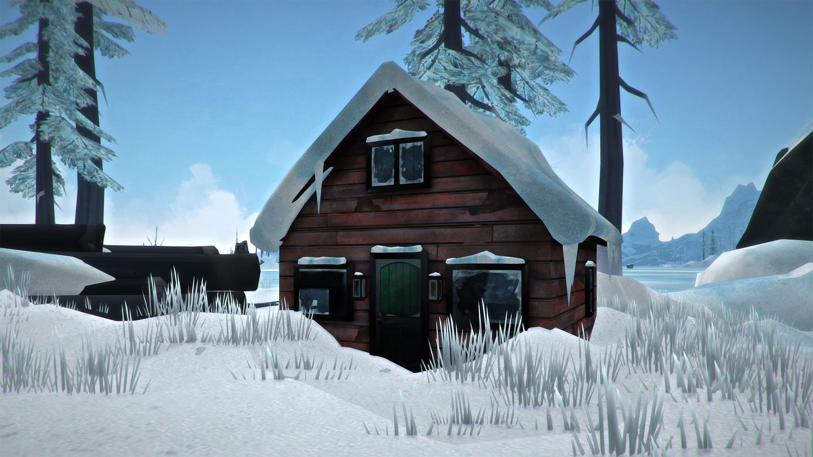
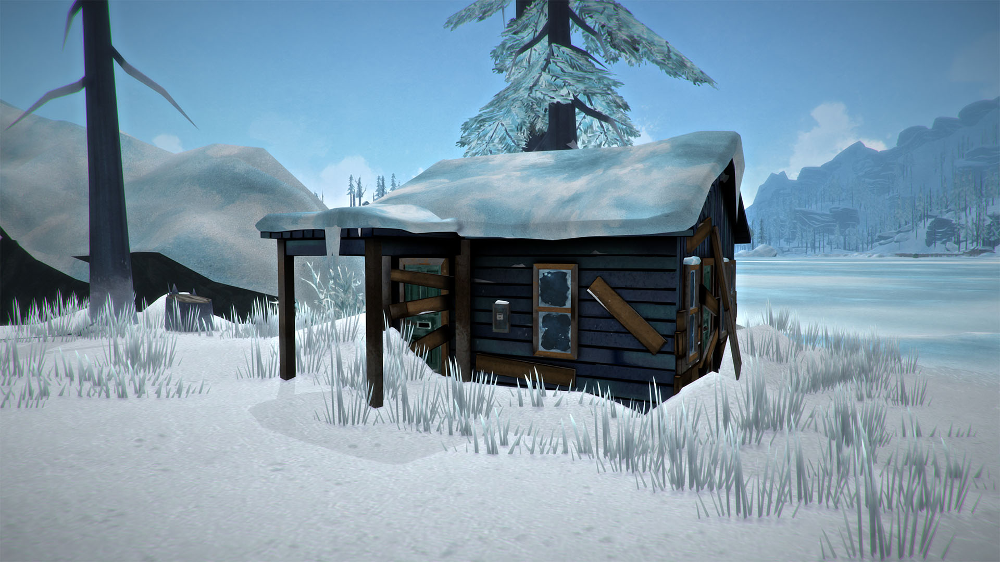
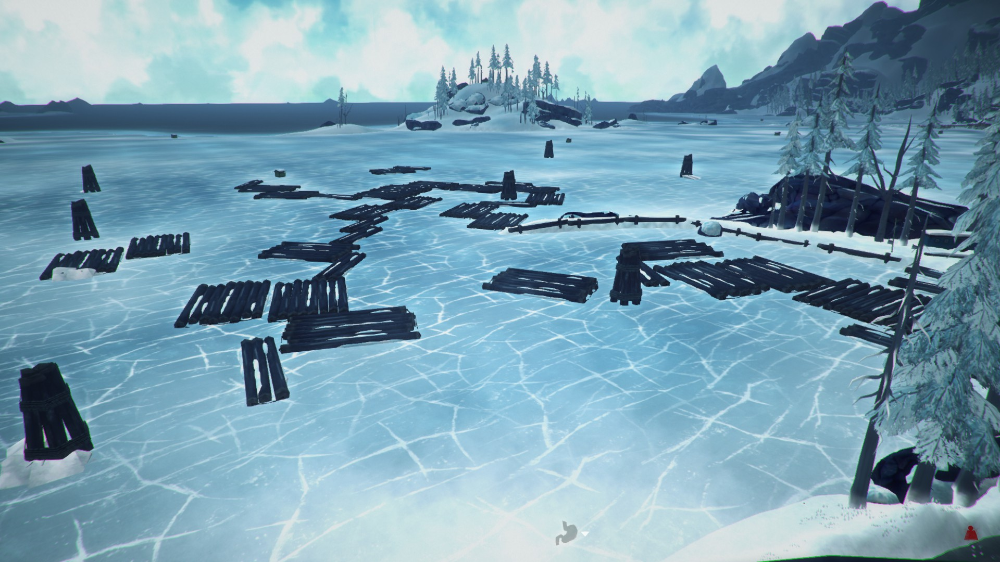

# Log Sort

**Categories:** Indoor locations, Locations, Locations in Coastal Highway, Residential locations · **Source:** [Fandom](https://thelongdark.fandom.com/wiki/Log_Sort)

**Log Sort**

\[\[File:

250px\]\]

**Location**

Region

[Coastal Highway](./Coastal%20Highway.md)|-

Location

Description

A few buildings

**General**

Type

Residential|-

Has an interior **Log Sort** is a location by the coast in [Coastal Highway](./Coastal%20Highway.md).

<!-- #Overview -->
​

<!-- #overview -->
## Overview

The Log Sort is located between [Fishing Camp](./Fishing%20Camp.md) and [Coastal Townsite](./Coastal%20Townsite.md). A two-story house serves as a suitable [safe house](./Safehouse.md) for the player. There is also a trailer that contains beds with different warmth bonuses.

The Log Sort is clearly defined by the tree logs that surround it.

There is an entrance to the [Abandoned Mine](./Cinder%20Hills%20Coal%20Mine.md) near the road, north of the Log Sort.

<!-- #Gallery -->
​

<!-- #gallery -->
## Gallery

_The **Log Sort** area, from above_
