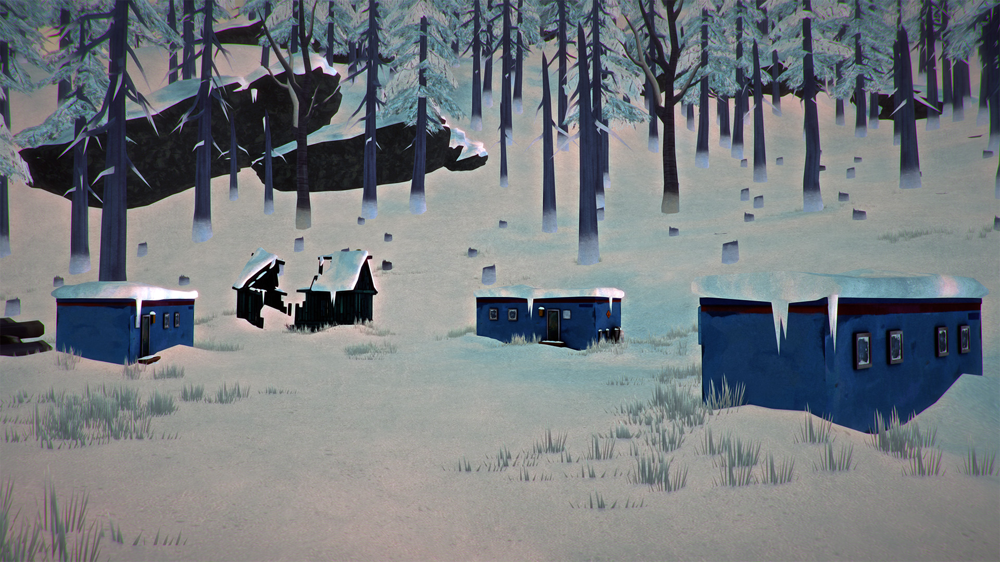
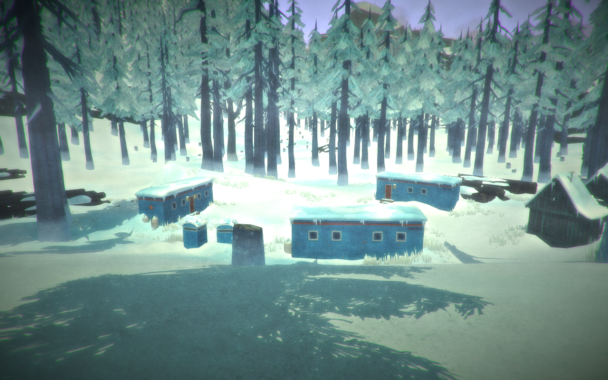

# Logging Camp

**Logging Camp**

| Property | Details |
| --- | --- |
|  |  / *Logging\_camp\_01.jpg* |
| **Location** |  |
|  |  / *Logging\_Camp\_Location.png* |
| Region | [Mystery Lake](./Mystery%20Lake%20%28region%29.md)\|- |
| Type | Residential\|- |
|  / *forge\_icon\_green.png* |  |
|  / *workbench\_icon\_green.png* |  |
|  | Has an interior\|} The**Logging Camp** is a collection of several small trailers, presumably to shelter the loggers who once worked in the nearby [Clearcut](./Clearcut.md) in [Mystery Lake](./Mystery%20Lake%20%28region%29.md). / ## Overview / The camp consists of three small, temporary prefabricated trailer structures and a ruined building. / There is a possible starting point on a hill south of the camp, near the cut trees. / Valuable supplies can be scavenged from inside the camp, including warm clothes, food, many items that can be scrapped for cloth, and a [Storm Lantern](./Storm%20Lantern.md). All the trailers have [bunk beds](./Bed.md). The ruined building may have a [hatchet](./Hatchet.md), a [frozen corpse](./Frozen%20Corpse.md), firewood, and a [wood stove](./Wood%20Stove.md). / The camp may make a fine temporary base, as it has many beds and access to plenty of firewood in the vicinity. However, there is no [work bench](./Work%20Bench.md), and only a small stove is available in the dilapidated building. The player must also be wary of [wolves](./Wolf.md) lurking nearby. / ## Gallery / \| Column 1 \| / \| --- \| / \|  / *An alternative view of the logging camp.* \| / **Lua execution error in Module:Navbox function navbox** |
|  |  / *An alternative view of the logging camp.* |
