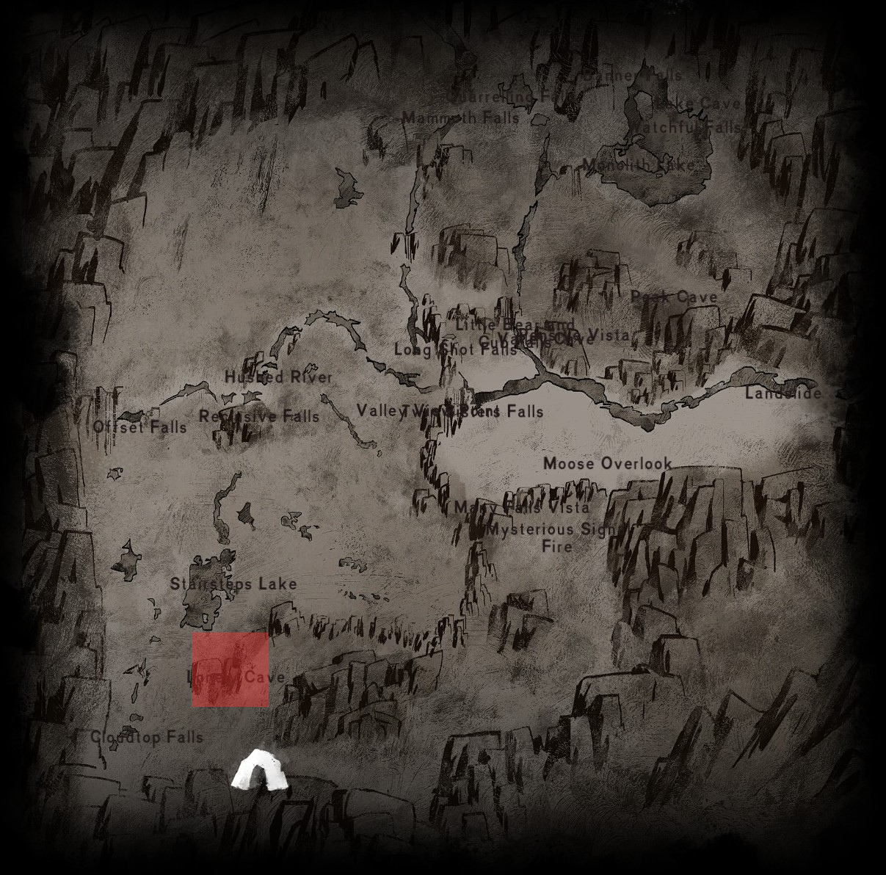

# Lonely Cave

**Lonely Cave**

| Property | Details |
| --- | --- |
|  |  / *LonelyCave.png* |
| **Location** |  |
|  |  / *Lonely\_Cave\_Location.png* |
| Region | [Hushed River Valley](./Hushed%20River%20Valley.md)\|- |
| Description | A small, isolated cave. |
| **General** |  |
| Type | Cave\|- |
