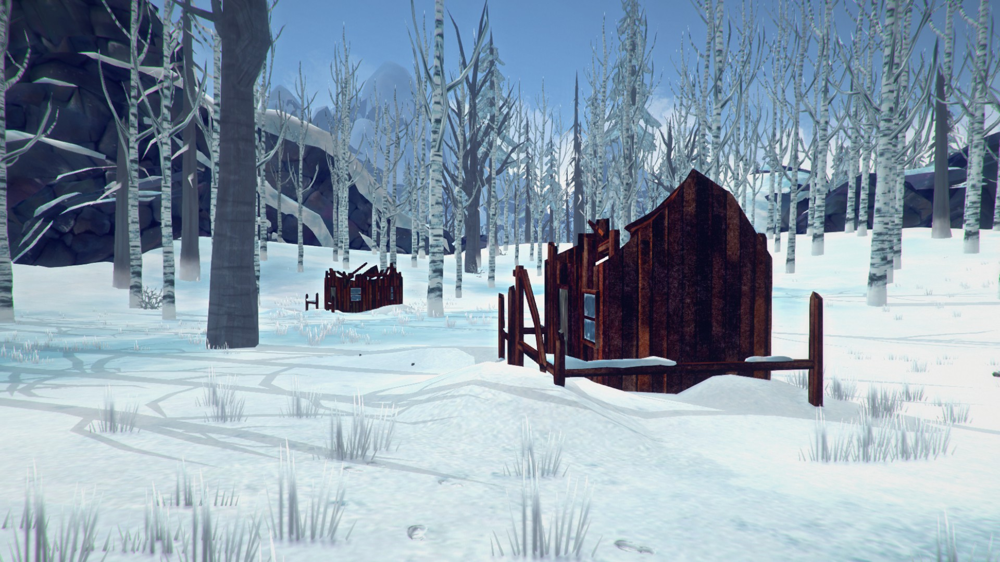
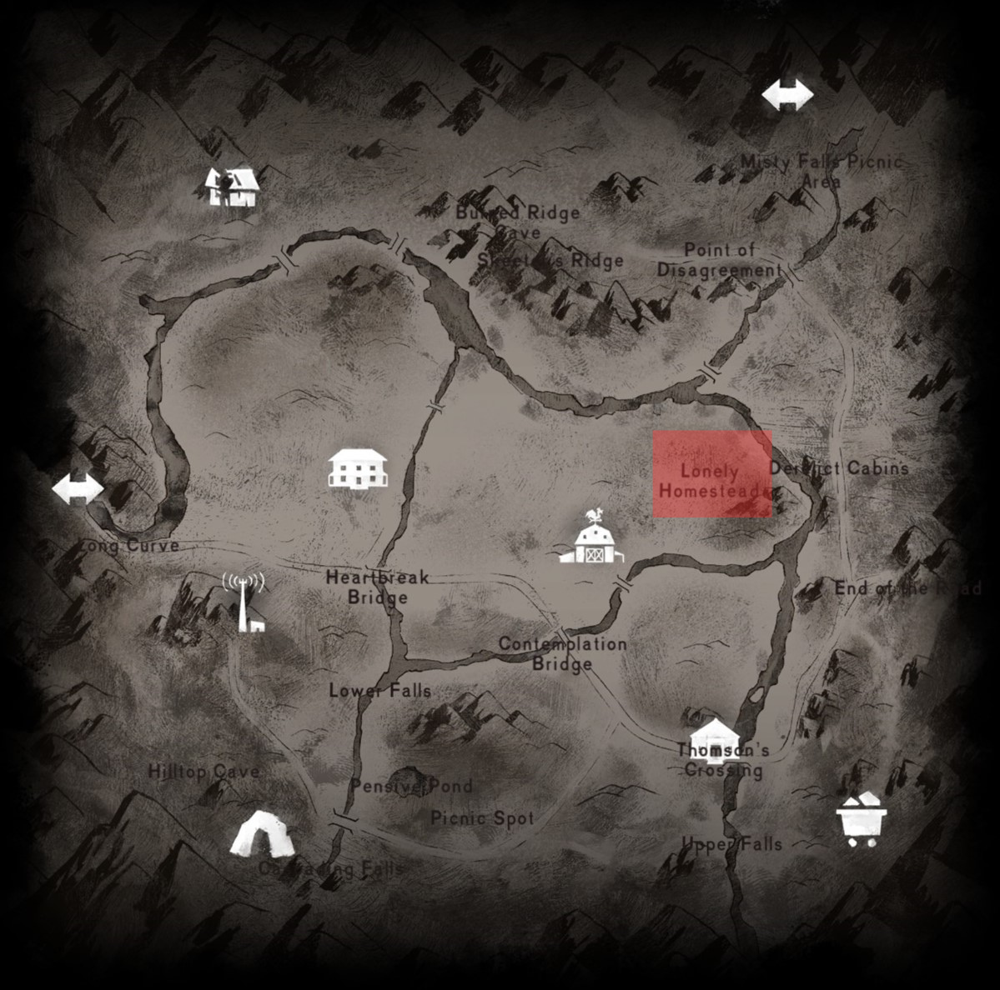
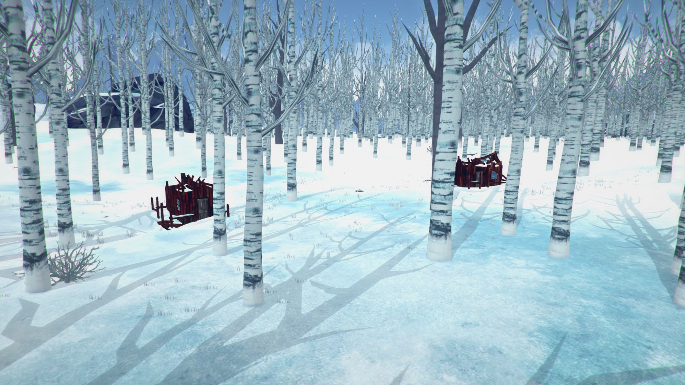
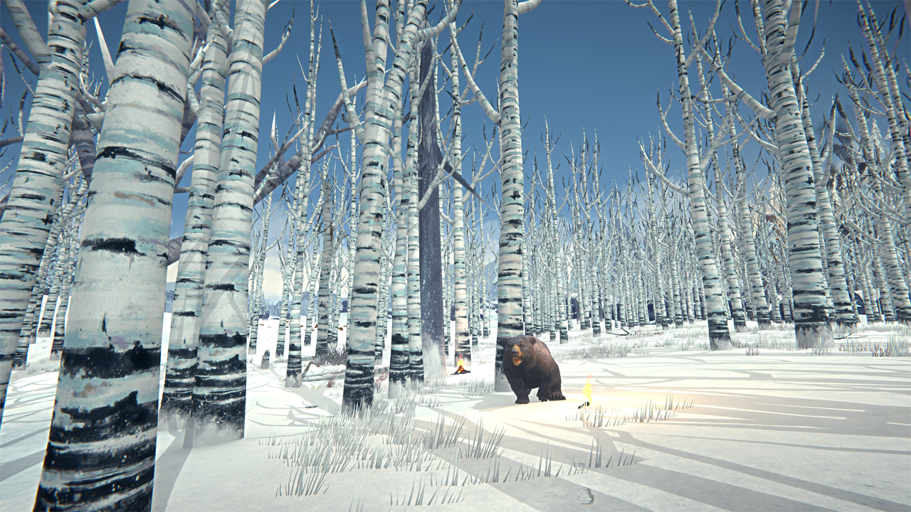

# Lonely Homestead

**Categories:** Locations, Locations in Pleasant Valley, Outdoor locations · **Source:** [Fandom](https://thelongdark.fandom.com/wiki/Lonely_Homestead)

**Lonely Homestead**

_Lonely\_Homestead.jpg_

**Location**

_Lonely\_Homestead\_Location.png_

**Region:** [Pleasant Valley](./Pleasant%20Valley.md)

**General**

**Type:** Outdoors

## Overview

Lonely Homestead lies to the northeast of [Pleasant Valley Outbuildings](./Pleasant%20Valley%20Outbuildings.md). The player can't enter into the burnt cabins, however several [frozen corpses](./Frozen%20Corpse.md) may be found in the snow with some loot scattered about the area.

The surrounding woods are also populous with [birch bark](./Birch%20Bark.md) from fallen birch trees as [Green Birch Saplings](./Green%20Birch%20Sapling.md). It's not rare to find a [moose](./Moose.md) around there.

A [Bear](./Bear.md) often patrols the forest, so watch out.

## Gallery

_Lonely\_Homestead2.jpg_

_The bear in the nearby forest_
