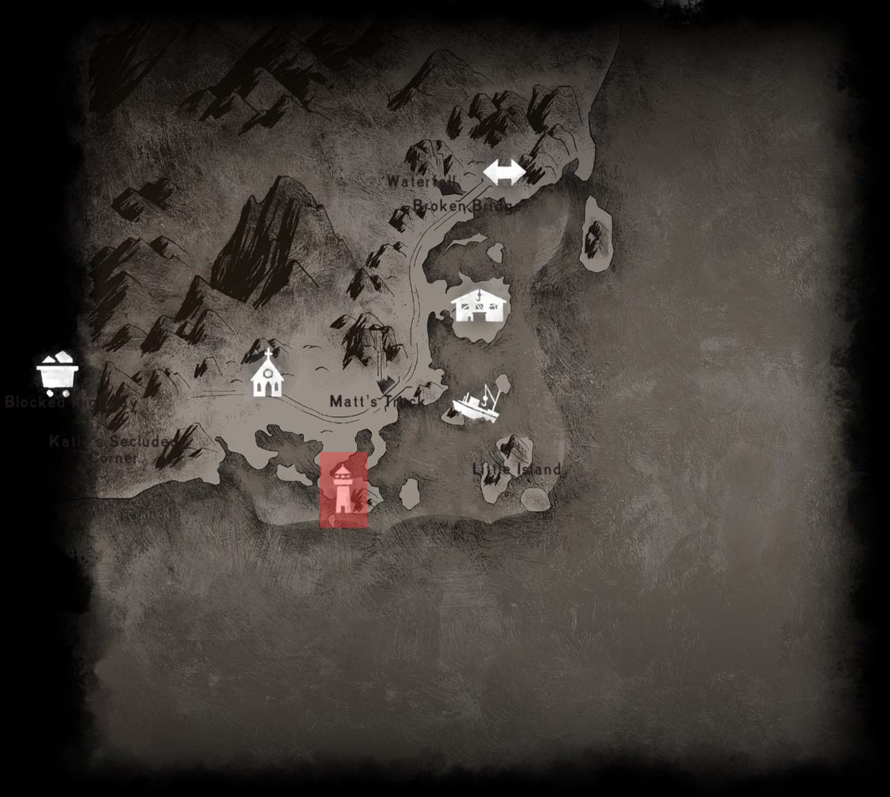
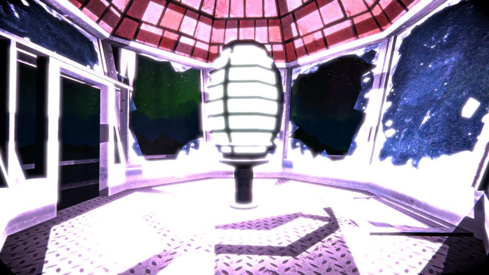
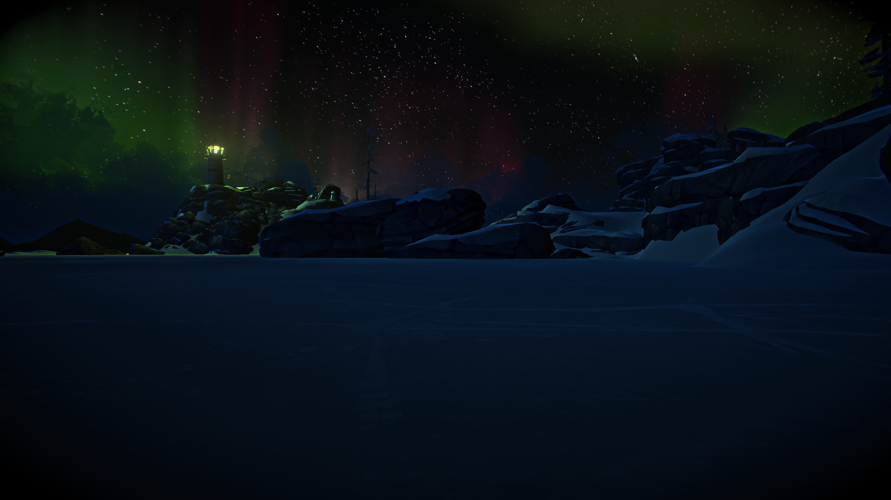

# Lonely Lighthouse

**Categories:** Indoor locations, Islands, Locations, Locations in Desolation Point, Residential locations · **Source:** [Fandom](https://thelongdark.fandom.com/wiki/Lonely_Lighthouse)

**Contents**

- [Overview](#overview)
- [Use as a base](#use-as-a-base)
- [Interior](#interior)
- [Gallery](#gallery)

**Lonely Lighthouse**

\[\[File: /  / _Exterior_ /  / _Interior_

250px\]\]

_Exterior_

_Interior_

**Location**

_Lonely\_Lighthouse\_Location.png_

Region

[Desolation Point](./Desolation%20Point.md)\|-

Location

**General**

Type

Residential\|-

Firebox

_bed\_icon.png_

Has a bed

_Lonely Lighthouse_

_A view from the top of the lighthouse_

_The Lighthouse during an aurora._

_Looking northeast towards [Hibernia Processing](./Hibernia%20Processing.md) and [The Riken](./The%20Riken.md)._

_The lighthouse lit during the aurora._
