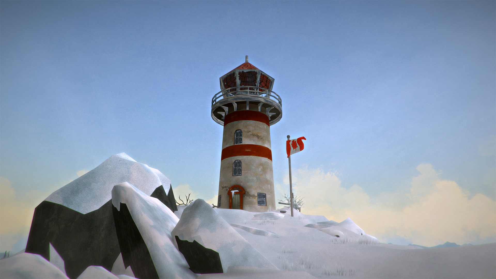

# Lonely Lighthouse

**Categories:** Indoor locations, Islands, Locations, Locations in Desolation Point, Residential locations · **Source:** [Fandom](https://thelongdark.fandom.com/wiki/Lonely_Lighthouse)

**Contents**

- [Overview](#overview)
- [Use as a base](#use-as-a-base)
- [Interior](#interior)
- [Gallery](#gallery)

**Lonely Lighthouse**

\[\[File: /  / _Exterior_ /  / _Interior_

250px\]\]

**Location**

_Lonely\_Lighthouse\_Location.png_

Region

[Desolation Point](./Desolation%20Point.md)

Location

**General**

Type

Residential

Firebox

_bed\_icon.png_

Has a bed
