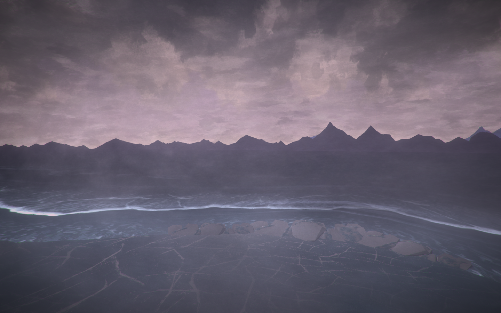
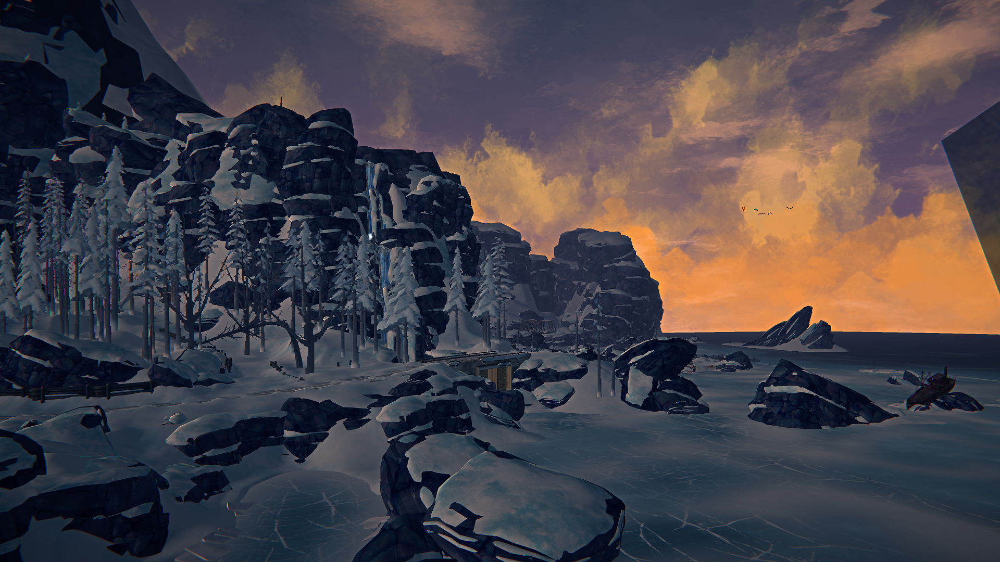

# Lonely Lighthouse

**Contents**

- [Overview](#Overview)
- [Use as a base](#Use_as_a_base)
- [Interior](#Interior)
- [Gallery](#Gallery)

<table class="infobox">
<caption>Lonely Lighthouse</caption>
<colgroup>
<col style="width: 33%" />
<col style="width: 33%" />
<col style="width: 33%" />
</colgroup>
<tbody>
<tr>
<td colspan="2">
[[File:

<table class="gallery">
<colgroup>
<col style="width: 50%" />
<col style="width: 50%" />
</colgroup>
<tbody>
<tr>
<th><figure>
[Missing image: Lonely_Lighthouse.jpg]
<figcaption>Exterior</figcaption>
</figure></th>
<td><figure>
[Missing image: Lonely_Lighthouse_interior.jpg]
<figcaption>Interior</figcaption>
</figure></td>
</tr>
</tbody>
</table></td>
<td>
250px]]
</td>
</tr>
<tr>
<td colspan="2">
<strong>Location</strong>
</td>
<td></td>
</tr>
<tr>
<td colspan="2"><figure>
[Missing image: Lonely_Lighthouse_Location.png]
<figcaption>Lonely_Lighthouse_Location.png</figcaption>
</figure></td>
<td></td>
</tr>
<tr>
<td>
Region
</td>
<td>
<a href="./Desolation%20Point.md" class="wikilink" title="Desolation Point">Desolation Point</a>|-
</td>
<td>
Location
</td>
</tr>
<tr>
<td colspan="2">
<strong>General</strong>
</td>
<td></td>
</tr>
<tr>
<td>
Type
</td>
<td>
Residential|-
</td>
<td>
Firebox
</td>
</tr>
<tr>
<td><figure>

<figcaption>bed_icon.png</figcaption>
</figure></td>
<td>
Has a bed
</td>
<td></td>
</tr>
<tr>
<td></td>
<td>
Has an interior|}

<strong>Lonely Lighthouse</strong> is a location in <a href="./Desolation%20Point.md" class="wikilink" title="Desolation Point">Desolation Point</a>.

<h2 id="Overview">Overview</h2>

The <strong>Lonely Lighthouse</strong> is a red-striped white tower that both provides visibility of surrounding landscapes and serves as an easily spotted landmark.

The lighthouse is accessible from the road by crossing two wooden footbridges, which lead to the small, jagged island on which the lighthouse rests. The little island may feature some medicinal plants, but the base and surrounding areas are mostly barren and are often patrolled by wolves. A <a href="./Frozen%20Corpse.md" class="wikilink" title="frozen corpse">frozen corpse</a> may be found on a nearby cliff face, and a decent amount of supplies can be looted from inside the lighthouse.

The frozen harbor area to the east features little of note except several rowboats on the shore, which may contain loot within or near them. The area around the boats is also patrolled by one or two <a href="./Wolf.md" class="wikilink" title="wolves">wolves</a> and sometimes <a href="./Deer.md" class="wikilink" title="deer">deer</a> and/or their carcasses can be seen to the west.

<h3 id="Use_as_a_base">Use as a base</h3>

The lighthouse can be used as a <a href="./Safehouse.md" class="wikilink" title="Safe House">Safe House</a> for the player, as it has a <a href="./Bed.md" class="wikilink" title="bed">bed</a> and a <a href="./Pot%20Belly%20Stove.md" class="wikilink" title="Pot Belly Stove">Pot Belly Stove</a>, and is not too far away from <a href="./The%20Riken.md" class="wikilink" title="The Riken&#39;s">The Riken's</a> <a href="./Forge.md" class="wikilink" title="forge">forge</a>. However, unlike <a href="./Hibernia%20Processing.md" class="wikilink" title="Hibernia Processing">Hibernia Processing</a> a short walk to the north, it contains no workbench. Rabbits can be found not too far away at the <a href="./Stone%20Church.md" class="wikilink" title="Stone Church">Stone Church</a> or <a href="./Little%20Island.md" class="wikilink" title="Little Island">Little Island</a>, and deer can be found at Little Island or a short walk west of the lighthouse. The major disadvantage of living here, however, is that <a href="./Wolf.md" class="wikilink" title="wolves">wolves</a> frequently spawn near the intersection of the road leading to the lighthouse from the main highway, making entering or leaving difficult. This is especially true if the player is carrying fresh meat back home.

<h2 id="Interior">Interior</h2>

The Lighthouse has four floors and a catwalk. The ground floor is a small room with a decent amount of storage, a computer, and a pot belly stove. There is a bed on the second floor, and a radio. The third floor includes three lockers, a metal container, and some wooden boxes and pallets. The fourth floor provides access to the roof hatch, as well as containing the drive mechanism (uninteractable, but mentioned in a buffer memory on the computer downstairs). The top part of the lighthouse consists of the lantern room and surrounding metal catwalk (called a gallery).

The top is considered outside, and the player will go through a loading screen whenever passing through the hatch. The lamp in the lantern room is not interactable, but will light up during an aurora, providing an enormous amount of light and illuminating everything in a radius as far as <a href="./The%20Riken.md" class="wikilink" title="The Riken">The Riken</a>.

Depending on the difficulty, on the catwalk you may find a few <a href="./Rifle%20Ammunition.md" class="wikilink" title="rifle rounds">rifle rounds</a>, and, in clear weather, you get an outstanding view of the road, the surrounding sea, <a href="./Abandoned%20Mine%20No.%205.md" class="wikilink" title="Abandoned Mine No. 5">Abandoned Mine No. 5</a>, part of the <a href="./Stone%20Church.md" class="wikilink" title="Stone Church">Stone Church</a> and <a href="./Hibernia%20Processing.md" class="wikilink" title="Hibernia Processing">Hibernia Processing</a>.

<h2 id="Gallery">Gallery</h2>
<table class="gallery">
<colgroup>
<col style="width: 25%" />
<col style="width: 25%" />
<col style="width: 25%" />
<col style="width: 25%" />
</colgroup>
<tbody>
<tr>
<td><figure>
[Missing image: lonely_lighthouse.jpg]
<figcaption>Lonely Lighthouse</figcaption>
</figure></td>
<td><figure>

<figcaption>A view from the top of the lighthouse</figcaption>
</figure></td>
<td><figure>
[Missing image: screen_ab517721-7f34-4ffe-8af6-1d08c5126dc9_hi.jpg]
<figcaption>The Lighthouse during an aurora.</figcaption>
</figure></td>
<td><figure>

<figcaption>Looking northeast towards <a href="./Hibernia%20Processing.md" class="wikilink" title="Hibernia Processing">Hibernia Processing</a> and <a href="./The%20Riken.md" class="wikilink" title="The Riken">The Riken</a>.</figcaption>
</figure></td>
</tr>
<tr>
<td><figure>

<figcaption>The lighthouse lit during the aurora.</figcaption>
</figure></td>
<td></td>
<td></td>
<td></td>
</tr>
</tbody>
</table>

<strong>Lua execution error in Module:Navbox function navbox</strong>

<a href="ru:%D0%9C%D0%B0%D1%8F%D0%BA" class="wikilink" title="ru:Маяк">ru:Маяк</a>
</td>
<td></td>
</tr>
</tbody>
</table>

