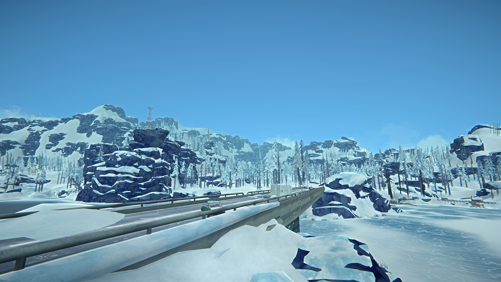
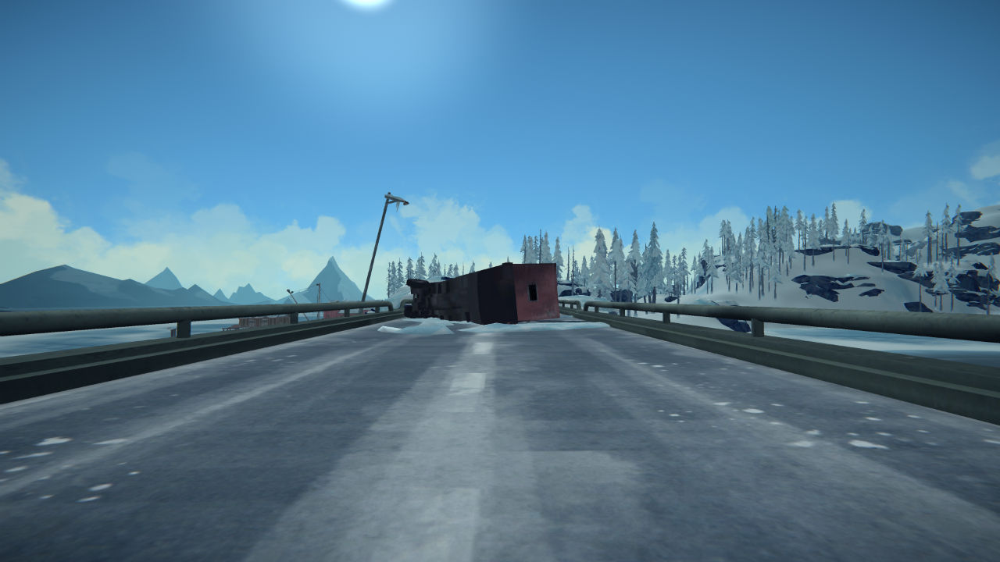
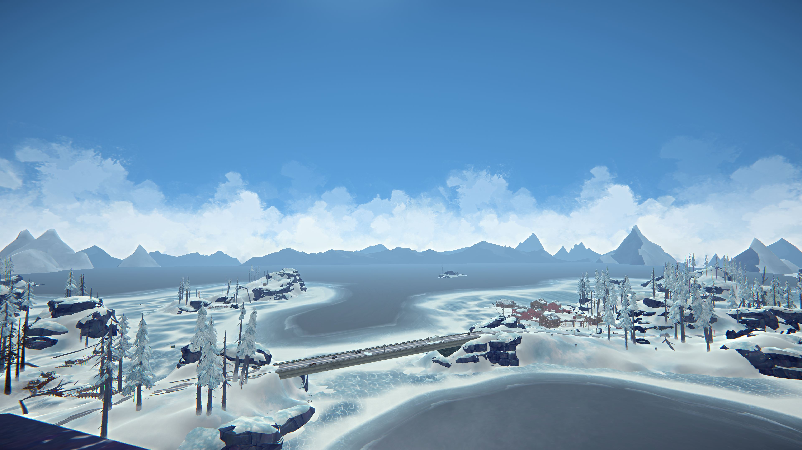

# Long Bridge

**Categories:** Locations, Locations in Bleak Inlet, Sheltered locations · **Source:** [Fandom](https://thelongdark.fandom.com/wiki/Long_Bridge)

**Long Bridge**

_Screen\_ff04f5c7-2496-4839-b372-ddcf19507a70\_hi.jpg_

**Location**

_Long\_Bridge\_Location.png_

**Region:** [Bleak Inlet](./Bleak%20Inlet.md)

**Description:** The long bridge connecting both sides of the region

**General**

_A view of the long bridge from the western side_

_A view of the long bridge from the eastern side_

_The fallen truck on the bridge_

_View from the radio tower._
