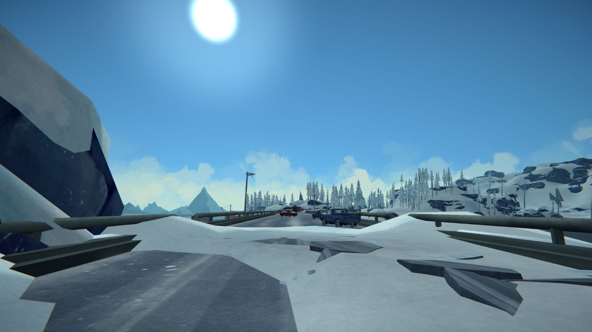
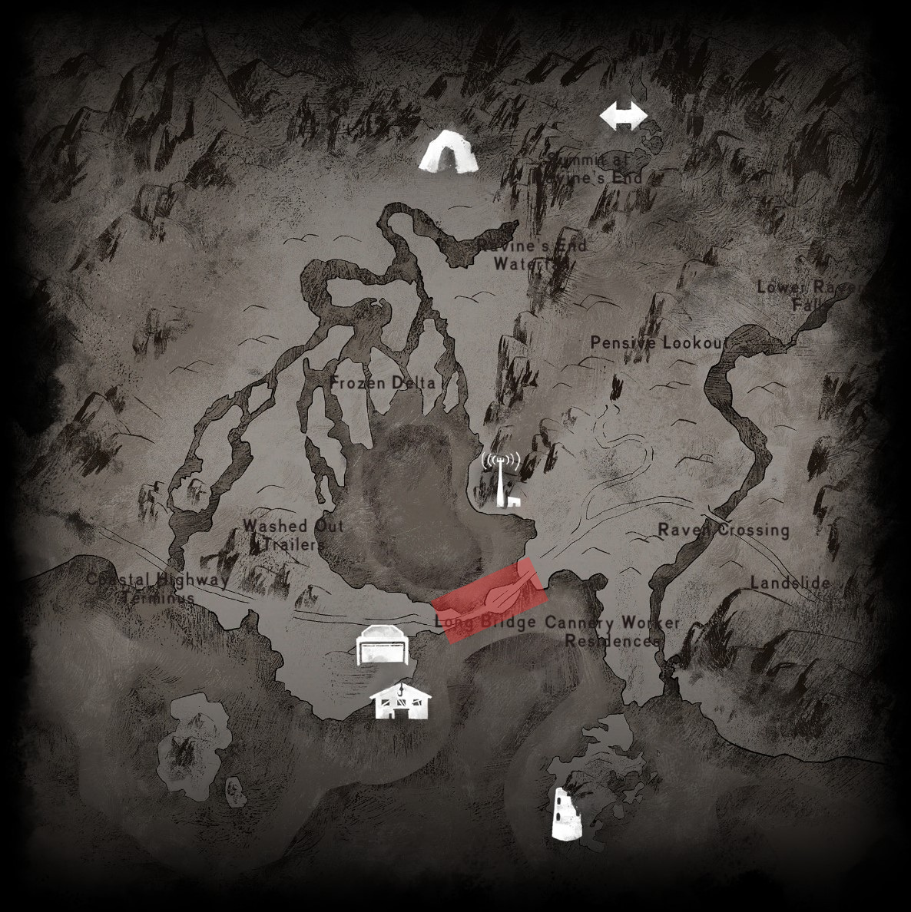

# Long Bridge

**Categories:** Locations, Locations in Bleak Inlet, Sheltered locations · **Source:** [Fandom](https://thelongdark.fandom.com/wiki/Long_Bridge)

**Long Bridge**

_Screen\_ff04f5c7-2496-4839-b372-ddcf19507a70\_hi.jpg_

**Location**

_Long\_Bridge\_Location.png_

**Region:** [Bleak Inlet](./Bleak%20Inlet.md)

**Description:** The long bridge connecting both sides of the region

**General**

Provides some shelter **Long Bridge** is a highway bridge that connects both sides of the region safely. It is lined by several broken down vehicles and an overturned semi truck trailer. While offering limited protection from the cold, the vehicles can offer temporary emergency shelter.

## Overview

Although the player could walk under the bridge, the safest way is to walk over it to avoid thin ice. The western end connects near the [Last Resort Cannery](./Last%20Resort%20Cannery.md) and the east end connects near the [Cannery worker residences](./Cannery%20Worker%20Residences.md). Some cars and a fallen truck sit on the bridge, providing shelter, loot and a good supply of [Car Batteries](./Car%20Battery.md). The bridge can be spotted from the [Echo One Radio Tower](./Echo%20One%20Radio%20Tower.md) very clearly.

_A view of the long bridge from the western side_

_A view of the long bridge from the eastern side_

_The fallen truck on the bridge_

_View from the radio tower._
