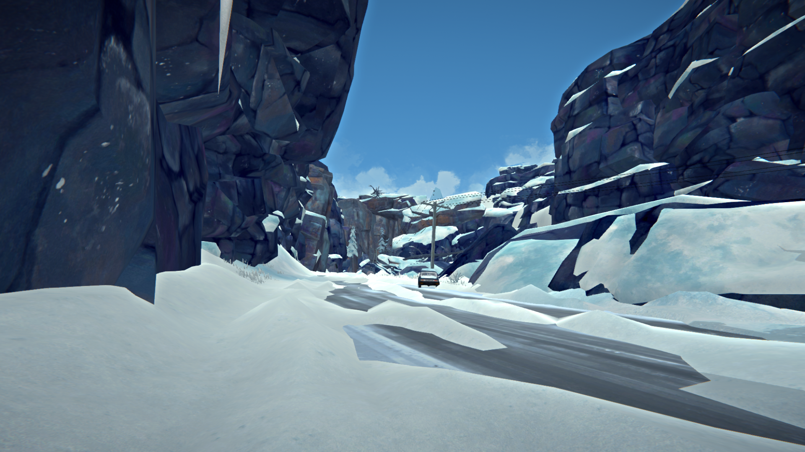
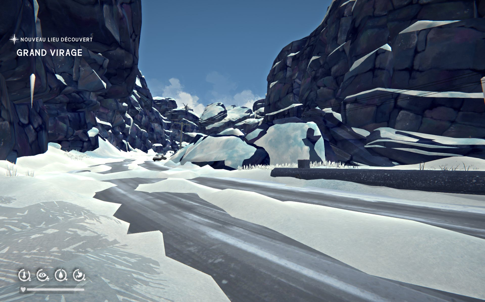

# Long Curve

**Categories:** Landmarks, Locations, Locations in Pleasant Valley, Outdoor locations · **Source:** [Fandom](https://thelongdark.fandom.com/wiki/Long_Curve)

**Long Curve**

| Property | Details |
| --- | --- |
|  | [Longcurveupdated](../assets/Longcurveupdated.png) |
| **Location** |  |
|  | [Long Curve Location](../assets/Long_Curve_Location.png) |
| Region | [Pleasant Valley](./Pleasant%20Valley.md)\|- |
| **General** |  |
| Type | Landmark\|- |

## Overview

Long Curve is located at the far western end of the region. The closest indoor location is [Signal Hill](./Signal%20Hill.md) to the south-east up the large hill.

Several [Cars](./Car.md) sit alongside the road, which may contain a [Hunting Rifle](./Hunting%20Rifle.md). Further down the road [Rose Hips](./Rose%20Hip.md) and a [Frozen Corpse](./Frozen%20Corpse.md) may be found.

At the end of the road is the entrance to [Keeper's Pass South](./Keeper%27s%20Pass%20South.md), which in turn leads to [Keeper's Pass North](./Keeper%27s%20Pass%20North.md) through an ice cave. Beyond these transitions is the [Blackrock](./Blackrock.md) region.

## Trivia

- Originally, the road continued west from here to Keeper's Pass South and later [Mountain Town](./Mountain%20Town.md), emerging near the [Crashed Prison Transport Bus](./Crashed%20Prison%20Transport%20Bus.md). However, since the tunnel collapsed, it's impossible to connect directly between Pleasant Valley and Mountain Town.
  - This is evidenced by [Astrid](./Astrid%20Greenwood.md) having crawled through the tunnel and being found near here by [Molly](./Molly.md) in [Episode 3](./Episode%203%20-%20Crossroads%20Elegy.md).
- With the release of Episode 4, the above theory has been confirmed, as heading from here towards [Keeper's Pass South](./Keeper%27s%20Pass%20South.md) leads to [Mirthless Fork](./Mirthless%20Fork.md), from which it was originally possible to go either towards [Milton](./Milton.md) or [Blackrock](./Blackrock.md).
  - Due to the collapse of the tunnel, it is currently only possible to travel towards Blackrock from here.

## Gallery

  
 
