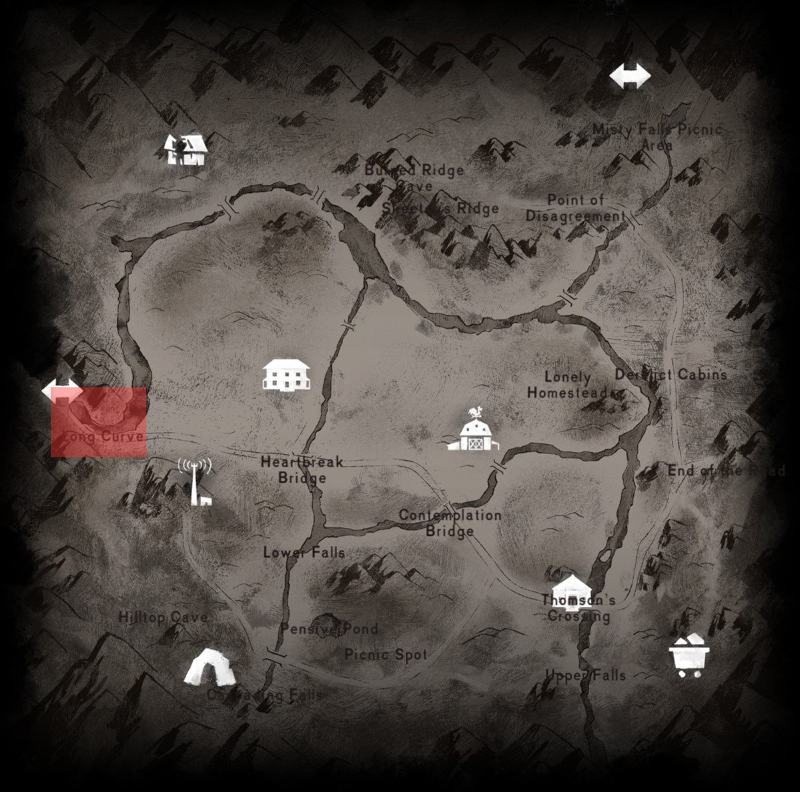

# Long Curve

**Long Curve**

| Property | Details |
| --- | --- |
|  |  / *Longcurveupdated.png* |
| **Location** |  |
|  |  / *Long\_Curve\_Location.png* |
| Region | [Pleasant Valley](./Pleasant%20Valley.md)\|- |
| **General** |  |
| Type | Landmark\|- |
