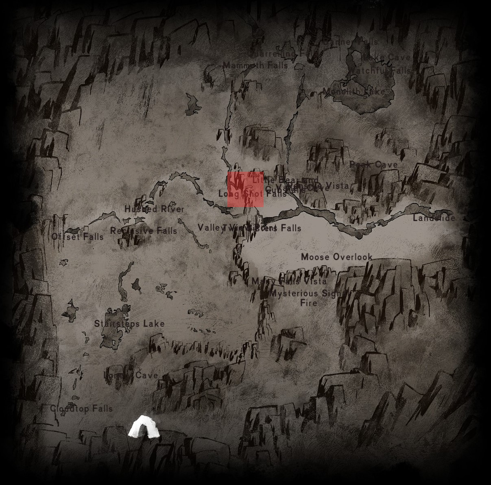

# Long Shot Falls

**Categories:** Locations, Locations in Hushed River Valley, Outdoor locations, Waterfalls · **Source:** [Fandom](https://thelongdark.fandom.com/wiki/Long_Shot_Falls)

**Long Shot Falls**

_Long\_Shot\_Falls\_(2).jpg_

**Location**

_Long\_Shot\_Falls\_Location.png_

**Region:** [Hushed River Valley](./Hushed%20River%20Valley.md)

**Type:** Outdoors

## Overview

A [Moose](./Moose.md) can be found in the area, as can a [Hidden Cache](./Hidden%20Cache.md). [Cat tails](./Cat%20Tail.md) spawn along the frozen river. Nearby is [Valley Cave](./Valley%20Cave.md), which offers the only shelter in the area.

_Long\_Shot\_Falls\_(1).jpg_
