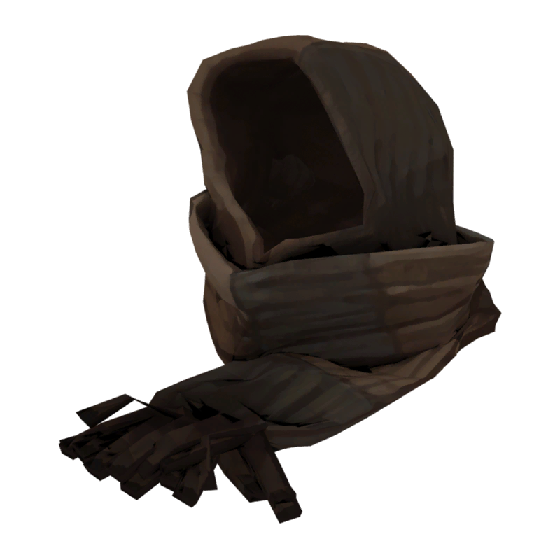
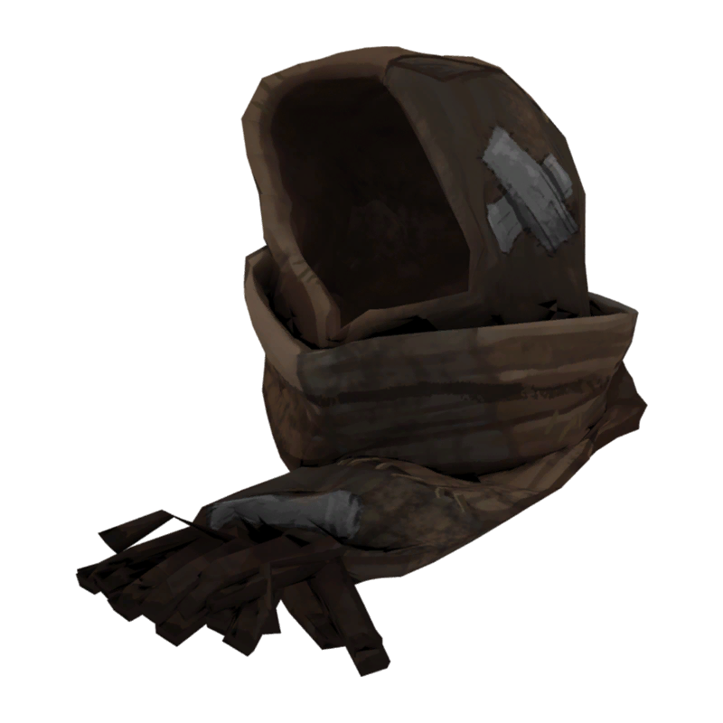

# Long Wool Scarf

**Categories:** Clothing, Pages with update history · **Source:** [Fandom](https://thelongdark.fandom.com/wiki/Long_Wool_Scarf)

**Long Wool Scarf**

| Property | Details |
| --- | --- |
|  | [Long Wool Scarf icon](../assets/Long_Wool_Scarf_icon.png) |
| **General** |  |
| Item Type | Clothing\|- |
| Clothing Slot | Head |
| **Statistics** |  |
| Weight | [Weight icon](../assets/Weight_icon.png)0.25 kg(0.55 lbs) |
| Warmth bonus | [Temp icon](../assets/Temp_icon.png)1.5 °C(2.7 °F) |
| Windproof bonus | [Windproofness icon](../assets/Windproofness_icon.png)1.0 °C(1.8 °F) |
| Waterproof bonus | [Waterproofness icon](../assets/Waterproofness_icon.png)30% |
| Protection | [Protection icon](../assets/Protection_icon.png)1% |
| Mobility | [Mobility icon](../assets/Mobility_icon.png)0% |
| Harvest | 1 × [Cloth](./Cloth.md) / 10 minutes |
| Repair | 1 × [Cloth](./Cloth.md) / 30 minutes / 60% condition |

> “**Longer wool scarf that can be wrapped around the entire head. Designed for cold weather.**”
>
> — In-game description

The **Long Wool Scarf** is a type of headgear in _[The Long Dark](./The%20Long%20Dark.md)_.

## Overview

The long wool scarf has similar stats as the [Fleece Cowl](./Fleece%20Cowl.md). But is 10% more waterproof and offers less protection. It is outclassed by the [Wool Toque](./Wool%20Toque.md), which shares most stats with long wool scarf, but is 0.5°C warmer and offers 1% more protection.

## Update history

- UPDATE **19 December 2016 ([Update](./The%20Long%20Dark%20%E2%80%94%20Early%20Access%20Changelog.md#0.386)):**
  - Added to game
