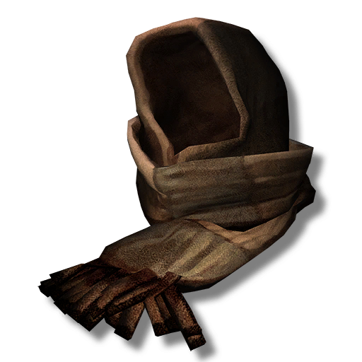

# Long Wool Scarf

**Long Wool Scarf**

| Property | Details |
| --- | --- |
|  |  / *Long\_Wool\_Scarf\_icon.png* |
| **General** |  |
| Item Type | Clothing\|- |
| Clothing Slot | Head |
| **Statistics** |  |
| Weight | 0.25 kg(0.55 lbs) |
| Warmth bonus | 1.5 °C(2.7 °F) |
| Windproof bonus | 1.0 °C(1.8 °F) |
| Waterproof bonus | 30% |
| Protection | 1% |
| Mobility | 0% |
| Harvest | 1 × [Cloth](./Cloth.md) / 10 minutes |
| Repair | 1 × [Cloth](./Cloth.md) / 30 minutes / 60% condition |

> “**Longer wool scarf that can be wrapped around the entire head. Designed for cold weather.**”
>
> — In-game description

The **Long Wool Scarf** is a type of headgear in *[The Long Dark](./The%20Long%20Dark.md)*.

## Overview

The long wool scarf has similar stats as the [Fleece Cowl](./Fleece%20Cowl.md). But is 10% more waterproof and offers less protection. It is outclassed by the [Wool Toque](./Wool%20Toque.md), which shares most stats with long wool scarf, but is 0.5°C warmer and offers 1% more protection.

| Column 1 | Column 2 |
| --- | --- |
|  / *Model icon* |  / *Model icon damaged* |

## Update history

- UPDATE **19 December 2016 ([Update](./The%20Long%20Dark%20%E2%80%94%20Early%20Access%20Changelog.md#0.386)):**
  - Added to game

**Lua execution error in Module:Navbox function navbox** [ru:Длинный\_шерстяной\_шарф](ru:%D0%94%D0%BB%D0%B8%D0%BD%D0%BD%D1%8B%D0%B9_%D1%88%D0%B5%D1%80%D1%81%D1%82%D1%8F%D0%BD%D0%BE%D0%B9_%D1%88%D0%B0%D1%80%D1%84)
