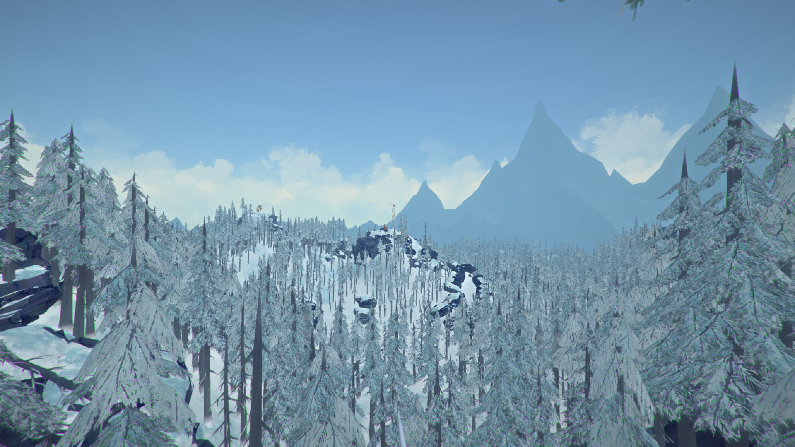

# Lookout \(Mystery Lake location\)

**Categories:** Locations, Locations in Mystery Lake, Outdoor locations · **Source:** [Fandom](https://thelongdark.fandom.com/wiki/Lookout_%28Mystery_Lake_location%29)

**Lookout (Mystery Lake location)**

[Lookout closeup](../assets/Lookout_closeup.jpg)

**Location**

[Lookout Location](../assets/Lookout_Location.png)

**Region:** [Mystery Lake](./Mystery%20Lake%20%28region%29.md)

**Type:** Outdoors

<!-- #Overview -->
​

<!-- #overview -->
## Overview

The Lookout is the second highest location in the region, and offers a wide view of Mystery Lake that is partially obscured by trees.

A lone [Green Maple Sapling](./Green%20Maple%20Sapling.md) can be harvested here. A [Frozen Corpse](./Frozen%20Corpse.md) can be found with a [Revolver](./Revolver.md) on the path up to the Lookout area.

This location does not need to be surveyed as part of the [Faithful Cartographer](./Faithful%20Cartographer.md) achievement.

<!-- #Gallery -->
​

<!-- #gallery -->
## Gallery

_A view of the Mystery Lake Region from the hill beside Lookout. The [Forestry Lookout](./Forestry%20Lookout.md) and [Destroyed Lookout](./Destroyed%20Lookout.md) are visible in the background._

[ru:Наблюдательный пункт](https://ru.wikipedia.org/wiki/%D0%9D%D0%B0%D0%B1%D0%BB%D1%8E%D0%B4%D0%B0%D1%82%D0%B5%D0%BB%D1%8C%D0%BD%D1%8B%D0%B9_%D0%BF%D1%83%D0%BD%D0%BA%D1%82)
