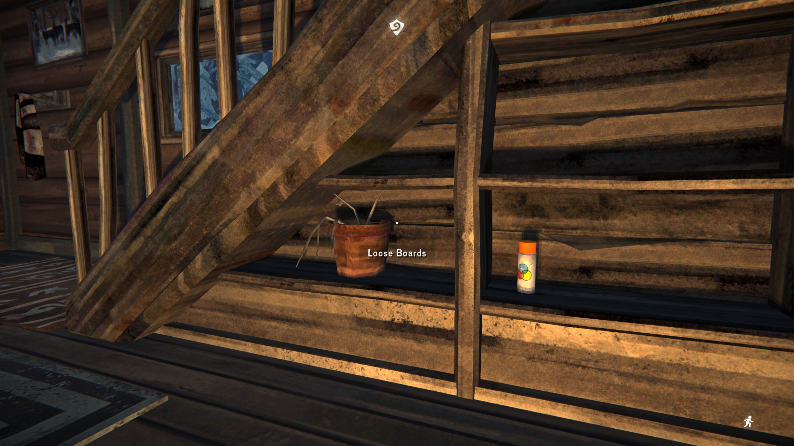

# Loose Boards

**Loose Boards**

| Property | Details |
| --- | --- |
|  |  / *Loose\_Boards.jpg* |
| Release | Part 1 TFTFT |
| Update | [0.00](./The%20Long%20Dark%20%E2%80%94%20Changelog.md#0.00) |
| Story item | [Church Artifact (mission)](./Church%20Artifact%20%28mission%29.md) |
| **Container** |  |
| Capacity | 30.00 kg(66 lbs) |

**Loose Boards** is an interactable storage object that contain hidden loot when found by a [Mementos](./Mementos.md) note. A prompt will not appear until the associated note is found.

## Mementos

A Loose Boards is found in an organ in [St. Christopher's Church](./St.%20Christopher%27s%20Church.md) in [Mountain Town](./Mountain%20Town.md) once its Mementos Note is found.

## Non-Mementos

A special version can be found inside the [Mindful Cabin](./Mindful%20Cabin.md) in [Forsaken Airfield](./Forsaken%20Airfield.md). It is found under the stairs behind the potted plant, and holds a [Note](./Notes.md) inside and often a [Revolver](./Revolver.md).

Another can be found in [Skeeter's Ridge](./Skeeter%27s%20Ridge.md) during the mission [Church Artifact (mission)](./Church%20Artifact%20%28mission%29.md) in [Episode 3: Crossroads Elegy](./Episode%203%20-%20Crossroads%20Elegy.md).**Lua execution error in Module:Navbox function navbox**
