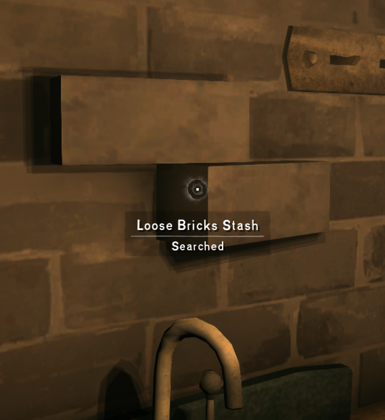
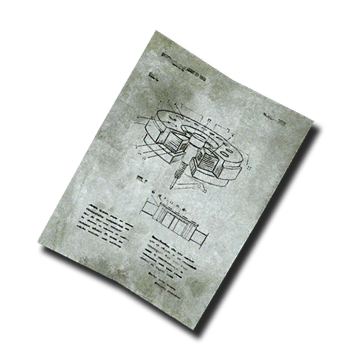
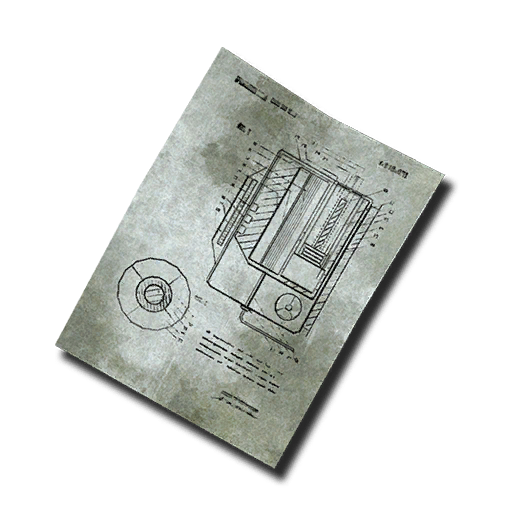
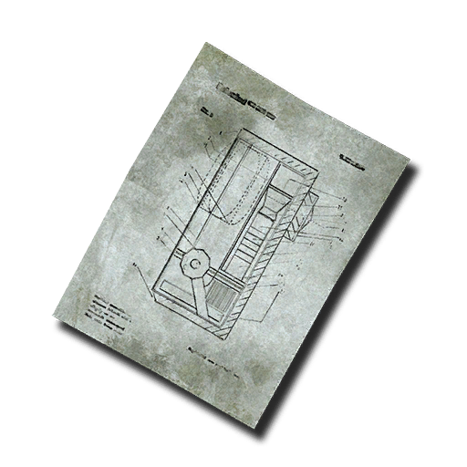

# Loose Bricks Stash

<table class="infobox">
<caption>Loose Bricks Stash</caption>
<colgroup>
<col style="width: 50%" />
<col style="width: 50%" />
</colgroup>
<tbody>
<tr>
<td colspan="2"><figure>

<figcaption>Loose_Bricks.png</figcaption>
</figure></td>
</tr>
</tbody>
</table>

**Loose Bricks Stash** are a unique type of container only found during <a href="./Sutherland%27s%20Tale.md" class="wikilink" title="Sutherland&#39;s Tale">Sutherland's Tale</a>.

- 

## Overview

These containers can be found inside stocked <a href="./Prepper%20Cache.md" class="wikilink" title="Prepper Caches">Prepper Caches</a>, and are only accessible if the player accepts the Special Request required to loot these stashes (otherwise they cannot be interacted with).

(Unknown what storage capacity is or if they can be used as regular containers afterwards).

*There's still a Known Issue with Sutherland's Tale where there is a chance the Loose Brick Stash in the Hunter Prepper Cache does not spawn. If this is the case the Document Stash 2 can be found at the Special Request 4 location (Joplin's Prepper Cache).*

## Loot

Stockpile Cache (1st cache)

-  <a href="./Document%20Stash%201.md" class="wikilink" title="Document Stash 1">Document Stash 1</a>
-  <a href="./Wyatt%27s%20Lost%20Papers%201.md" class="wikilink" title="Wyatt&#39;s Lost Papers 1">Wyatt's Lost Papers 1</a>
-  <a href="./Bunker%20Schematic%20Fragment%201.md" class="wikilink" title="Bunker Schematic Fragment 1">Bunker Schematic Fragment 1</a>

Hunter Cache (2nd cache)

-  <a href="./Document%20Stash%202.md" class="wikilink" title="Document Stash 2">Document Stash 2</a>
-  <a href="./Wyatt%27s%20Lost%20Papers%202.md" class="wikilink" title="Wyatt&#39;s Lost Papers 2">Wyatt's Lost Papers 2</a>
-  <a href="./Bunker%20Schematic%20Fragment%202.md" class="wikilink" title="Bunker Schematic Fragment 2">Bunker Schematic Fragment 2</a>

Conspiracy Cache (3rd cache)

-  <a href="./Document%20Stash%203.md" class="wikilink" title="Document Stash 3">Document Stash 3</a>
-  <a href="./Wyatt%27s%20Lost%20Papers%203.md" class="wikilink" title="Wyatt&#39;s Lost Papers 3">Wyatt's Lost Papers 3</a>
-  <a href="./Bunker%20Schematic%20Fragment%203.md" class="wikilink" title="Bunker Schematic Fragment 3">Bunker Schematic Fragment 3</a>\

**Lua execution error in Module:Navbox function navbox**

