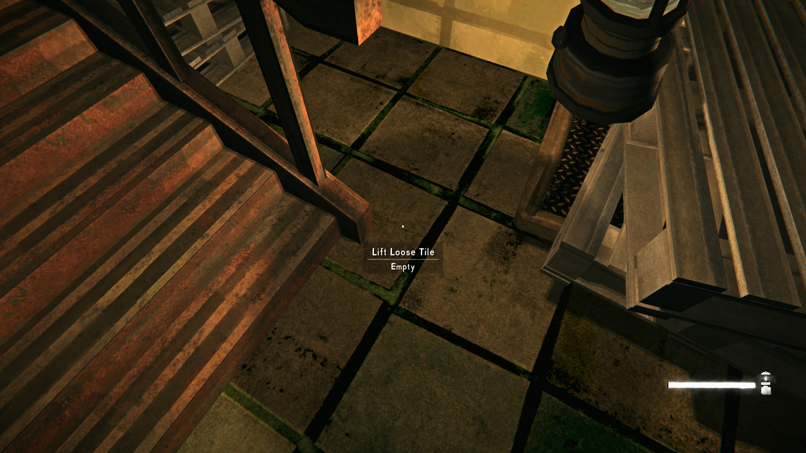

# Loose Tile

**Categories:** Interactable Objects · **Source:** [Fandom](https://thelongdark.fandom.com/wiki/Loose_Tile)

**Loose Tile**

| Property | Details |
| --- | --- |
|  |  / _Loose\_Tile.jpg_ |
| Story item | Yes |
| **Container** |  |
| Capacity | 20.00 kg(44 lbs) |

**Loose Tile** is a unique storage container only found in [Episode 2: Luminance Fugue](./Episode%202%20-%20Luminance%20Fugue.md) as part of the [Lake Gunshots](./Lake%20Gunshots.md) side mission. It is a hidden tile at the bottom of the stairwell in the [Carter Hydro Dam](./Carter%20Hydro%20Dam.md), and only appears once the Lake Gunshots side mission is active.

It does not appear in [Survival Mode](./Survival%20Mode.md).

## Loot

This tile only contains the [Forest Talker Documents](./Forest%20Talker%20Documents.md) as part of the quest.
