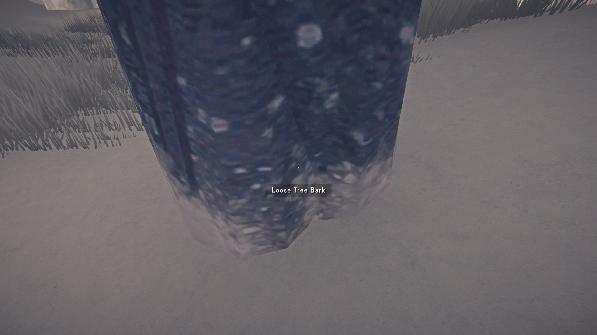

# Loose Tree Bark

**Categories:** Interactable Objects · **Source:** [Fandom](https://thelongdark.fandom.com/wiki/Loose_Tree_Bark)

**Loose Tree Bark**

| Property | Details |
| --- | --- |
|  |  / _Loose\_Tree\_Bark.jpg_ |
| Release | Part 1 TFTFT |
| Update | [0.00](./The%20Long%20Dark%20%E2%80%94%20Changelog.md#0.00) |
| **Container** |  |
| Capacity | 30.00 kg(66 lbs) |

**Loose Tree Bark** is an interactable storage object that contain hidden loot when found by a [Mementos](./Mementos.md) note. A prompt will not appear until the associated note is found. They often mimic the appearance of regular stumps, and the prompt's location can be found somewhere on top of the stump or around the base of the stump.

## Locations

- One is found near [Muskeg Overlook](./Muskeg%20Overlook.md), with the note found near [Old Spence Family Homestead](./Old%20Spence%20Family%20Homestead.md). (The prompt is near the back, middle side).
- One is found in [Coastal Highway](./Coastal%20Highway.md) near the [Rabbit Grove](./Rabbit%20Grove.md) cabin.
