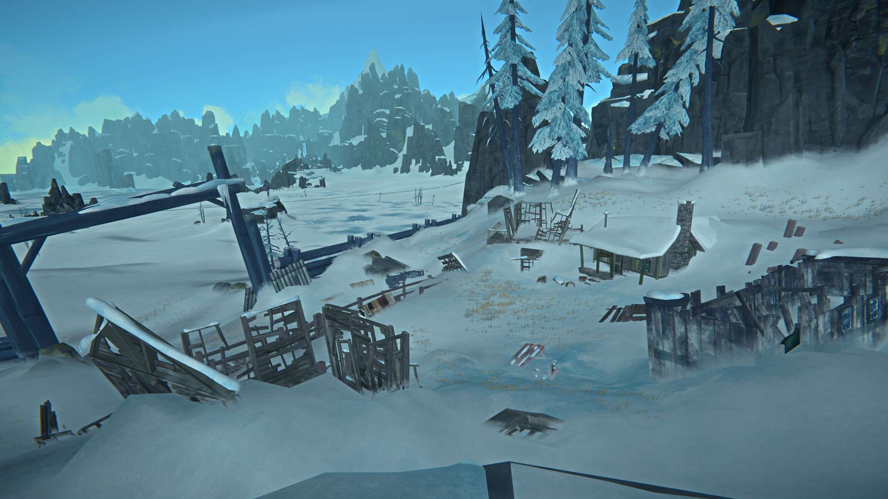
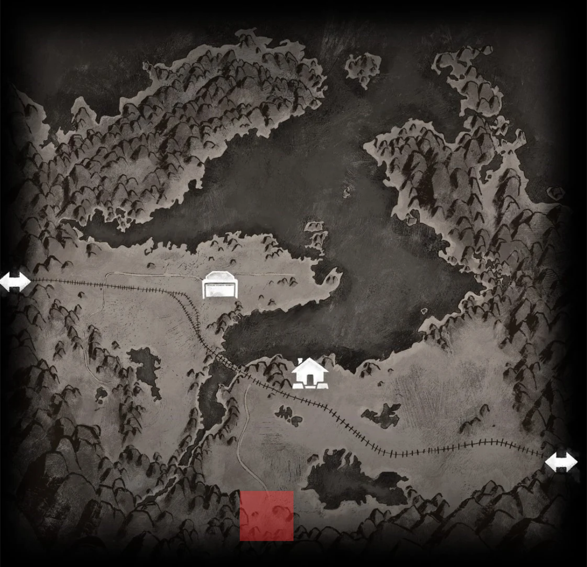

# Looted Grotto

| Column 1 | Column 2 | Column 3 |
| --- | --- | --- |
|  / *Seal\_icon.png* | **DLC-Exclusive content.** / This content requires the [Iron Road](./Iron%20Road.md) addon to be installed before it can be seen or used in regular gameplay. | \|} / **Stub:****This article is a stub. You can help by \[//dummy.host/index.php?title=Looted+Grotto&amp;action=edit expanding it\].** / **Looted Grotto** / \| Property \| Details \| / \| --- \| --- \| / \|  \|  / *Looted\_Grotto.jpg* \| / \| **Location** \|  \| / \|  \|  / *Looted\_Grotto\_Location.png* \| / \| Region \| [Port Remnant](./Port%20Remnant.md)\\|- \| / \| Description \| A set of ruined buildings and trailers built under the cliffs \| / \| **General** \|  \| / \|  / *bed\_icon.png* \| Has a bed \| / \|  \| Has an interior\\|} **Looted Grotto** is a location in [Port Remnant](./Port%20Remnant.md). / ## Overview / A small area below the cliffs with a notable wood arch entrance, Looted Grotto is in quite a state of disrepair. Most of the buildings have been destroyed by time, but a single cabin stands for the player to enter. **Lua execution error in Module:Navbox function navbox** \| |
|  / *Looted\_Grotto.jpg* |  |  |
| **Location** |  |  |
|  / *Looted\_Grotto\_Location.png* |  |  |
| Region | [Port Remnant](./Port%20Remnant.md)\|- |  |
| Description | A set of ruined buildings and trailers built under the cliffs |  |
| **General** |  |  |
|  / *bed\_icon.png* | Has a bed |  |
|  | Has an interior\|} **Looted Grotto** is a location in [Port Remnant](./Port%20Remnant.md). / ## Overview / A small area below the cliffs with a notable wood arch entrance, Looted Grotto is in quite a state of disrepair. Most of the buildings have been destroyed by time, but a single cabin stands for the player to enter. **Lua execution error in Module:Navbox function navbox** |  |
