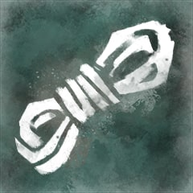

# Losing a Child is Like\.\.\.

<table class="infobox">
<caption>Losing a Child is Like...</caption>
<colgroup>
<col style="width: 50%" />
<col style="width: 50%" />
</colgroup>
<tbody>
<tr>
<td colspan="2"><figure>

<figcaption>Losing_a_Child_is_Like..._icon.png</figcaption>
</figure></td>
</tr>
<tr>
<td>
Description
</td>
<td>
Complete Lily's Story.
</td>
</tr>
</tbody>
</table>

**Losing a Child is Like...** is a <a href="./Wintermute.md" class="wikilink" title="Wintermute">Wintermute</a> <a href="./The%20Long%20Dark%20%E2%80%94%20Achievements.md" class="wikilink" title="achievement">achievement</a> in <a href="./Episode%201%20-%20Do%20Not%20Go%20Gentle.md" class="wikilink" title="Episode 1: Do Not Go Gentle">Episode 1: Do Not Go Gentle</a> of *<a href="./The%20Long%20Dark.md" class="wikilink" title="The Long Dark">The Long Dark</a>*.

## Guide

This is a story achievement achieved after completing the side mission <a href="./One%20Last%20Thing.md" class="wikilink" title="One Last Thing">One Last Thing</a>. Place <a href="./Grey%20Mother%27s%20Pearls.md" class="wikilink" title="Grey Mother&#39;s Pearls">Grey Mother's Pearls</a> on <a href="./Lilith%20Barker.md" class="wikilink" title="Lilith Barker&#39;s">Lilith Barker's</a> headstone at the <a href="./Graveyard.md" class="wikilink" title="Graveyard">Graveyard</a> and then return to <a href="./Grey%20Mother.md" class="wikilink" title="Grey Mother">Grey Mother</a>.

## Trivia

The achievement name borrows from the exchange from <a href="./Will%20Mackenzie.md" class="wikilink" title="Will Mackenzie">Will Mackenzie</a> and Grey Mother:

Mackenzie - "Losing a child is like..."

Grey Mother - "like losing your whole life."

## Game History

\* UPDATE **1 August 2017 (<a href="./The%20Long%20Dark%20%E2%80%94%20Changelog.md#1.00" class="wikilink" title="Update">Update</a>):**

- - Added to game.

**Lua execution error in Module:Navbox function navbox**

