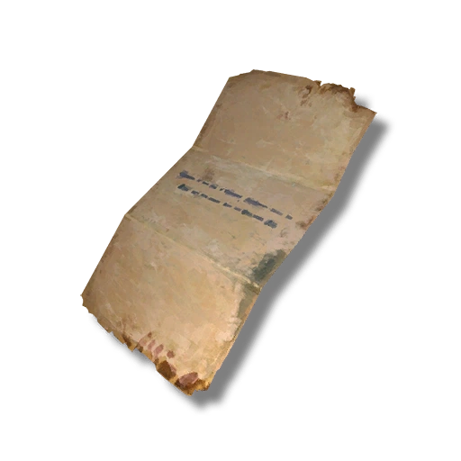

# Lost in the Storm

**Categories:** Collectibles, Pages with update history · **Source:** [Fandom](https://thelongdark.fandom.com/wiki/Lost_in_the_Storm)

**Lost in the Storm**

_Lost\_in\_the\_Storm\_icon.png_

**Release:** [1 August 2017](./The%20Long%20Dark%20%E2%80%94%20Early%20Access%20Changelog.md#1.00)

**Wintermute:** [Episode 1](./Episode%201%20-%20Do%20Not%20Go%20Gentle.md)

**Properties**

**Item type:** [Collectibles](./Collectibles.md)\|-

**Stackable:** No

**Examine:** A letter found on a discarded backpack in a cave.

**Values**

**Weight:** 0.00 kg (0 lbs)

**Actions**

**Backpack:** Examine

**Lost in the Storm** is a note found in [Episode 1: Do Not Go Gentle](./Episode%201%20-%20Do%20Not%20Go%20Gentle.md) in [Wintermute](./Wintermute.md) inside the "indoor" cave leading to [Mackenzie's Crashed Plane](./Mackenzie%27s%20Crashed%20Plane.md) from [Spruce Falls Bridge](./Spruce%20Falls%20Bridge.md).

To access the note, you will have to go east from the Bridge, then head south before the end of the road to find the cave at the end of the path. Continuing through the cave will lead you mid-way on a path from the plane to [Mountain Town](./Mountain%20Town.md). The note is on a corpse of a woman.

## Transcript

_The following text is transcribed from **Lost in the Storm**_

**I left with the others but the storm turned bad and I couldn't keep up. Some turned back to see if they could wait it out at the old Church. I kept going but I think I took a wrong turn. I'll backtrack in the morning and see if I can find their trail.

The letter is signed: "Alice"**

## Update history

- UPDATE **1 August 2017 ([Update](./The%20Long%20Dark%20%E2%80%94%20Changelog.md#1.00)):**
  - Added to game.
