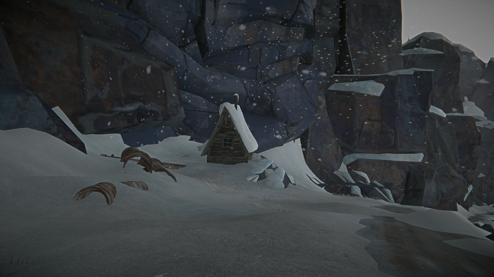

# Lotte's Rest

**Categories:** Indoor locations, Locations, Locations in Sundered Pass, Residential locations · **Source:** [Fandom](https://thelongdark.fandom.com/wiki/Lotte's_Rest)

**Lotte's Rest**

[Lotte's Rest](../assets/Lotte%27s_Rest_.jpg)

**Location**

[Lotte's Rest Location](../assets/Lotte%27s_Rest_Location.png)

**Region:** [Sundered Pass](./Sundered%20Pass.md)

**Description:** A small cabin atop a ridge.

**General**

**Type:** Residential

[Bed icon](../assets/Bed_icon.png)

Has a bed

Has an interior **Lotte's Rest**, also known as Refuge Cabin A, is a small cabin located in [Sundered Pass](./Sundered%20Pass.md) found on the main mountain road located closest to the region transition to [Transfer Pass](./Transfer%20Pass.md), just past [Baneful Bridge](./Baneful%20Bridge.md). Past the area on the road is [Cascading Gap](./Cascading%20Gap.md).

<!-- #Overview -->
​

<!-- #overview -->
## Overview

The cabin can provide life-saving shelter if the weather conditions turn poor. It offers a small amount of loot and limited storage:

- A [Pot Belly Stove](./Pot%20Belly%20Stove.md)
- 2 [Beds](./Bed.md) (+2 C°) and 2 [Pillows](./Pillow.md)
- A [Table](./Table.md)
- A [Chair](./Chair.md)
- A [Crate](./Crate.md)
- A [First Aid Kit](./First%20Aid%20Kit.md) on the wall
- Several [Cardboard Boxes](./Cardboard%20Box.md) above the door entrance and under the bunk bed
- 2 [Plastic Containers](./Plastic%20Container.md) on the shelf (depending on difficulty)

[Ptarmigan](./Ptarmigan.md) nest can be found just outside the entrance near the bridge, along with a possible [Deer Carcass](./Deer%20Carcass.md).

