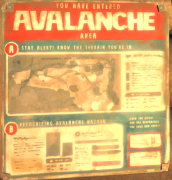

# Lotte's Rest

<table class="infobox">
<caption>Lotte's Rest</caption>
<colgroup>
<col style="width: 50%" />
<col style="width: 50%" />
</colgroup>
<tbody>
<tr>
<td colspan="2"><figure>

<figcaption>Lotte's_Rest_.jpg</figcaption>
</figure></td>
</tr>
<tr>
<td colspan="2" class="section">
<strong>Location</strong>
</td>
</tr>
<tr>
<td colspan="2"><figure>
[Missing image: Lotte's_Rest_Location.png]
<figcaption>Lotte's_Rest_Location.png</figcaption>
</figure></td>
</tr>
<tr>
<td>
Region
</td>
<td>
<a href="./Sundered%20Pass.md" class="wikilink" title="Sundered Pass">Sundered Pass</a>|-
</td>
</tr>
<tr>
<td>
Description
</td>
<td>
A small cabin atop a ridge.
</td>
</tr>
<tr>
<td colspan="2" class="section">
<strong>General</strong>
</td>
</tr>
<tr>
<td>
Type
</td>
<td>
Residential|-
</td>
</tr>
<tr>
<td><figure>

<figcaption>bed_icon.png</figcaption>
</figure></td>
<td>
Has a bed
</td>
</tr>
<tr>
<td></td>
<td>
Has an interior|} <strong>Lotte's Rest</strong>, also known as Refuge Cabin A, is a small cabin located in <a href="./Sundered%20Pass.md" class="wikilink" title="Sundered Pass">Sundered Pass</a> found on the main mountain road located closest to the region transition to <a href="./Transfer%20Pass.md" class="wikilink" title="Transfer Pass">Transfer Pass</a>, just past <a href="./Baneful%20Bridge.md" class="wikilink" title="Baneful Bridge">Baneful Bridge</a>. Past the area on the road is <a href="./Cascading%20Gap.md" class="wikilink" title="Cascading Gap">Cascading Gap</a>.

<h2 id="Overview">Overview</h2>

The cabin can provide life-saving shelter if the weather conditions turn poor. It offers a small amount of loot and limited storage:

<ul>
<li>A <a href="./Pot%20Belly%20Stove.md" class="wikilink" title="Pot Belly Stove">Pot Belly Stove</a></li>
<li>2 <a href="./Bed.md" class="wikilink" title="Beds">Beds</a> (+2 C°) and 2 <a href="./Pillow.md" class="wikilink" title="Pillows">Pillows</a></li>
<li>A <a href="./Table.md" class="wikilink" title="Table">Table</a></li>
<li>A <a href="./Chair.md" class="wikilink" title="Chair">Chair</a></li>
<li>A <a href="./Crate.md" class="wikilink" title="Crate">Crate</a></li>
<li>A <a href="./First%20Aid%20Kit.md" class="wikilink" title="First Aid Kit">First Aid Kit</a> on the wall</li>
<li>Several <a href="./Cardboard%20Box.md" class="wikilink" title="Cardboard Boxes">Cardboard Boxes</a> above the door entrance and under the bunk bed</li>
<li>2 <a href="./Plastic%20Container.md" class="wikilink" title="Plastic Containers">Plastic Containers</a> on the shelf (depending on difficulty)</li>
</ul>

<a href="./Ptarmigan.md" class="wikilink" title="Ptarmigan">Ptarmigan</a> nest can be found just outside the entrance near the bridge, along with a possible <a href="./Deer%20Carcass.md" class="wikilink" title="Deer Carcass">Deer Carcass</a>.

<table class="gallery">
<colgroup>
<col style="width: 33%" />
<col style="width: 33%" />
<col style="width: 33%" />
</colgroup>
<tbody>
<tr>
<td><figure>

<figcaption>An avalanche warning inside the cabin</figcaption>
</figure></td>
<td><figure>

<figcaption>Refuge_Cabin_A_resized.png</figcaption>
</figure></td>
<td><figure>

<figcaption>The cliffside view during an aurora</figcaption>
</figure></td>
</tr>
</tbody>
</table>

<strong>Lua execution error in Module:Navbox function navbox</strong>
</td>
</tr>
</tbody>
</table>

